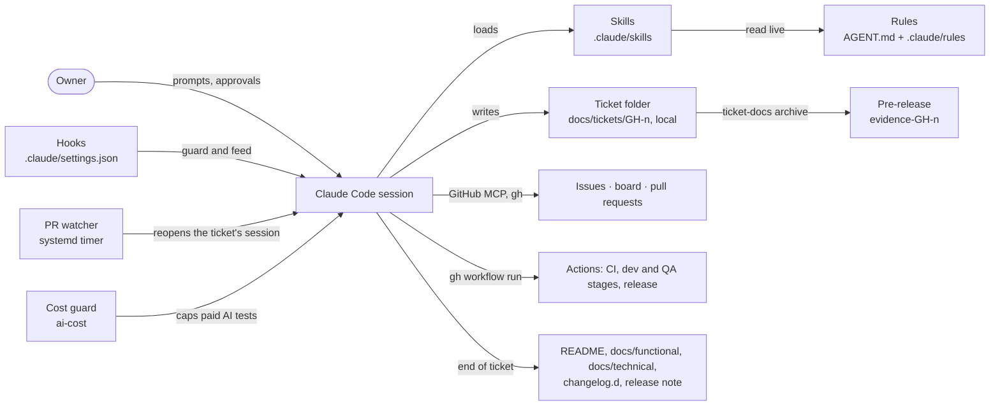

# The simple-erp Claude Code harness

How Claude Code works on simple-erp: the rules it follows, the skills it loads, the hooks that guard it, the tools it
runs, and the GitHub side (issues, project board, workflows, stages, releases). Everything here is versioned with the
code, in `.claude/`.

**In a hurry? Read [HOWTO.md](HOWTO.md).**

| Part | For | Answers |
|---|---|---|
| [functional/](functional/README.md) | Anyone who works with the harness | What happens, when, and what I have to do |
| [technical/](technical/README.md) | Whoever maintains or extends it | How it is built: files, hooks, tools, workflows, tests |

## Where things live

| What | Where |
|---|---|
| Hooks | `.claude/settings.json` |
| Skills | `.claude/skills/<name>/SKILL.md` (+ templates, configuration, tools) |
| The tools' Python code | `.claude/skills/<tool>/src/`, one uv workspace in `.claude/skills/` |
| Rules (single source of truth) | `AGENT.md`, `.claude/rules/*.md` |
| Ticket folders (local, not versioned) | `docs/tickets/GH-<n>/`, index `docs/tickets/README.md` |
| Their archive | GitHub pre-release `evidence-GH-<n>` per ticket |
| Project documentation (versioned) | `README.md`, `docs/functional/`, `docs/technical/`, `CHANGELOG.md`, `changelog.d/` |
| PR watcher state | `~/.local/state/claude-pr-watch/` |
| Cost ledgers | `~/.local/state/ai-test-cost/` |
| The tools' logs | `~/.local/state/claude-harness/<tool>.log` |

Adapted on 2026-11-10 from a harness built for Jira, Bitbucket and Jenkins. It depends on no other project.
