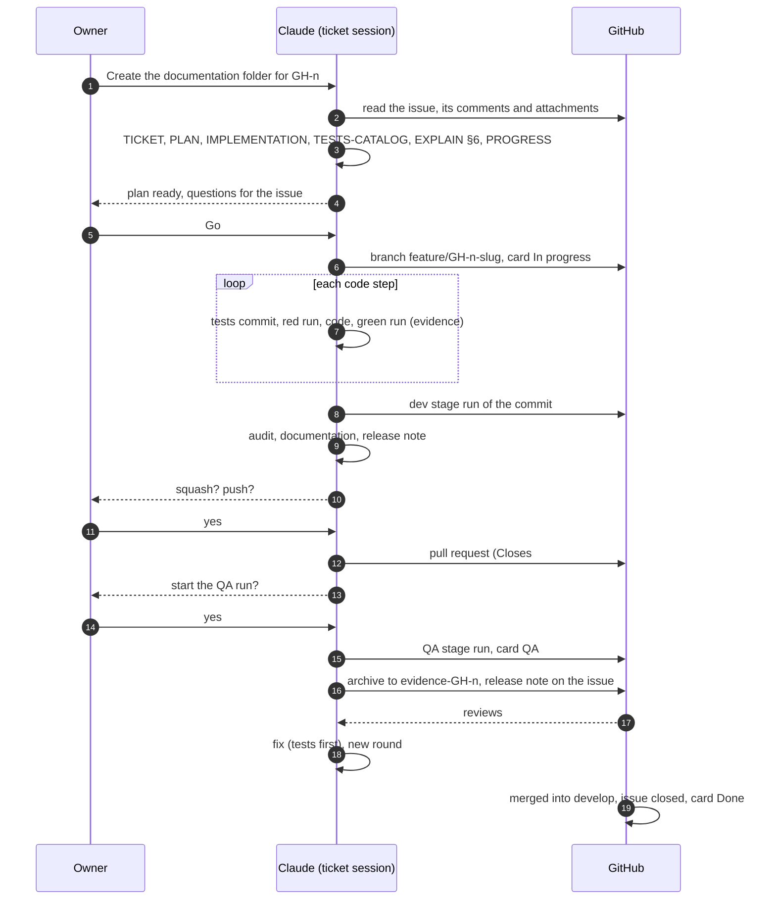

# 1. Ticket lifecycle

A ticket is a GitHub issue `#<n>`, written `GH-<n>`. Its card on the project board "simple-erp" moves Backlog → Ready →
In progress → In review → QA → Done. Claude works on it in one session, and keeps a local folder `docs/tickets/GH-<n>/`.

## What you decide

| Gate | When | How |
|---|---|---|
| Go | After the plan | Say "Go" (or change the plan) |
| Squash | Before the pull request, before each fix push | Claude asks (GIT-1), with the commits and the message |
| Push | Each time | Claude asks again; a yes covers one push |
| QA run | Once everything before it has passed | Claude asks your yes before starting it (GIT-6) |
| Raise a cost cap | When a ticket's AI tests are blocked | In your own terminal (`ai-cost raise-cap`) |
| Waive a step | Rarely | Say so; Claude logs it as a decision `Dn` in EXPLAIN §6.3 |

## The ticket folder

| File | Holds |
|---|---|
| `TICKET.md` | The issue, unchanged, its topics T1… and the acceptance criteria AC1… |
| `PLAN.md` | Decisions, steps, AC → tests → validation, rules applied, scope |
| `IMPLEMENTATION.md` | Choices and their justification, the exact files modified |
| `TESTS-CATALOG.md`, `TESTS-NOTICE.md` | Every test per criterion, and how to run each level |
| `PROGRESS.md` | Status and time of every step, stages, documentation, release note, pull request, reviews |
| `EXPLAIN.md` | For developers and testers: what was done and how to test it |
| `RELEASE-NOTE.md` | For users: what the ticket gives them |
| `STATUS.md` | Only when paused or after a rebase conflict |
| `tests-evidences/` | One folder per test run, every report kept |

The folder is not versioned: at hand-over and after each review round, Claude zips it and attaches it to the
pre-release `evidence-GH-<n>`, and comments the link on the issue.

## Pausing and resuming

Say "Pause GH-<n>, because …": Claude writes `STATUS.md` with the exact state and how to resume, and nothing is
pushed after that. "Resume GH-<n>" picks it up from there.
