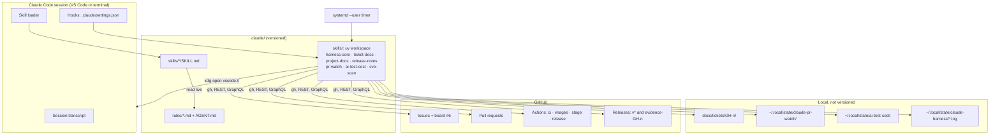

# 1. Architecture

## Layers

| Layer | Holds | Changes how |
|---|---|---|
| **Rules** (`AGENT.md`, `.claude/rules/`) | What is right: CS, GIT, DEP, TEST, DOC | Edited in place; a new rule takes the next ID |
| **Skills** (`.claude/skills/*/SKILL.md`) | How to do a task; the rule skills only load their file live | Edited in place; the description is the trigger |
| **Tools** (`.claude/skills/*/src/`) | Checks, gates, recorders, watchers | Python, tests first, AGENT.md rules |
| **Hooks** (`.claude/settings.json`) | Automatic guards and reminders | `settings.json`, each hook calls a tool |
| **State** (`~/.local/state/…`, `docs/tickets/`) | What the tools and the tickets remember | Written by the tools and the skills |
| **Generated pages** | `docs/tickets/README.md`, the PR summary, `COST.md` | Written by their tool only, never by hand |

## Runtimes

- **Python 3.13 with uv:** one workspace in `.claude/skills/` (`pyproject.toml`, `uv.lock`, `.venv`). Each `bin/<tool>`
  wrapper runs `uv run --project .claude/skills --frozen <tool>` without the caller's virtual environment.
- **gh** (2.22 here: no `gh project`, so the board goes through `gh api graphql`) with the `project` scope.
- **systemd --user** for the PR watcher's timer.

## Main flows

| Flow | Path |
|---|---|
| Code step | tests commit → `git-gate` allows → `record-run --expect red` → code commit (`git-gate` checks the red run) → `record-run` green → `time-reminder` |
| Stage run | `gh workflow run stage.yml` → Actions run → `record-run --run-id` downloads artifacts and log |
| Hand-over | final runs → audit → `project-docs` → `release-notes` → `ticket-docs check` → bundle, squash, push (yes) → PR → `pr-watch register` → `board` → QA run (yes) → `archive` |
| Broken pull request | timer → `pr-watch once` → GitHub REST + merge-tree probe → inbox → session reopened → `/pr-watch GH-n` → fix |
| Paid AI test | `ai-cost run` → `ai-cost gate` allows → usage report polled → ledger + COST.md |
| Release | `release/x.y.z` → `release-notes build` → QA → PR into `master` → tag (yes) → `release.yml` |
