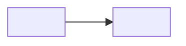

# <Capability>

<Two or three sentences: what users can do with this capability, and who they are.>

## What users can do

| Action | Who | Where | Result |
|---|---|---|---|
| <action> | <role> | <screen, command or endpoint> | <what they get> |

## Rules

- <A business rule, in users' words, with its numbers.>

## Flow

## Not built yet

<What the specifications plan and does not exist yet, or "Nothing.">

Last reviewed: <DATE> (<KEY>)
