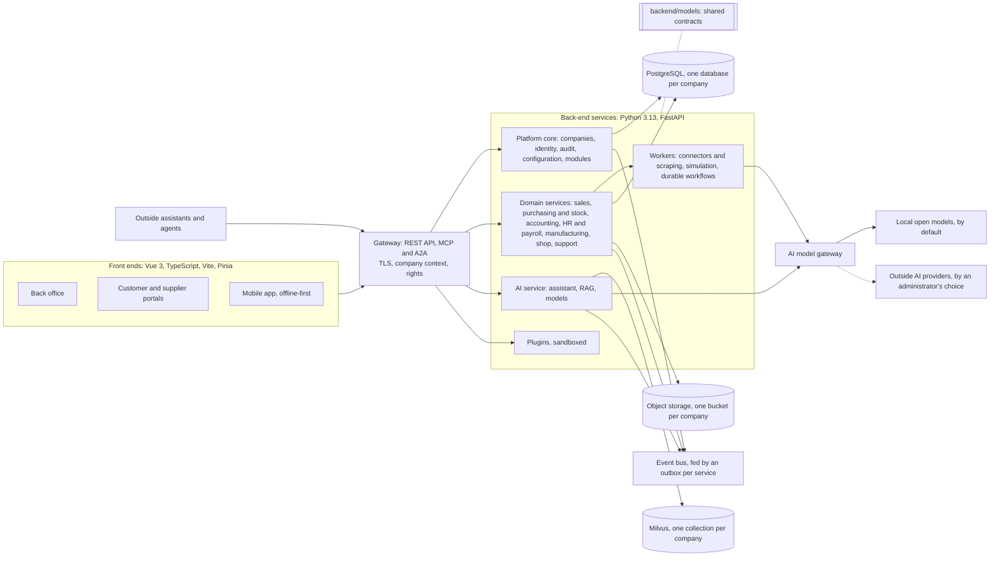
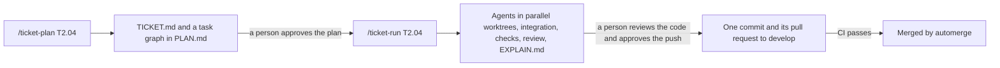

<p align="center">
  <picture>
    <source media="(prefers-color-scheme: dark)" srcset="docs/assets/logo-dark.svg">
    
  </picture>
</p>

<p align="center">
  <a href="https://github.com/gpbcom/SimpleERP/actions/workflows/ci.yml"></a>
  
  
  
  
  
  
  
  
  
  
</p>

<p align="center">
  <b>SimpleERP</b> is an <b>open-source</b>, <b>self-hosted</b>, <b>AI-native ERP</b> for <b>small and medium
  companies</b>, whatever their field. One open, sovereign tool runs the whole company, from sales and stock to
  accounting, HR and payroll, with an <b>AI assistant</b> on every screen and <b>meetings</b> turned into records, the
  AI included on the company's own servers. It is <b>extendable</b> without touching its core, <b>set up by anyone</b>,
  and runs for <b>one company</b> or for an <b>IT provider</b> hosting many.
</p>

<p align="center">
  <a href="#-documentation"><b>📖 Documentation</b></a> ·
  <a href="#-quick-start"><b>🚀 Quick start</b></a> ·
  <a href="#-key-features"><b>🧩 Features</b></a> ·
  <a href="#-architecture"><b>🏗️ Architecture</b></a> ·
  <a href="#-roadmap"><b>🛣️ Roadmap</b></a> ·
  <a href="#-contributing"><b>🤝 Contributing</b></a>
</p>

> [!NOTE]
> **Project status:** the specifications v1 are complete ([docs/specs/](docs/specs/README.md)). The implementation is
> in progress, phase by phase, following the [roadmap](#-roadmap) and its board on GitHub. Nothing of the product can
> be installed yet: this page describes what is specified, and says when each part becomes available.

---

## 📑 Table of contents

- [Overview](#-overview)
- [Key features](#-key-features)
  - [Functional capabilities](#functional-capabilities) · [Platform capabilities](#platform-capabilities) ·
    [Sector and country packs](#sector-and-country-packs)
- [Architecture](#-architecture)
- [Quick start](#-quick-start)
- [Roadmap](#-roadmap)
- [How it is built](#-how-it-is-built)
- [Working on tickets](#-working-on-tickets)
- [Project structure](#-project-structure)
- [Testing and quality](#-testing-and-quality)
- [Documentation](#-documentation)
- [Contributing](#-contributing)
- [Security](#-security)
- [License](#-license)

---

## 🔭 Overview

Small and medium companies run on a pile of tools that do not share their data, and on ERPs that are too heavy for
them ([Problem](docs/specs/00-vision/product/problem.md)). SimpleERP answers with one tool for everything, its AI
doing the work:

| What | Scope |
|---|---|
| 🛡️ **Fully self-hosted, AI included** | every part runs on the operator's own servers, local open models by default; data leaves only where an administrator chooses an outside provider for a feature ([D440](docs/specs/06-decisions/vision/d440-local-by-default-outside-by-choice.md)) |
| 🤖 **AI-native** | an assistant on every screen answers from the company's own data and acts after confirmation; meetings become transcripts, summaries, decisions and tasks on the company's records |
| 🧩 **Extendable** | no-code configuration, plugins on a stable public API, sector packs, a documented REST API with webhooks, MCP and A2A both ways |
| 🧭 **Set up by anyone** | a guided, step-by-step start in plain words, and each module switched on in one click |
| 🏢 **For a company or an IT provider** | run by one company on its own server, or by an IT provider hosting many client companies on one platform ([D1](docs/specs/06-decisions/foundations/d01-runs-for-a-company-or-a-provider.md)) |
| 🔓 **Truly open** | AGPL-3.0, with no paid edition holding back features; only the publisher's hosting services are closed ([D388](docs/specs/06-decisions/vision/d388-hosted-edition-open-core.md)) |

**Who it is for:** small companies of 1 to 50 people with no IT staff, SMEs of 50 to 250 people, IT providers hosting
several client companies on one platform, and accounting firms running it for their clients.

**Against the alternatives** ([Positioning](docs/specs/00-vision/product/positioning.md)): classic ERPs, open source or
not, need an integrator, charge per user and per app and sell AI as a paid extra; AI-native ERPs are SaaS only and
mostly finance only; AI meeting and support tools keep the company's data in their own clouds. SimpleERP is set up in
a day, priced per company, with the same agents across every area, on the company's servers.

## ✨ Key features

Every capability below is specified and planned for V1; none is built yet. Each links to its specification: use
cases, flows, business rules, data and screens.

### Functional capabilities

🔒 marks the services that only the publisher's hosted edition offers
([D447](docs/specs/06-decisions/vision/d447-country-pack-updates-free-hosted-only-named.md)); every other feature is
open and self-hostable.

| What | Scope |
|---|---|
| ⚙️ **Set-up and control** | [F1 Administration](docs/specs/02-functional/f01-administration/README.md): the company and its sites, users, roles and record rules, connections and AI settings · [F2 No-code configuration](docs/specs/02-functional/f02-no-code-configuration/README.md): fields, statuses, forms, record types, templates and workflows without a developer · [F21 Onboarding and module activation](docs/specs/02-functional/f21-onboarding-and-modules/README.md): a first run in plain words, sector templates, demo data, each module in one click · [F22 Unified platform cost management](docs/specs/02-functional/f22-unified-cost-management/README.md): every paid usage metered and budgeted, warned then stopped, never blocking a legal duty · [F24 Integrations hub](docs/specs/02-functional/f24-integrations-hub/README.md): openDesk and La Suite numérique first, the 50 leading ATS and CRM by default |
| 🤖 **AI** | [F3 Assistant](docs/specs/02-functional/f03-assistant/README.md): in the side panel of every screen, answers from the company's data, acts after confirmation, drafts and guides · [F4 Meetings](docs/specs/02-functional/f04-meetings/README.md): online, in-person and phone meetings become transcripts, summaries, decisions and tasks · [F15 Legal assistant](docs/specs/02-functional/f15-legal-assistant/README.md): the law of each enabled country, France first, for the person's real situation · [F16 Customer support agents](docs/specs/02-functional/f16-customer-support-agents/README.md): customer requests resolved end to end, each kind automated once it proves accurate |
| 🛒 **Business areas** | [F6 Customers and sales](docs/specs/02-functional/f06-customers-and-sales/README.md): from the first contact to the last payment, with a self-service customer portal · [F7 Purchasing and stock](docs/specs/02-functional/f07-purchasing-and-stock/README.md): buying, receiving, storing, shipping, counting, tracing and valuing stock, with a supplier portal · [F8 Accounting](docs/specs/02-functional/f08-accounting/README.md): the books end to end, in-house and with the external accountant · [F9 HR and projects](docs/specs/02-functional/f09-hr-and-projects/README.md): employees, recruitment, time, skills, shifts, timesheets, projects and field service |
| 🔌 **Plugins** | [F10 Point of sale](docs/specs/02-functional/f10-point-of-sale/README.md): tills, payments, kitchen screens, offline selling, French till rules · [F11 Online shop](docs/specs/02-functional/f11-online-shop/README.md): catalogue, checkout, delivery, returns, B2B, subscriptions, marketplaces · [F12 Manufacturing](docs/specs/02-functional/f12-manufacturing/README.md): bills of materials, routings, planning, the shop-floor tablet, quality, OEE · [F13 Payroll](docs/specs/02-functional/f13-payroll/README.md): gross to net with collective-agreement rules, payslips, the monthly social declaration · [F14 Plugin store](docs/specs/02-functional/f14-plugin-store/README.md): find, install, buy and publish plugins and sector packs, checked and signed |
| 📈 **Growth and insight** | [F5 Social media and marketing](docs/specs/02-functional/f05-social-media/README.md): posts prepared, approved, scheduled and published, with AI drafts and statistics · [F17 Competitive analysis](docs/specs/02-functional/f17-competitive-analysis/README.md): competitors followed from every lawful source, turned into sourced SWOT and battle cards · [F23 What-if simulation and impact](docs/specs/02-functional/f23-what-if-simulation/README.md): any change simulated on a copy of the company, its impact shown on every area |
| 🔒 **Hosted edition** | [F18 Hosted websites and domains](docs/specs/02-functional/f18-hosted-websites-and-domains/README.md): a website built from the ERP's data, its domain and certificates, tested before it goes live · [F19 Feature factory](docs/specs/02-functional/f19-feature-factory/README.md): a chatbot that builds a missing feature as a tested, reviewed and signed plugin · [F20 Hosted support assistant](docs/specs/02-functional/f20-hosted-support-assistant/README.md): a problem talked through in plain words, fixed only with a maintainer's yes · [F25 DevOps agents](docs/specs/02-functional/f25-devops-agents/README.md): customers' bug reports and feature requests turned into specifications and pull requests, maintainers approving |

### Platform capabilities

What the platform provides to every feature ([Technical capabilities](docs/specs/03-technical/README.md)):

| What | Scope |
|---|---|
| 🏢 **Tenancy and security** | [T1 Companies and data isolation](docs/specs/03-technical/t01-companies-and-data-isolation/README.md): each company's data kept apart in every store and every path · [T2 Identity and access engine](docs/specs/03-technical/t02-identity-and-access/README.md): who signs in and what they may do, everywhere · [T3 Audit trail](docs/specs/03-technical/t03-audit-trail/README.md): what happened, who did it and with which tools, inalterable and searchable |
| 🔗 **Extension and interfaces** | [T4 Plugin runtime](docs/specs/03-technical/t04-plugin-runtime/README.md): where plugins, industry modules and generated features run · [T5 API and webhooks](docs/specs/03-technical/t05-api-and-webhooks/README.md): the documented API every front end, plugin, connector and agent uses · [T6 MCP and A2A gateway](docs/specs/03-technical/t06-mcp-and-a2a-gateway/README.md): SimpleERP as an MCP server and an A2A agent, and as their client · [T12 Connectors and scrapers](docs/specs/03-technical/t12-connectors-and-scrapers/README.md): every outside system, with or without an API, credentials in a vault |
| 🧠 **AI and knowledge** | [T7 AI providers and models](docs/specs/03-technical/t07-ai-providers-and-models/README.md): every model call through one gateway, local by default · [T8 RAG platform (Milvus)](docs/specs/03-technical/t08-rag-platform/README.md): search over each company's data and the law, respecting rights and erasure · [T11 Legal corpora](docs/specs/03-technical/t11-legal-corpora/README.md): each country's law and rules, versioned by date |
| 🚀 **Operations and reach** | [T9 Install, backups and updates](docs/specs/03-technical/t09-install-backups-and-updates/README.md): installing, backing up and upgrading anywhere, fully CNCF · [T10 Translations and notifications](docs/specs/03-technical/t10-translations-and-notifications/README.md): languages, money and every notification · [T13 Maps and geodata](docs/specs/03-technical/t13-maps-and-geodata/README.md): maps, geocoding, routing and scheduling, from the company's own servers |

### Sector and country packs

| What | Scope |
|---|---|
| 🏷️ **Sector packs** | twenty sectors, SC01 to SC20, from construction and retail to health practices and public bodies, each a pack of record types, rules, documents and screens installed on the capabilities above ([Sectors](docs/specs/08-sectors/README.md)) |
| 🌍 **Country packs** | each country's law and the legal rules SimpleERP enforces there, France first, signed and versioned by date; their updates are free for everyone ([Country packs](docs/specs/10-country-packs/README.md)) |

## 🏗️ Architecture

Micro-services cut by business domain, one image each, behind one gateway; one PostgreSQL database, one object-storage
bucket and one vector collection per company ([Architecture](docs/technical/architecture/architecture.md),
[D405](docs/specs/06-decisions/technical/d405-architecture-and-scalability.md)). This is the specified target: nothing
of it is built yet.



| Part | Choice |
|---|---|
| 🐍 **Back end** | Python 3.13 with uv, Pydantic models, FastAPI, each service layered api → service → storage → models ([D406](docs/specs/06-decisions/technical/d406-back-end.md)) |
| 🖥️ **Front end** | Vue 3 with TypeScript and Vite, Pinia, a component library on the design system's tokens; an offline-first progressive web app for tills and field work ([D407](docs/specs/06-decisions/technical/d407-front-end.md)) |
| 🗄️ **Storage** | PostgreSQL for every company database, S3-compatible object storage, Milvus standalone, encrypted disks and per-company keys ([D409](docs/specs/06-decisions/technical/d409-storage-choices.md)) |
| 🔗 **Interfaces** | REST with OpenAPI, versioned, OAuth 2 and OpenID Connect with scoped short-lived tokens ([D410](docs/specs/06-decisions/technical/d410-api-style-and-auth.md)); MCP and A2A both ways (T6) |
| 🧠 **AI** | one model gateway, local models and embeddings by default, outside providers per feature when an administrator chooses ([D417](docs/specs/06-decisions/technical/d417-ai-operations-design.md)) |
| ☸️ **Deployment** | fully CNCF: Docker Compose for one server and the laptop profile, Helm on any Kubernetes, the same images, Terraform for OVHcloud and Scaleway ([Deployment](docs/technical/infrastructure/deployment.md)) |

The repository layout is in [Project structure](#-project-structure).

## 🚀 Quick start

<a id="prerequisites"></a>

### 🧰 Prerequisites

| Tool | Version | Used for |
|---|---|---|
| [Docker](https://docs.docker.com/) with Compose | recent | running SimpleERP; the laptop profile fits in 8 GB of RAM ([REQ-T09-03](docs/specs/03-technical/t09-install-backups-and-updates/requirements/req-t09-03-laptop-profile.md)) |
| [uv](https://docs.astral.sh/uv/) | recent | the Python 3.13 workspace (see [`.python-version`](.python-version)) |
| [Node.js](https://nodejs.org/) 22 with [pnpm](https://pnpm.io/) | 22; pnpm at the version that `packageManager` pins in [`package.json`](package.json) | the front-end workspace |
| [Git](https://git-scm.com/) | recent | the GitFlow hooks of the repository |

<a id="run-it"></a>

### ▶️ Run it on a laptop

> [!IMPORTANT]
> **Available from phase P0.** The laptop profile of `infra/compose/` does not exist yet. The ticket of phase P0 that
> writes it sets the exact command, and this section will give it.

```bash
git clone https://github.com/gpbcom/SimpleERP.git
cd SimpleERP
docker compose -f infra/compose/<profile>.yaml up -d   # available from phase P0
```

On a server, the same images run with Docker Compose; on a cluster, with Helm.

<a id="development-setup"></a>

### 📥 Development setup

```bash
git clone https://github.com/gpbcom/SimpleERP.git
cd SimpleERP
uv sync --locked                                   # Python 3.13 workspace, installed from uv.lock
pnpm install --frozen-lockfile                     # front-end workspace, installed from pnpm-lock.yaml
uv run pytest tests -n 2                           # the repository-level tests
python3 .claude/scripts/tickets/tickets.py setup   # the GitFlow git hooks, once per clone
```

## 🛣️ Roadmap

V1 holds everything the specifications hold, built phase after phase; the DevOps agents come first so that they help
build the rest ([D483](docs/specs/06-decisions/vision/d483-roadmap-devops-agents-first.md)). The plan and its options
are in [docs/specs/00-vision/roadmap/](docs/specs/00-vision/roadmap/README.md); the live state of every phase, epic and
ticket is on the GitHub project **SimpleERP roadmap** ([projects](https://github.com/gpbcom/SimpleERP/projects)).

| Phase | Name | Delivers |
|---|---|---|
| P0 | 🧱 Foundations | the repository layout, the shared models and libraries, the laptop profile and the back-office shell the next phases build on |
| P1 | 🤖 DevOps agents | F25 |
| P2 | 🏗️ Platform core | T1 to T13 |
| P3 | ⚙️ Platform features | F1, F2, F3, F4, F21, F22, F24 |
| P4 | 🛒 Customers and sales | F6, F16 |
| P5 | 📦 Purchasing and stock | F7 |
| P6 | 📒 Accounting | F8 |
| P7 | 👥 HR, projects and legal | F9, F15 |
| P8 | 🔌 Plugins and the plugin store | F10, F11, F12, F13, F14 |
| P9 | 📈 Growth and insight (Proposed) | F5, F17, F23 |
| P10 | 🏷️ Sectors (Proposed) | SC01 to SC20 |
| P11 | 🔒 Hosted edition services (Proposed) | F18, F19, F20 |

The phase pages, their epics and tickets are in
[docs/specs/00-vision/roadmap/phases/](docs/specs/00-vision/roadmap/phases/README.md).

"(Proposed)" marks a placement waiting for the product owner's confirmation.

## 🤖 How it is built

SimpleERP is specified before it is built, and built by a team of Claude Code agents under rules a person approves.
The harness is versioned with the code in [.claude/](.claude/), its rules in
[.claude/rules/tickets.md](.claude/rules/tickets.md).



1. 📝 **Plan.** `/ticket-plan <ID>` turns a roadmap ticket into `docs/tickets/<ID>/TICKET.md`, taken from the
   specifications only, and a task graph in `PLAN.md`, then stops.
2. 🟢 **Approve.** A person reads the plan and sets `**Plan:** 🟢 Approved`. Nothing is built before.
3. ⚡ **Run.** `/ticket-run <ID>` runs the agents in parallel waves, tests first, then integrates, verifies, reviews and
   explains the work.
4. 👀 **Code review gate.** The run stops for a person to read the code. Nothing is pushed until `PLAN.md` says
   `**Push:** 🟢 Approved`.
5. 🔀 **Merge.** The ticket becomes one commit with its pull request to `develop`, merged by the `automerge` workflow
   once every check passes; its card moves to Done on the board.

Several tickets run at once when the start rule allows it, and `/board` shows the roadmap board from the terminal.
Releases are started with `/release`, which tests, writes the changelog and the release notes, and reaches `master`
by itself.

## 🎫 Working on tickets

The commands a maintainer uses, from Claude Code in the main checkout:

| Step | Command | What it does |
|---|---|---|
| 🗂️ See the board | `/board` | What is ready, planned, running, in review and done, phase by phase, and what may start next |
| 📝 Plan one ticket | `/ticket-plan T2.04` | Writes `TICKET.md` and the task graph in `PLAN.md`, then stops for approval |
| 📝 Plan a group | `/issue-plan E2.1` or `/issue-plan #42 T2.07` | Plans every ticket of an epic, a phase or a list, in parallel, then stops once for all of them |
| 🟢 Approve a group | `python3 .claude/scripts/tickets/tickets.py approve E2.1` | Approves every plan of the group that passes `check_plan.py` (one approval for the group) |
| ⚡ Run one ticket | `/ticket-run T2.04` | Runs the approved plan; run it again after setting `**Push:** 🟢 Approved` to push the reviewed code |
| ⚡ Run a group | `/issue-run E2.1` | Starts every approved ticket the start rule allows, each other one as soon as its prerequisites are merged |
| 🔎 Check the start rule | `python3 .claude/scripts/tickets/tickets.py check --ticket T2.04` | Prints nothing when the ticket may start |
| 🧹 Clean up | `python3 .claude/scripts/tickets/tickets.py prune` | Removes the worktrees and branches of merged tickets (`--dry-run` shows them first) |

---

## 📁 Project structure

The layout decided in [D438](docs/specs/06-decisions/technical/d438-repository-layout.md)
([Repository layout](docs/technical/architecture/repository-layout.md)). The first tickets of phase P0 create it; today
every folder of the tree exists, with a README saying what it holds. The services, libraries, plugins, packages and
portals are added by the tickets that build them.

```text
SimpleERP/
├── backend/
│   ├── models/              # shared Pydantic models of every public contract (package erp_models)
│   ├── shared/<lib>/        # shared libraries, no business rules
│   └── services/<service>/  # one image each: Dockerfile, conf/, tests/, src/<service_pkg>/{models,storage,service,api}/
├── frontend/
│   ├── backoffice/          # the back-office web app
│   ├── portals/<portal>/    # customer and supplier portals
│   ├── mobile/              # the offline-first app
│   └── packages/<pkg>/      # shared TypeScript packages: design tokens, components, API client
├── plugins/                 # first-party plugins, built on backend/models
├── sdk/                     # the plugin SDK and its command line
├── infra/                   # compose/ (laptop, one server), helm/, terraform/ (modules, OVHcloud, Scaleway)
├── packs/                   # countries/ and sectors/, as data
├── docs/                    # specs/, functional/, technical/
├── tests/                   # repository-level tests: harness/, conventions/, ci/
├── .github/workflows/       # the CI/CD pipeline
├── .claude/                 # the Claude Code harness: rules, agents, skills, hooks, scripts
├── compose.e2e.yaml         # the real images, for Playwright
└── pyproject.toml           # the uv workspace root, with one uv.lock
```

## ✅ Testing and quality

```bash
uv run ruff check backend plugins sdk tests
uv run mypy backend/models/src backend/shared/*/src backend/services/*/src plugins/*/src sdk/src
uv run --package <service> pytest backend/services/<service>/tests -n 2
uv run pytest tests/<folder> -n 2
```

- 🧪 **Tests first:** every ticket writes its tests, sees them fail, then writes the code.
- 📏 **Convention tests:** `tests/conventions/` enforces the rules of [AGENT.md](AGENT.md) a test can check: one class
  per file, five Python files per folder at most, no `Any`, the layers api → service → storage → models.
- 🎭 **Front ends:** Playwright in each app's `e2e/` folder, against the real images of `compose.e2e.yaml`, never a
  development server.
- 🎯 **Target** ([D426](docs/specs/06-decisions/technical/d426-testing-strategy.md),
  [Tests and traceability](docs/technical/delivery/tests-and-traceability.md)): specs-driven tests on the real images
  with seeded sectors, synthetic data, 100 % coverage including errors and edge cases, and k6 load tests per release.
- ⚙️ **CI** runs the checks of what each change touches, on every push and pull request
  ([CI/CD and stages](docs/technical/delivery/ci-cd-and-stages.md)).

## 📖 Documentation

| Audience | Where |
|---|---|
| 🎯 Product, users | [Specifications](docs/specs/README.md) · [Vision](docs/specs/00-vision/README.md) · [Users](docs/specs/01-users/README.md) · [Functional capabilities](docs/specs/02-functional/README.md) · [UX](docs/specs/04-ux/README.md) · [Roadmap](docs/specs/00-vision/roadmap/README.md) · [Functional documentation](docs/functional/README.md) |
| 🛠️ Developers, operators | [Technical capabilities](docs/specs/03-technical/README.md) · [Non-functional requirements](docs/specs/05-non-functional/README.md) · [Decisions](docs/specs/06-decisions/README.md) · [Technical documentation](docs/technical/README.md) |
| 🤝 Contributors | [AGENT.md](AGENT.md) (how code is written) · [CLAUDE.md](CLAUDE.md) (the harness) · [CONTRIBUTING.md](CONTRIBUTING.md) · [CHANGELOG.md](CHANGELOG.md) |

## 🤝 Contributing

1. 🌿 Branch from `develop` following GitFlow, or let the harness work a roadmap ticket on `feature/tickets`.
2. 📏 Follow [AGENT.md](AGENT.md); the convention tests enforce what they can.
3. 🧪 Write the tests first, and run the checks of [Testing and quality](#-testing-and-quality).
4. ✍️ Sign off every commit (`git commit -s`): contributions use the Developer Certificate of Origin, with no
   copyright transfer ([D376](docs/specs/06-decisions/vision/d376-contributions-dco-then-foundation.md)).
5. 🐛 Report a bug or ask for a feature with the [issue forms](https://github.com/gpbcom/SimpleERP/issues/new/choose).

The full guide is [CONTRIBUTING.md](CONTRIBUTING.md). Everyone taking part follows the
[Code of conduct](CODE_OF_CONDUCT.md), the Contributor Covenant 2.1.

## 🔒 Security

Never report a vulnerability in a public issue. Use GitHub's private vulnerability reporting, as
[SECURITY.md](SECURITY.md) explains.

## 📄 License

SimpleERP is free software under the [GNU Affero General Public License v3.0](LICENSE)
([D9](docs/specs/06-decisions/foundations/d09-licence-agpl.md)). Whoever runs a modified SimpleERP for others, an IT
provider for example, offers its users the modified source. Plugins and sector packs are AGPL-3.0 too
([D377](docs/specs/06-decisions/vision/d377-plugins-agpl-only.md)); the closed services of the hosted edition are
separate programs that reach SimpleERP only through its public API and MCP
([Licence](docs/specs/00-vision/business/licence.md)).

<p align="center"><sub>Built on Python, uv, Pydantic, FastAPI, Vue, Vite, Pinia, Playwright, PostgreSQL, Milvus, Docker, Kubernetes and Helm · Code of conduct from the Contributor Covenant · Odoo, ERPNext and Dolibarr, which showed an ERP can be self-hosted, are compared in the <a href="docs/specs/00-vision/benchmark/benchmark.md">benchmark</a>.</sub></p>
