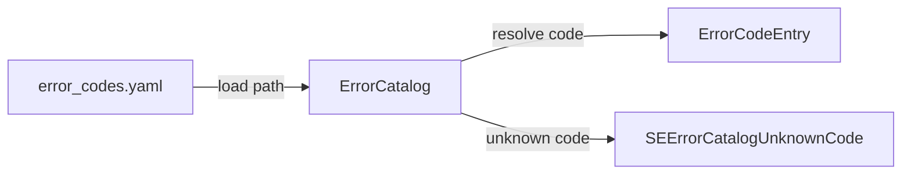

# Shared models

The shared Pydantic models of every public contract: API resources, events, plugin and connector contracts, enums and
their `SE` exceptions. Each is defined once here. The package is `erp_models`, imported by the services, `plugins/` and
`sdk/`.

See [D438 Repository layout](../../docs/specs/06-decisions/technical/d438-repository-layout.md), the
[Repository layout](../../docs/technical/architecture/repository-layout.md) page, and the
[Backend](../../docs/technical/architecture/backend.md) page.

## Sub-packages

`erp_models` imports no service and no library of `backend/shared/`. Each sub-package holds the models of one concern.

| Sub-package | Models | Import path | Specification |
|---|---|---|---|
| `base` | `ErpModel`, a Pydantic model that forbids unknown keys; `FrozenErpModel`, the same and also frozen; `OpaqueId`, the base of opaque texts | `erp_models.base.erp_model`, `erp_models.base.frozen_erp_model`, `erp_models.base.opaque_id` | [D406 Back end](../../docs/specs/06-decisions/technical/d406-back-end.md) |
| `ids` | `RecordId`, the id of a record; `CompanyId`, the opaque id of a company | `erp_models.ids.record_id`, `erp_models.ids.company_id` | [E-T01-01 Company](../../docs/specs/03-technical/t01-companies-and-data-isolation/data/e-t01-01-company.md) |
| `times` | `UtcTimestamp`, an aware instant converted to UTC; naive times are refused | `erp_models.times.utc_timestamp` | [D406 Back end](../../docs/specs/06-decisions/technical/d406-back-end.md) |
| `money` | `Money`, an exact `Decimal` with an ISO 4217 alphabetic currency code; floats are refused and nothing is rounded (the country pack rounds, D293); with `zero`, `add` and `total`; sums in different currencies are refused | `erp_models.money.money` | [REQ-T10-03 Money decimals](../../docs/specs/03-technical/t10-translations-and-notifications/requirements/req-t10-03-money-decimals.md) |
| `paging` | `CursorPage[ItemT]`, with `items`, `next_cursor` and `has_more` | `erp_models.paging.cursor_page` | [REQ-T05-02 Paging and idempotency](../../docs/specs/03-technical/t05-api-and-webhooks/requirements/req-t05-02-paging-and-idempotency.md) |
| `idempotency` | `IdempotencyKey`, equal and hashable by value | `erp_models.idempotency.idempotency_key` | [REQ-T05-02 Paging and idempotency](../../docs/specs/03-technical/t05-api-and-webhooks/requirements/req-t05-02-paging-and-idempotency.md) |
| `catalogs` | `YamlCatalog`, with `load(path)`, which reads a UTF-8 YAML mapping; the `UNREADABLE` exception that each catalogue sets | `erp_models.catalogs.yaml_catalog` | [Configuration](../../docs/technical/architecture/configuration.md) |

## Exceptions

The `SE` exceptions of a model live in its sub-package's `exceptions/` folder, and the folder's `__init__.py` re-exports
them through a sorted `__all__`, so callers import from the package (`erp_models.money.exceptions`). The shared `SE`
base classes and the error codes are described in [Exceptions and error codes](#exceptions-and-error-codes).

## Exceptions and error codes

Every error raised by a shared contract derives from one of three bases in `erp_models.exceptions`. Each class carries a
stable `CODE`, which the API reports with the message, and each message text comes from a translation key.

| Base | `CODE` | Parent of |
|---|---|---|
| `SEException` | `UNEXPECTED-ERROR-01` | The root of every `SE` exception |
| `SEError` | `SERVICE-FAILURE-01` | Every layer error, `SE<Domain>Error` |
| `SEInvalidModelException` | `INVALID-INPUT-01` | Every model exception, `SEInvalid<Model>Exception` |

- **An `SE` exception never subclasses `ValueError`.** Pydantic catches a `ValueError` raised inside a validator and
  wraps it in its own `ValidationError`, so the specific exception would be lost to the caller. The bases derive from
  `Exception`, and a validator raises the specific class directly.
- A subclass sets its own `CODE`; a subclass that sets none keeps the code of its base.
- An exception raised from a cause keeps it: `raise SEError(...) from error`.

### The error code catalogue

`backend/models/conf/catalogs/error_codes.yaml` lists every error code the platform reports, as a mapping under `codes`:

```yaml
codes:
  SITE-CLOSE-01:
    title: errors.site_close_01.title
    why: errors.site_close_01.why
    action: errors.site_close_01.action
    reference: SITE-CLOSE-01
```

- `title`, `why` and `action` are translation keys, not texts. The texts belong to the translation catalogues of P2.
- `reference` repeats the code and points to the specification that defines it.

The model `erp_models.errors.catalogs.error_catalog.ErrorCatalog` reads the file:



- `ErrorCatalog.load(path)` reads the YAML as UTF-8 and validates it. A missing or malformed file raises
  `SEErrorCatalogUnreadable`.
- `ErrorCatalog.resolve(code)` returns the entry of a known code. An unknown code, including an empty one or one in
  lower case, raises `SEErrorCatalogUnknownCode`, so no caller shows a code without an entry.

### Adding an error code

A later ticket adds a code in two places, in the same change:

1. a new entry in `backend/models/conf/catalogs/error_codes.yaml`, with its three translation keys and its `reference`;
2. the exception that raises it, which sets `CODE` to the same value.

`backend/models/tests/errors/catalogs/test_error_codes_data.py` loads the file and checks every entry, so an entry with a
missing field fails the build.

Specifications: [D122 Error message standard](../../docs/specs/06-decisions/ux/d122-error-message-standard.md),
the [Error messages pattern](../../docs/specs/04-ux/design-system/patterns/error-messages.md) and
[REQ-T05-03 Problem JSON](../../docs/specs/03-technical/t05-api-and-webhooks/requirements/req-t05-03-problem-json.md).
The design is in the [Back end](../../docs/technical/architecture/backend.md) and [API](../../docs/technical/interfaces/api.md)
pages.

## StrEnum conventions

`backend/models/tests/test_str_enum_conventions.py` enforces these rules on every `StrEnum` of the package:

- the class carries `@unique`;
- each enum is in its own file, named after it in snake case (`PaymentStatus` in `payment_status.py`);
- its members are listed under `Attributes:` in the docstring;
- the `enums/` package's `__init__.py` re-exports it.

## Checks

Run the package's tests and type checks from the repository root:

```bash
uv run pytest backend/models/tests -n 2
uv run mypy backend/models/src
```
