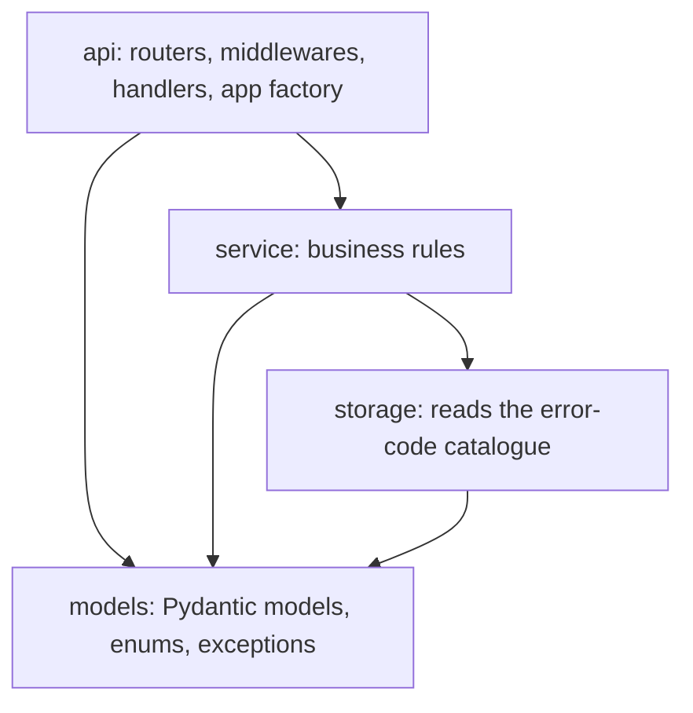

# Platform service

The platform service is the first back-end service of SimpleERP. It is the skeleton that the next services copy: the
same layers, the same configuration files, the same error format and the same image. It answers the health check
`GET /v1/health` and returns the standard error format for every request it cannot serve.

It is a regular FastAPI application, built by its application factory and served by uvicorn, with no command line
([D406](../../../docs/specs/06-decisions/technical/d406-back-end.md)). It follows the repository layout of
[D438](../../../docs/specs/06-decisions/technical/d438-repository-layout.md) and the back-end architecture of
[backend](../../../docs/technical/architecture/backend.md).

## Layers

The package is `src/erp_platform/`. It is called `erp_platform` and not `platform`, because `platform` would shadow the
standard-library module of the same name. Each layer calls only the one below it:



| Path | Holds |
| --- | --- |
| `src/erp_platform/api/` | The FastAPI application: the `/v1` router, the company-context middleware, the problem handler and `api/app_factory.py` |
| `src/erp_platform/service/` | The business rules: the health status and the problem details |
| `src/erp_platform/storage/` | Reading the error-code catalogue, and nothing else |
| `src/erp_platform/models/` | The service's own models (health status, problem details, configuration), their enums and their exceptions |
| `conf/` | The configuration (`app.yaml`), the logging (`logger.yaml`) and the catalogue of error codes |
| `tests/` | Mirrors `src/erp_platform/`, folder by folder |

`api` never imports `storage`, and no layer imports one above it.

## Configuration

`conf/app.yaml` holds every default of the service:

| Key | Default | Holds |
| --- | --- | --- |
| `public_paths` | `/v1/health` | The paths that need no company |
| `error_codes_path` | `conf/catalogs/error_codes.yaml` | The catalogue of error codes |

Each key can be overridden by an environment variable, read through the configuration library of
`backend/shared/config`. `conf/logger.yaml` configures the coloured console and the rotating file in `logs/`.

The address and the port are not configuration. They are uvicorn's options (`--host`, `--port`), so the same image runs
anywhere. See [configuration](../../../docs/technical/architecture/configuration.md).

## Endpoints

| Method and path | Answers | Company needed |
| --- | --- | --- |
| `GET /v1/health` | `{"status": "ok"}` | No |

Every other request needs a company. The company-context middleware of `backend/shared/context` reads it on each
request and refuses the request when it is missing
([REQ-T01-02](../../../docs/specs/03-technical/t01-companies-and-data-isolation/requirements/req-t01-02-company-context-everywhere.md)).

## Errors

Every error is returned as `application/problem+json`, with the members `title`, `status`, `detail` and `code`
([REQ-T05-03](../../../docs/specs/03-technical/t05-api-and-webhooks/requirements/req-t05-03-problem-json.md)). The
messages follow the error message standard of [D122](../../../docs/specs/06-decisions/ux/d122-error-message-standard.md).
A body never holds a secret.

| Code | Status | Raised when |
| --- | --- | --- |
| `PLATFORM-ROUTE-01` | 404 | No route matches the path |
| `PLATFORM-METHOD-01` | 405 | The route exists, but not for this method |
| `PLATFORM-REQUEST-01` | 422 | The request is not valid |
| `PLATFORM-INTERNAL-01` | 500 | An unexpected failure, reported without its cause |

The codes and their message keys are in `conf/catalogs/error_codes.yaml`.

## Run it

From `backend/services/platform/`, uvicorn serves the application factory:

```bash
uv run --package platform uvicorn --factory erp_platform.api.app_factory:AppFactory.create --port 8000
```

Then call the health check:

```bash
curl http://localhost:8000/v1/health
```

## Image

The image is built from the repository root, because the shared `uv.lock` is there:

```bash
docker build -f backend/services/platform/Dockerfile -t simpleerp-platform .
docker run -p 8000:8000 simpleerp-platform
```

The image runs uvicorn on the application factory, listening on `0.0.0.0` inside the container. It has no console
script of its own.

## Tests

Run one folder at a time, from the repository root:

```bash
uv run --package platform pytest backend/services/platform/tests/<folder> -n 2
```

The folders mirror the source: `api`, `service`, `storage` and `models`, plus `conf` and `image`. The `image` folder
builds the image and calls the health check, and it is skipped where Docker is absent.

## What comes next

- The OpenAPI document, served at `/openapi.json` and committed from `app.openapi()` (T0.18).
- The typed client generated from that document (T0.20).
- The Bruno collection of the API (T0.24).
- The Compose profiles and the Helm chart that run the image (T0.21 and T0.19).
