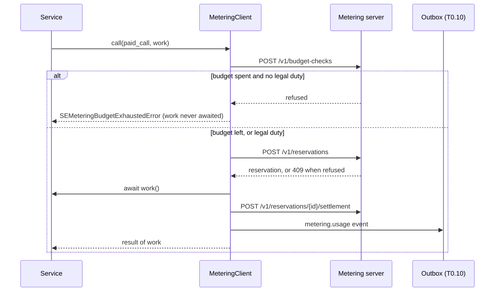

# Metering client

`erp_metering` is the shared library through which every paid call of SimpleERP goes. A paid call is made through `MeteringClient.call(paid_call, work)`, which checks the budget, reserves
the cost, makes the call, settles the actual cost and writes one usage event. The design is set out in
[Architecture, Metering (TC-21)](../../../docs/technical/architecture/architecture.md) and in
[TC-21: Metering every paid call, and stopping on a budget](../../../docs/specs/03-technical/challenges/tc-21-metering-every-paid-call.md).

The list of legal duties comes from the country pack and is not read here: the library only carries the flag.

## The sequence of a paid call

`MeteringClient.call(paid_call, work)` runs these steps, in this order:



1. **Budget check.** The client asks the metering server whether the budget of the paid call still has room
   (`POST /v1/budget-checks`). A call without legal duty is refused when the budget is spent, and its work is never
   awaited.
2. **Reservation.** The cost of the call is reserved before the work runs (`POST /v1/reservations`). The server answers
   `409` when it refuses the reservation.
3. **The call.** The `work` coroutine runs and returns its result with the actual cost, as a `Money` value.
4. **Settlement.** The actual cost is sent to the server (`POST /v1/reservations/{id}/settlement`).
5. **Usage event.** One event of type `metering.usage` is written through the outbox of T0.10, as
   [D405, Architecture and scalability](../../../docs/specs/06-decisions/technical/d405-architecture-and-scalability.md)
   requires. The event carries the reservation ID, the actual cost and the `over_budget` flag.

The result of `work` is returned to the caller unchanged.

## The legal-duty flag

`PaidCall.legal_duty` lets a call pass an exhausted budget. The stop at 100 % of a budget refuses new paid calls, except
those a legal duty needs, as [BR-F22-06, Stop at the budget, legal duties kept](../../../docs/specs/02-functional/f22-unified-cost-management/business-rules/br-f22-06-stop-at-budget-legal-duties-kept.md)
states, and as [D398, Budgets warn, then stop](../../../docs/specs/06-decisions/f22-unified-cost-management/d398-budgets-warn-then-stop.md)
decides.

- A call with `legal_duty=True` goes on when the budget is spent. Its work runs, and its usage event is written with
  `over_budget` set to `True`.
- The client logs a **WARNING** that the budget is exhausted and that a legal duty goes on.
- A call without `legal_duty` is refused when the budget is spent, and writes no usage event.

## What happens on failure

| Failure | What the client does |
| --- | --- |
| The work raises an exception | The reservation is released (`DELETE /v1/reservations/{id}`), no settlement is sent and no usage event is written. A **WARNING** is logged, and the exception is re-raised unchanged. |
| The metering server is unreachable, for a normal call | The call is refused with `SEMeteringServerUnavailableError`, and its work is never awaited. |
| The metering server is unreachable, for a legal-duty call | The work runs, and one usage event is written without a reservation. A **WARNING** is logged. |
| The settlement fails | The result of the work is still returned, and one usage event is still written with the reservation ID. A **WARNING** is logged. |

## HTTP routes

The client expects these routes from the metering server:

| Method and path | Use |
| --- | --- |
| `POST /v1/budget-checks` | Asks whether the budget has room for the paid call. |
| `POST /v1/reservations` | Reserves the cost of the call. Answers `409` when the reservation is refused. |
| `POST /v1/reservations/{id}/settlement` | Settles the reservation with the actual cost. |
| `DELETE /v1/reservations/{id}` | Releases the reservation when the work fails. |

## Tests

The tests run against a stand-in metering server: a real HTTP server on `127.0.0.1`, with its budget held in memory,
in [`tests/stand_in/`](tests/stand_in/). The tests of the client are in
[`tests/service/metering/metering_client/`](tests/service/metering/metering_client/).

```bash
uv run --package erp-metering pytest backend/shared/metering/tests -n 2
```
