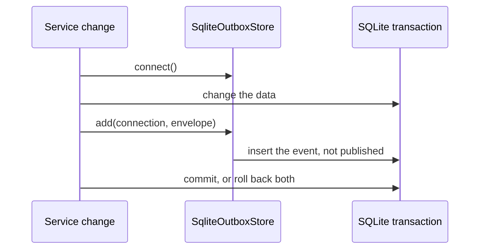
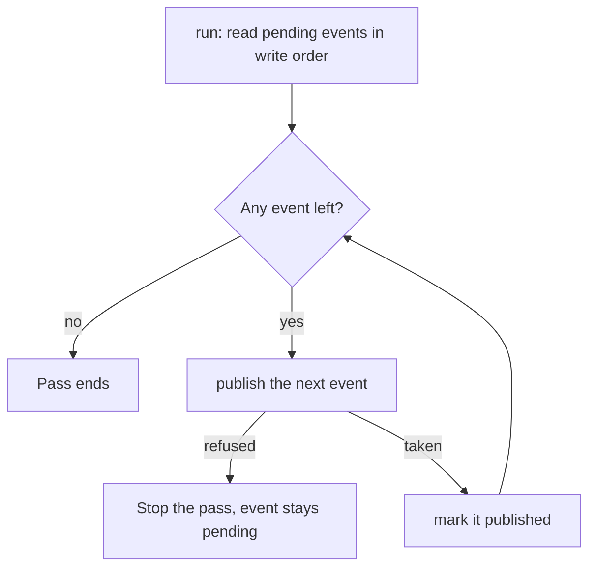

# erp_outbox

`erp_outbox` is the event outbox library. Each service writes the events of its changes into its own outbox, in the
same transaction as the change, and a relay later publishes them to the event bus. An event that happened is therefore
never lost, even when the bus is down at the moment of the change.

The library holds no business rules. It knows how to store an event, read the events still to publish, publish them
through an interface and mark them as published. What an event means is decided by the service that writes it.

The architecture places one outbox per service, fed to the event bus, for what happened:
[D405](../../../docs/specs/06-decisions/technical/d405-architecture-and-scalability.md),
[architecture page, Messaging](../../../docs/technical/architecture/architecture.md), and the back-end design in
[D406](../../../docs/specs/06-decisions/technical/d406-back-end.md) and
[backend page](../../../docs/technical/architecture/backend.md). The repository layout of the library follows
[D438](../../../docs/specs/06-decisions/technical/d438-repository-layout.md). The tests follow
[D426](../../../docs/specs/06-decisions/technical/d426-testing-strategy.md). The audit writer, which will write its
entries through this outbox, is specified in
[I-T03-01](../../../docs/specs/03-technical/t03-audit-trail/interfaces/i-t03-01-audit-writer.md).

## What it holds

| Path | Holds |
| --- | --- |
| `src/erp_outbox/storage/outbox_store.py` | `OutboxStore`, the abstract store: connect, create the table, add, read the pending events and mark them published |
| `src/erp_outbox/storage/sqlite/sqlite_outbox_store.py` | `SqliteOutboxStore`, the store kept in a table of a SQLite database |
| `src/erp_outbox/storage/publishers/publisher.py` | `Publisher`, the outbound interface the relay publishes through |
| `src/erp_outbox/storage/publishers/recording_publisher.py` | `RecordingPublisher`, a stand-in publisher that keeps the events it is given |
| `src/erp_outbox/service/relay/outbox_relay.py` | `OutboxRelay`, the runnable that publishes the pending events in one pass |
| `src/erp_outbox/models/exceptions/` | `SEOutboxError`, `SEOutboxStoreError` and `SEOutboxPublishError` |

## How a caller writes an event

The caller opens a connection with `SqliteOutboxStore.connect()`, which opens it with `autocommit=False`. It makes its
change and calls `SqliteOutboxStore.add(connection, envelope)` inside the same transaction. The caller then commits or
rolls back both the change and the event together, so an event exists if and only if its change does.

`add` never commits and never rolls back. A write that fails, or an identifier already in the table, raises
`SEOutboxStoreError`.

The envelope is `EventEnvelope` of the shared models, in `erp_models.events.event_envelope`
([`backend/models/src/erp_models/events/event_envelope.py`](../../models/src/erp_models/events/event_envelope.py)).
Its fields are:

- `event_id`: the identifier of the event, a new one by default. The outbox keeps it unique.
- `event_type`: the type of the event, a non-empty text such as `audit.entry.appended`.
- `company_id`: the company the event belongs to.
- `occurred_at`: when it happened, in UTC, now by default.
- `payload`: what happened, a JSON object. Its schema belongs to the event type, not to this library.

The table holds the write order in `sequence`, the `event_id`, the envelope as JSON, and `published_at`, which stays
empty until the event is published. The payload is never logged.



## How the relay publishes

`OutboxRelay` is a `Runnable` of `erp_lifecycle`. It takes a store, a `Publisher` and an optional logger. Its lifecycle
is `initialize()`, which opens the connection and creates the table when missing, `run()`, which makes one pass, and
`close()`, which releases the connection and is safe to call twice.

One call to `run()`:

1. reads the pending events in write order;
2. publishes each one through the `Publisher`;
3. marks the event as published only once the publisher returned.

The relay is **at least once**. A stop between the publish and the mark leaves the event pending, so it is published
again on the next pass. Consumers must therefore tolerate a duplicate, and identify it by the `event_id` of the
envelope.

A refused publish raises `SEOutboxPublishError` from the publisher. The relay then stops the pass, so that later
events never overtake the refused one, and the refused event stays pending for the next run. The relay makes one pass
and does not loop, retry or wait.



## The publisher

`Publisher` is the abstract outbound interface. Its `publish(envelope)` returns only once the bus has taken the event,
and raises `SEOutboxPublishError` when the bus refuses it. The event bus is chosen in P2, so the relay depends on this
interface only.

`RecordingPublisher` implements it by keeping every envelope in `published`, in call order. It stands in for the event
bus in tests.

## Exceptions

| Class | Raised when |
| --- | --- |
| `SEOutboxError` | The base of every error of the library |
| `SEOutboxStoreError` | The store cannot be opened, prepared, written or read, or an event cannot be marked |
| `SEOutboxPublishError` | The publisher refuses an event |

## How to run its tests

From the repository root:

```bash
uv run --package erp-outbox pytest backend/shared/outbox/tests -n 2
```

## What is not here

- The event bus itself. It is chosen in P2, and `Publisher` is the only point where it connects.
- A PostgreSQL store. Only the SQLite store exists.
- The scheduling of the passes. The service decides when to run the relay.
- Retry, backoff and ordering rules beyond the single pass described above.
