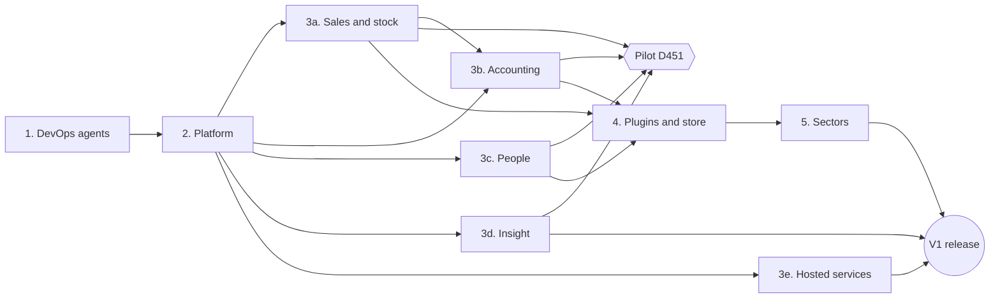

🏠 [Specs](../../../README.md) › 🎯 [Vision](../../README.md) › 🛣️ [Roadmap and options](../README.md) ›
🔀 [Roadmap options](README.md) › 🛤️ Option B: the platform, then parallel tracks

# 🛤️ Option B: the platform, then parallel tracks

**Status:** 🔄 waiting for the owner

## Principle

The DevOps agents and the platform come first, as in A. Then the business areas, the insight capabilities and the hosted
services run as parallel tracks, each with its own milestone; the business areas start in the D4 order inside their
track, and a track that needs another's records starts from its contracts (data model, API, posting rules) as soon as
they are frozen. The plugins and the sectors keep their place at the end.

## Steps

| Step | Holds | Starts after | Use cases (share of V1) | Notes |
|---|---|---|---|---|
| 1. DevOps agents | [F25](../../../02-functional/f25-devops-agents/README.md) | none | 28 (2 %) |  |
| 2. Platform | [T1](../../../03-technical/t01-companies-and-data-isolation/README.md), [T2](../../../03-technical/t02-identity-and-access/README.md), [T3](../../../03-technical/t03-audit-trail/README.md), [T4](../../../03-technical/t04-plugin-runtime/README.md), [T5](../../../03-technical/t05-api-and-webhooks/README.md), [T6](../../../03-technical/t06-mcp-and-a2a-gateway/README.md), [T7](../../../03-technical/t07-ai-providers-and-models/README.md), [T8](../../../03-technical/t08-rag-platform/README.md), [T9](../../../03-technical/t09-install-backups-and-updates/README.md), [T10](../../../03-technical/t10-translations-and-notifications/README.md), [T11](../../../03-technical/t11-legal-corpora/README.md), [T12](../../../03-technical/t12-connectors-and-scrapers/README.md), [T13](../../../03-technical/t13-maps-and-geodata/README.md), [F1](../../../02-functional/f01-administration/README.md), [F2](../../../02-functional/f02-no-code-configuration/README.md), [F3](../../../02-functional/f03-assistant/README.md), [F4](../../../02-functional/f04-meetings/README.md), [F21](../../../02-functional/f21-onboarding-and-modules/README.md), [F22](../../../02-functional/f22-unified-cost-management/README.md) | 1 | 176 (14 %) | contracts of F6 to F9 frozen at the end |
| 3a. Track sales and stock | [F6](../../../02-functional/f06-customers-and-sales/README.md), [F7](../../../02-functional/f07-purchasing-and-stock/README.md), [F16](../../../02-functional/f16-customer-support-agents/README.md) | 2 | 84 (7 %) | F6, then F7, then F16 |
| 3b. Track accounting | [F8](../../../02-functional/f08-accounting/README.md) | 2 and F6's contracts | 40 (3 %) | finishes after F7 |
| 3c. Track people | [F9](../../../02-functional/f09-hr-and-projects/README.md), [F15](../../../02-functional/f15-legal-assistant/README.md) | 2 | 67 (5 %) | F9, then F15 |
| 3d. Track insight | [F5](../../../02-functional/f05-social-media/README.md), [F17](../../../02-functional/f17-competitive-analysis/README.md), [F23](../../../02-functional/f23-what-if-simulation/README.md), [F24](../../../02-functional/f24-integrations-hub/README.md) | 2 | 122 (10 %) |  |
| 3e. Track hosted services | [F18](../../../02-functional/f18-hosted-websites-and-domains/README.md), [F19](../../../02-functional/f19-feature-factory/README.md), [F20](../../../02-functional/f20-hosted-support-assistant/README.md) | 2 | 93 (8 %) | revenue earlier |
| 4. Plugins and the plugin store | [F10](../../../02-functional/f10-point-of-sale/README.md), [F11](../../../02-functional/f11-online-shop/README.md), [F12](../../../02-functional/f12-manufacturing/README.md), [F13](../../../02-functional/f13-payroll/README.md), [F14](../../../02-functional/f14-plugin-store/README.md) | 3a to 3c | 170 (14 %) | D15 |
| 5. Sectors | [SC01](../../../08-sectors/sc01-construction/README.md), [SC02](../../../08-sectors/sc02-retail/README.md), [SC03](../../../08-sectors/sc03-services/README.md), [SC04](../../../08-sectors/sc04-home-care/README.md), [SC05](../../../08-sectors/sc05-manufacturing/README.md), [SC06](../../../08-sectors/sc06-hospitality/README.md), [SC07](../../../08-sectors/sc07-transport/README.md), [SC08](../../../08-sectors/sc08-non-profit/README.md), [SC09](../../../08-sectors/sc09-health-practices/README.md), [SC10](../../../08-sectors/sc10-real-estate/README.md), [SC11](../../../08-sectors/sc11-professional-firms/README.md), [SC12](../../../08-sectors/sc12-education-and-training/README.md), [SC13](../../../08-sectors/sc13-agriculture-and-food/README.md), [SC14](../../../08-sectors/sc14-it-and-software/README.md), [SC15](../../../08-sectors/sc15-wholesale-and-distribution/README.md), [SC16](../../../08-sectors/sc16-events-and-culture/README.md), [SC17](../../../08-sectors/sc17-beauty-and-wellness/README.md), [SC18](../../../08-sectors/sc18-sports-and-fitness/README.md), [SC19](../../../08-sectors/sc19-trades-and-home-services/README.md), [SC20](../../../08-sectors/sc20-public-bodies/README.md) | 4 | 441 (36 %) |  |

Every step also builds the technical design chapters, technical challenges, non-functional requirements and country-pack
themes its capabilities need, as listed in [What V1 holds](../inventory.md).

## Dependency graph

## The dated pilot

The pilot starts when tracks 3a, 3b and 3c, and F5 of track 3d, pass: its calendar is the longest of those tracks, not
their sum.

## Decisions

| Decision | In this option | How |
|---|---|---|
| [D3](../../../06-decisions/foundations/d03-every-area-in-the-first-version.md) | ✅ kept |  |
| [D4](../../../06-decisions/foundations/d04-business-build-order.md) | ⚠️ bent | kept as the start order inside a track, but the areas overlap |
| [D15](../../../06-decisions/foundations/d15-industry-areas-as-plugins.md) | ✅ kept |  |
| [D16](../../../06-decisions/foundations/d16-platform-first.md) | ✅ kept |  |
| [D380](../../../06-decisions/vision/d380-every-capability-first-confirmed.md) | ✅ kept |  |
| [D451](../../../06-decisions/vision/d451-dated-pilot-before-the-release.md) | ✅ kept | F5 in track 3d, before the pilot |
| [D483](../../../06-decisions/vision/d483-roadmap-devops-agents-first.md) | ✅ kept | F24 (Proposed placement) leaves step 2 |

## Strengths

- A much shorter calendar: the DevOps agents build the tracks at the same time.
- The hosted services are ready, and tried on the publisher's own clusters, long before V1.
- The pilot no longer waits for F15, F16 or the growth capabilities.

## Risks

- The contracts between areas (data model, API, posting rules) must be frozen before the tracks start; a late change
  costs every track.
- The maintainer reviews five streams of pull requests at once: the human approval of F25 becomes the bottleneck.
- More integration risk at the milestones.

---

⬅️ [Option A: ten steps in a row](option-a-ten-steps-in-a-row.md) · ⬆️ [Up](README.md) ·
➡️ [Option C: the pilot first](option-c-the-pilot-first.md)
