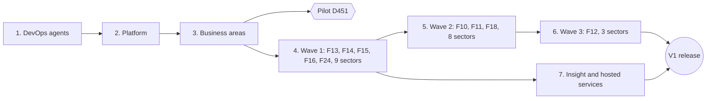

🏠 [Specs](../../../README.md) › 🎯 [Vision](../../README.md) › 🛣️ [Roadmap and options](../README.md) ›
🔀 [Roadmap options](README.md) › 🏘️ Option D: sector waves

# 🏘️ Option D: sector waves

**Status:** 🔄 waiting for the owner

## Principle

After the platform and the business areas, V1 grows in three waves of sectors: each wave builds the capabilities its
sectors still lack, then those sectors' packs, and ends when their example companies run their use cases end to end. The
waves are those of [What V1 holds](../inventory.md#sectors).

## Steps

| Step | Holds | Starts after | Use cases (share of V1) | Notes |
|---|---|---|---|---|
| 1. DevOps agents | [F25](../../../02-functional/f25-devops-agents/README.md) | none | 28 (2 %) |  |
| 2. Platform | [T1](../../../03-technical/t01-companies-and-data-isolation/README.md), [T2](../../../03-technical/t02-identity-and-access/README.md), [T3](../../../03-technical/t03-audit-trail/README.md), [T4](../../../03-technical/t04-plugin-runtime/README.md), [T5](../../../03-technical/t05-api-and-webhooks/README.md), [T6](../../../03-technical/t06-mcp-and-a2a-gateway/README.md), [T7](../../../03-technical/t07-ai-providers-and-models/README.md), [T8](../../../03-technical/t08-rag-platform/README.md), [T9](../../../03-technical/t09-install-backups-and-updates/README.md), [T10](../../../03-technical/t10-translations-and-notifications/README.md), [T11](../../../03-technical/t11-legal-corpora/README.md), [T12](../../../03-technical/t12-connectors-and-scrapers/README.md), [T13](../../../03-technical/t13-maps-and-geodata/README.md), [F1](../../../02-functional/f01-administration/README.md), [F2](../../../02-functional/f02-no-code-configuration/README.md), [F3](../../../02-functional/f03-assistant/README.md), [F4](../../../02-functional/f04-meetings/README.md), [F21](../../../02-functional/f21-onboarding-and-modules/README.md), [F22](../../../02-functional/f22-unified-cost-management/README.md) | 1 | 176 (14 %) |  |
| 3. Business areas | [F6](../../../02-functional/f06-customers-and-sales/README.md), [F7](../../../02-functional/f07-purchasing-and-stock/README.md), [F8](../../../02-functional/f08-accounting/README.md), [F9](../../../02-functional/f09-hr-and-projects/README.md), [F5](../../../02-functional/f05-social-media/README.md) | 2 | 176 (14 %) | D4 order; pilot |
| 4. Wave 1: offices and field services | [F13](../../../02-functional/f13-payroll/README.md), [F14](../../../02-functional/f14-plugin-store/README.md), [F15](../../../02-functional/f15-legal-assistant/README.md), [F16](../../../02-functional/f16-customer-support-agents/README.md), [F24](../../../02-functional/f24-integrations-hub/README.md), [SC01](../../../08-sectors/sc01-construction/README.md), [SC03](../../../08-sectors/sc03-services/README.md), [SC04](../../../08-sectors/sc04-home-care/README.md), [SC07](../../../08-sectors/sc07-transport/README.md), [SC09](../../../08-sectors/sc09-health-practices/README.md), [SC10](../../../08-sectors/sc10-real-estate/README.md), [SC11](../../../08-sectors/sc11-professional-firms/README.md), [SC14](../../../08-sectors/sc14-it-and-software/README.md), [SC19](../../../08-sectors/sc19-trades-and-home-services/README.md) | 3 | 345 (28 %) | payroll and the store first |
| 5. Wave 2: counters, shops and websites | [F10](../../../02-functional/f10-point-of-sale/README.md), [F11](../../../02-functional/f11-online-shop/README.md), [F18](../../../02-functional/f18-hosted-websites-and-domains/README.md), [SC02](../../../08-sectors/sc02-retail/README.md), [SC08](../../../08-sectors/sc08-non-profit/README.md), [SC12](../../../08-sectors/sc12-education-and-training/README.md), [SC15](../../../08-sectors/sc15-wholesale-and-distribution/README.md), [SC16](../../../08-sectors/sc16-events-and-culture/README.md), [SC17](../../../08-sectors/sc17-beauty-and-wellness/README.md), [SC18](../../../08-sectors/sc18-sports-and-fitness/README.md), [SC20](../../../08-sectors/sc20-public-bodies/README.md) | 4 | 271 (22 %) |  |
| 6. Wave 3: making things | [F12](../../../02-functional/f12-manufacturing/README.md), [SC05](../../../08-sectors/sc05-manufacturing/README.md), [SC06](../../../08-sectors/sc06-hospitality/README.md), [SC13](../../../08-sectors/sc13-agriculture-and-food/README.md) | 5 | 100 (8 %) |  |
| 7. Insight and hosted services | [F17](../../../02-functional/f17-competitive-analysis/README.md), [F23](../../../02-functional/f23-what-if-simulation/README.md), [F19](../../../02-functional/f19-feature-factory/README.md), [F20](../../../02-functional/f20-hosted-support-assistant/README.md) | 4 | 125 (10 %) |  |

Every step also builds the technical design chapters, technical challenges, non-functional requirements and country-pack
themes its capabilities need, as listed in [What V1 holds](../inventory.md).

## Dependency graph

## The dated pilot

The pilot starts after step 3; its company can belong to a wave 1 sector (services, professional firms, home care),
whose pack comes next.

## Decisions

| Decision | In this option | How |
|---|---|---|
| [D3](../../../06-decisions/foundations/d03-every-area-in-the-first-version.md) | ✅ kept |  |
| [D4](../../../06-decisions/foundations/d04-business-build-order.md) | ✅ kept |  |
| [D15](../../../06-decisions/foundations/d15-industry-areas-as-plugins.md) | ⚠️ bent | the plugins still follow the business areas, but are spread over the waves |
| [D16](../../../06-decisions/foundations/d16-platform-first.md) | ✅ kept |  |
| [D380](../../../06-decisions/vision/d380-every-capability-first-confirmed.md) | ✅ kept |  |
| [D451](../../../06-decisions/vision/d451-dated-pilot-before-the-release.md) | ✅ kept |  |
| [D483](../../../06-decisions/vision/d483-roadmap-devops-agents-first.md) | ⚠️ bent | steps 7 to 10 are interleaved |

## Strengths

- Every wave ends on example companies working end to end: acceptance on real scenarios, not on capabilities alone.
- A gap that a sector reveals is found in the wave, not at the end of V1.
- The 20 example companies become the test plan of the waves.

## Risks

- Wave 1 holds nine sectors at once.
- The plugin store (F14) must be built early, since every sector pack installs through it.
- Manufacturing (F12) waits for the last wave.

---

⬅️ [Option C: the pilot first](option-c-the-pilot-first.md) · ⬆️ [Up](README.md) ·
➡️ [Option E: the factory first](option-e-the-factory-first.md)
