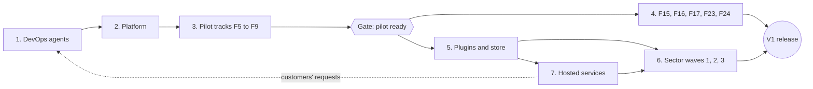

🏠 [Specs](../../../README.md) › 🎯 [Vision](../../README.md) › 🛣️ [Roadmap and options](../README.md) ›
🔀 [Roadmap options](README.md) › ⭐ Option F: the pilot spine, with tracks and waves

# ⭐ Option F: the pilot spine, with tracks and waves

**Status:** 🔄 waiting for the owner

## Principle

A combination that keeps every decision of the owner: option C's order (the pilot as a gate), option B's parallel tracks
inside each step, and option D's waves for the sectors once the plugins are built. (Proposed)

## Steps

| Step | Holds | Starts after | Use cases (share of V1) | Notes |
|---|---|---|---|---|
| 1. DevOps agents | [F25](../../../02-functional/f25-devops-agents/README.md) | none | 28 (2 %) | delivery chapters, TC-20, TC-24 |
| 2. Platform | [T1](../../../03-technical/t01-companies-and-data-isolation/README.md), [T2](../../../03-technical/t02-identity-and-access/README.md), [T3](../../../03-technical/t03-audit-trail/README.md), [T4](../../../03-technical/t04-plugin-runtime/README.md), [T5](../../../03-technical/t05-api-and-webhooks/README.md), [T6](../../../03-technical/t06-mcp-and-a2a-gateway/README.md), [T7](../../../03-technical/t07-ai-providers-and-models/README.md), [T8](../../../03-technical/t08-rag-platform/README.md), [T9](../../../03-technical/t09-install-backups-and-updates/README.md), [T10](../../../03-technical/t10-translations-and-notifications/README.md), [T11](../../../03-technical/t11-legal-corpora/README.md), [T12](../../../03-technical/t12-connectors-and-scrapers/README.md), [T13](../../../03-technical/t13-maps-and-geodata/README.md), [F1](../../../02-functional/f01-administration/README.md), [F2](../../../02-functional/f02-no-code-configuration/README.md), [F3](../../../02-functional/f03-assistant/README.md), [F4](../../../02-functional/f04-meetings/README.md), [F21](../../../02-functional/f21-onboarding-and-modules/README.md), [F22](../../../02-functional/f22-unified-cost-management/README.md) | 1 | 176 (14 %) | T13 added; contracts of F6 to F9 frozen |
| 3. The pilot, in tracks | [F6](../../../02-functional/f06-customers-and-sales/README.md), [F7](../../../02-functional/f07-purchasing-and-stock/README.md), [F8](../../../02-functional/f08-accounting/README.md), [F9](../../../02-functional/f09-hr-and-projects/README.md), [F5](../../../02-functional/f05-social-media/README.md) | 2 | 176 (14 %) | tracks F6 then F7, F8, F9, F5; started in the D4 order; e-invoicing; data migration |
| Gate: pilot ready | none | 3 | - | by 1 June 2027 (Proposed), before 1 September 2027 (D451) |
| 4. During the pilot, in tracks | [F15](../../../02-functional/f15-legal-assistant/README.md), [F16](../../../02-functional/f16-customer-support-agents/README.md), [F24](../../../02-functional/f24-integrations-hub/README.md), [F17](../../../02-functional/f17-competitive-analysis/README.md), [F23](../../../02-functional/f23-what-if-simulation/README.md) | 3 | 137 (11 %) |  |
| 5. Plugins and the plugin store | [F14](../../../02-functional/f14-plugin-store/README.md), [F13](../../../02-functional/f13-payroll/README.md), [F10](../../../02-functional/f10-point-of-sale/README.md), [F11](../../../02-functional/f11-online-shop/README.md), [F12](../../../02-functional/f12-manufacturing/README.md) | 3 | 170 (14 %) | D15 |
| 6. Sector waves 1, 2 and 3 | [SC01](../../../08-sectors/sc01-construction/README.md), [SC02](../../../08-sectors/sc02-retail/README.md), [SC03](../../../08-sectors/sc03-services/README.md), [SC04](../../../08-sectors/sc04-home-care/README.md), [SC05](../../../08-sectors/sc05-manufacturing/README.md), [SC06](../../../08-sectors/sc06-hospitality/README.md), [SC07](../../../08-sectors/sc07-transport/README.md), [SC08](../../../08-sectors/sc08-non-profit/README.md), [SC09](../../../08-sectors/sc09-health-practices/README.md), [SC10](../../../08-sectors/sc10-real-estate/README.md), [SC11](../../../08-sectors/sc11-professional-firms/README.md), [SC12](../../../08-sectors/sc12-education-and-training/README.md), [SC13](../../../08-sectors/sc13-agriculture-and-food/README.md), [SC14](../../../08-sectors/sc14-it-and-software/README.md), [SC15](../../../08-sectors/sc15-wholesale-and-distribution/README.md), [SC16](../../../08-sectors/sc16-events-and-culture/README.md), [SC17](../../../08-sectors/sc17-beauty-and-wellness/README.md), [SC18](../../../08-sectors/sc18-sports-and-fitness/README.md), [SC19](../../../08-sectors/sc19-trades-and-home-services/README.md), [SC20](../../../08-sectors/sc20-public-bodies/README.md) | 5 | 441 (36 %) | each wave ends on its example companies |
| 7. Hosted edition services | [F18](../../../02-functional/f18-hosted-websites-and-domains/README.md), [F19](../../../02-functional/f19-feature-factory/README.md), [F20](../../../02-functional/f20-hosted-support-assistant/README.md) | 5 | 93 (8 %) | in parallel with 6; F18 before SC20 |

Every step also builds the technical design chapters, technical challenges, non-functional requirements and country-pack
themes its capabilities need, as listed in [What V1 holds](../inventory.md).

## Dependency graph

## The dated pilot

As in C: the pilot is the gate after step 3, ready by 1 June 2027 (Proposed). Its company can belong to a wave 1 sector,
whose pack the waves of step 6 bring first.

## Decisions

| Decision | In this option | How |
|---|---|---|
| [D3](../../../06-decisions/foundations/d03-every-area-in-the-first-version.md) | ✅ kept |  |
| [D4](../../../06-decisions/foundations/d04-business-build-order.md) | ✅ kept | the start order of the tracks |
| [D15](../../../06-decisions/foundations/d15-industry-areas-as-plugins.md) | ✅ kept | plugins after the business areas |
| [D16](../../../06-decisions/foundations/d16-platform-first.md) | ✅ kept | T13 added to the platform |
| [D380](../../../06-decisions/vision/d380-every-capability-first-confirmed.md) | ✅ kept |  |
| [D451](../../../06-decisions/vision/d451-dated-pilot-before-the-release.md) | ✅ kept | made a gate with a margin |
| [D483](../../../06-decisions/vision/d483-roadmap-devops-agents-first.md) | ✅ kept | only Proposed placements move: F5, F15, F16, F17, F23, F24 |

## Strengths

- It keeps every decision the owner took; only Claude's (Proposed) placements move.
- The pilot's date is protected, as in C, and the calendar after it is shortened by tracks, as in B.
- The sectors are accepted wave by wave on their example companies, as in D.

## Risks

- Like B, the tracks need frozen contracts and put several streams of pull requests before the maintainer at once.
- Like C, F16 waits for the pilot.

---

⬅️ [Option E: the factory first](option-e-the-factory-first.md) · ⬆️ [Up](README.md)
