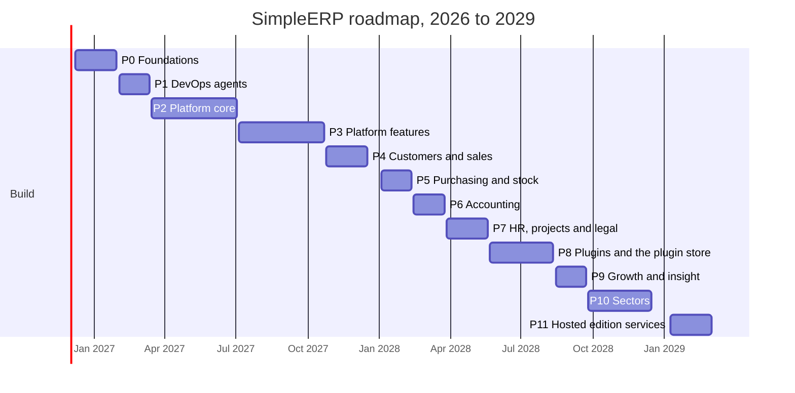

🏠 [Specs](../../../README.md) › 🎯 [Vision](../../README.md) › 🛣️ [Roadmap and options](../README.md) › 🪜 Phases

# 🪜 Phases

**Status:** 🟡 Draft

The [roadmap](../roadmap.md) cut into phases, epics and tickets for the Claude Code harness (`.claude/rules/tickets.md`):
every ticket `T<phase>.<nn>` is planned with `/ticket-plan`, built with `/ticket-run`, and mirrored on the GitHub
project **SimpleERP roadmap** (`.claude/scripts/github/board.py`). The ten build steps of the roadmap become twelve
phases: a foundations phase comes first, and the platform step is split into its technical core (T1 to T13) and its
platform features, so that no phase holds more than 99 tickets. Placements marked (Proposed) wait for the owner, as in
the roadmap ([Q20](../../../07-questions/q20-which-roadmap-option-orders-v1.md)).

## 📋 Phases

| Phase | Builds | Sprints | Dates | Page |
|---|---|---|---|---|
| P0 Foundations | The layout, shared models and libraries, laptop profile, back-office shell | S01 to S04 | 7 Dec 2026 to 29 Jan 2027 | [P0](01-p0-foundations.md) |
| P1 DevOps agents | F25 | S05 to S07 | 1 Feb to 12 Mar 2027 | [P1](02-p1-devops-agents.md) |
| P2 Platform core | T1 to T13 | S08 to S15 | 15 Mar to 2 Jul 2027 | [P2](03-p2-platform-core.md) |
| P3 Platform features | F1, F2, F3, F4, F21, F22, F24 | S16 to S23 | 5 Jul to 22 Oct 2027 | [P3](04-p3-platform-features.md) |
| P4 Customers and sales | F6, F16 | S24 to S27 | 25 Oct to 17 Dec 2027 | [P4](05-p4-customers-and-sales.md) |
| P5 Purchasing and stock | F7 | S28 to S30 | 3 Jan to 11 Feb 2028 | [P5](06-p5-purchasing-and-stock.md) |
| P6 Accounting | F8 | S31 to S33 | 14 Feb to 24 Mar 2028 | [P6](07-p6-accounting.md) |
| P7 HR, projects and legal | F9, F15 | S34 to S37 | 27 Mar to 19 May 2028 | [P7](08-p7-hr-projects-and-legal.md) |
| P8 Plugins and the plugin store | F10, F11, F12, F13, F14 | S38 to S43 | 22 May to 11 Aug 2028 | [P8](09-p8-plugins-and-the-plugin-store.md) |
| P9 Growth and insight (Proposed) | F5, F17, F23 | S44 to S46 | 14 Aug to 22 Sep 2028 | [P9](10-p9-growth-and-insight.md) |
| P10 Sectors (Proposed) | SC01 to SC20 | S47 to S52 | 25 Sep to 15 Dec 2028 | [P10](11-p10-sectors.md) |
| P11 Hosted edition services (Proposed) | F18, F19, F20 | S53 to S56 | 8 Jan to 2 Mar 2029 | [P11](12-p11-hosted-edition-services.md) |

Sprints last two weeks; the weeks of Christmas are left out. The dates are an estimate from the ticket sizes, to be
corrected as tickets are planned; the measured pace is in the [parallel plan](parallel-plan.md).

## 📆 Timeline

## 🎫 Tickets

- The ticket graph (prerequisites, areas, sizes) is [gantt/ticket-graph.json](gantt/ticket-graph.json); the parallel
  plan and its critical path are generated from it by `python3 .claude/scripts/reports/roadmap_gantt.py build`.
- A ticket is opened, planned, run and merged under the TKT rules; its folder is `docs/tickets/<ID>/`.

---

⬆️ [Up](../README.md)
