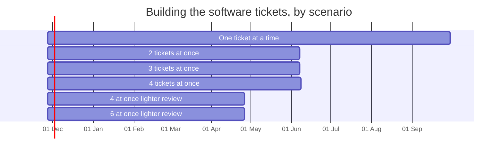
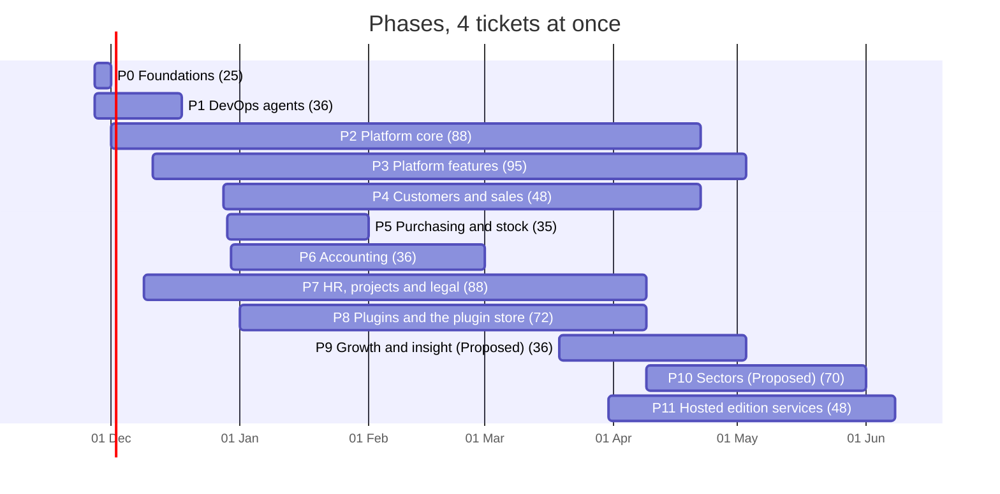
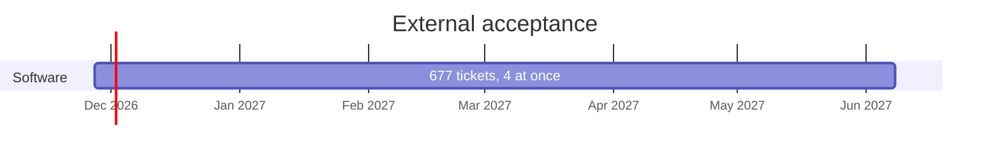

# ⛓️ Parallel plan

Which roadmap tickets can run at the same time, and when the software tickets can be built. Everything between the
markers below is written by `python3 .claude/scripts/reports/roadmap_gantt.py build`, never by hand.

<!-- gantt:plan -->

## 📆 Timeline

As of 27 Nov 2026: 0 of the 677 tickets are merged. The 677 software tickets left are scheduled in working days of 6 hours, without holidays. The [interactive Gantt chart](gantt/parallel-plan.html) shows every ticket.

| Scenario | Lanes | Review time | Working days | Built by | Review load |
| --- | --- | --- | --- | --- | --- |
| One ticket at a time | 1 | full | 220 | 30 Sep 2027 | 38 % |
| 2 tickets at once | 2 | full | 137 | 7 Jun 2027 | 62 % |
| 3 tickets at once | 3 | full | 137 | 7 Jun 2027 | 62 % |
| 4 tickets at once | 4 | full | 137 | 8 Jun 2027 | 62 % |
| 4 at once, lighter review | 4 | halved off the security-critical code | 107 | 26 Apr 2027 | 40 % |
| 6 at once, lighter review | 6 | halved off the security-critical code | 107 | 26 Apr 2027 | 40 % |
| Roadmap plan, the phases' own dates | | | 27 months | 16 Mar 2029 | |

With 4 tickets at once, every phase overlaps the others:

## ⛓️ Dependencies

**Ready now**, every ticket they need merged:

- T0.01: Mono-repo folders and workspaces
- T1.02: GitHub Apps and branch protection
- T1.06: Closed service skeleton and request models

**Critical path**, 51 tickets and 108 hours of work: the floor, whatever the number of lanes.

T0.01 › T0.03 › T0.04 › T0.09 › T0.14 › T0.18 › T0.20 › T0.23 › T2.01 › T2.12 › T2.30 › T2.40 › T2.51 › T2.60 › T3.06 › T3.16 › T3.27 › T3.37 › T3.50 › T3.94 › T4.05 › T4.12 › T4.13 › T4.14 › T4.16 › T4.25 › T4.38 › T4.39 › T4.42 › T5.21 › T5.25 › T5.30 › T6.05 › T6.13 › T6.15 › T6.27 › T6.31 › T6.32 › T6.36 › T7.14 › T7.26 › T8.47 › T8.49 › T8.50 › T8.51 › T8.52 › T8.53 › T8.60 › T10.28 › T10.59 › T10.69

**Waves**: a ticket's wave is one more than the latest wave of the tickets it needs. Tickets of a wave can run together when they share no area.

| Wave | Tickets | Count |
| --- | --- | --- |
| 1 | T0.01 T1.02 T1.06 | 3 |
| 2 | T0.02 T0.03 T0.05 T0.07 T0.08 T1.03 T1.08 | 7 |
| 3 | T0.04 T0.06 T0.15 T0.16 T1.05 T1.09 T1.11 T1.26 T1.28 T1.29 | 10 |
| 4 | T0.09 T0.10 T0.12 T0.17 T1.27 T1.31 | 6 |
| 5 | T0.11 T0.13 T0.14 T1.35 | 4 |
| 6 | T0.18 T0.19 T0.21 | 3 |
| 7 | T0.20 T0.22 T0.24 T0.25 | 4 |
| 8 | T0.23 T1.01 T2.04 T2.05 T2.06 T2.07 T2.08 | 7 |
| 9 | T1.04 T1.20 T2.01 T2.02 T2.03 T2.09 T2.10 T2.11 T2.14 T2.15 T2.16 T2.17 T2.22 T2.33 T2.72 T2.74 | 16 |
| 10 | T1.07 T1.12 T1.16 T1.17 T1.21 T1.30 T2.12 T2.13 T2.18 T2.19 T2.20 T2.21 T2.23 T2.25 T2.28 T2.32 T2.35 T2.36 T2.45 T2.53 T2.58 T2.81 | 22 |
| 11 | T1.10 T1.18 T1.22 T1.23 T1.24 T1.25 T2.24 T2.26 T2.27 T2.29 T2.30 T2.31 T2.34 T2.37 T2.41 T2.43 T2.44 T2.46 T2.54 T2.70 T2.71 T4.04 T6.01 T7.01 T7.02 T7.03 T7.04 T8.02 T8.19 T8.48 | 30 |
| 12 | T1.13 T1.19 T1.32 T1.33 T2.38 T2.39 T2.40 T2.42 T2.47 T2.48 T2.52 T2.56 T2.57 T2.59 T2.64 T2.73 T2.79 T2.86 T2.88 T3.04 | 20 |
| 13 | T1.14 T2.49 T2.50 T2.51 T2.55 T2.63 T2.67 T2.68 T2.69 T2.76 T2.77 T2.78 T2.80 T2.82 T2.87 T3.02 T3.05 | 17 |
| 14 | T1.15 T2.60 T2.61 T2.62 T2.65 T2.66 T2.75 T2.85 T3.03 T3.07 T3.15 T4.01 T4.03 T5.01 T6.02 T7.56 | 16 |
| 15 | T1.34 T1.36 T2.83 T2.84 T3.06 T3.09 T3.13 T3.18 T3.24 T3.25 T3.36 T4.02 T5.02 T5.10 T6.03 T6.04 T6.08 T6.10 T6.12 T8.61 T11.01 | 21 |
| 16 | T3.01 T3.08 T3.10 T3.11 T3.16 T3.17 T3.29 T3.30 T3.40 T3.41 T3.42 T3.48 T3.53 T3.54 T4.08 T5.04 T5.12 T6.06 T6.17 T6.24 T7.09 T7.11 T8.62 T8.63 T8.65 T11.03 T11.06 | 27 |
| 17 | T3.12 T3.14 T3.19 T3.20 T3.21 T3.22 T3.23 T3.26 T3.27 T3.28 T3.33 T3.38 T3.39 T3.47 T3.49 T3.60 T3.63 T3.64 T3.65 T3.66 T3.71 T5.08 T8.64 T8.66 T8.67 T11.07 T11.12 | 27 |
| 18 | T3.31 T3.32 T3.34 T3.35 T3.37 T3.44 T3.45 T3.46 T3.51 T3.52 T3.57 T3.59 T3.61 T3.74 T3.82 T3.83 T3.85 T8.68 T8.69 T8.70 T11.20 T11.34 | 22 |
| 19 | T3.43 T3.50 T3.55 T3.56 T3.58 T3.62 T3.67 T3.69 T3.70 T3.75 T3.76 T3.77 T3.78 T3.80 T3.87 T3.90 T3.93 T5.19 T6.11 T7.05 T9.01 T9.05 T11.17 T11.21 T11.22 T11.35 | 26 |
| 20 | T3.68 T3.72 T3.73 T3.79 T3.81 T3.86 T3.88 T3.89 T3.91 T3.92 T3.94 T7.06 T7.10 T7.13 T7.21 T7.22 T7.31 T7.33 T7.36 T7.42 T7.44 T9.03 T9.07 T9.17 | 24 |
| 21 | T3.84 T4.05 T7.12 T7.15 T7.23 T7.24 T7.27 T7.28 T7.37 T7.61 T9.06 T9.11 | 12 |
| 22 | T3.95 T4.06 T4.07 T4.09 T4.12 T5.03 T5.09 T7.07 T7.08 T7.16 T7.18 T7.25 T7.29 T7.32 T7.35 T7.43 T7.45 T9.18 T9.19 T9.20 | 20 |
| 23 | T4.10 T4.11 T4.13 T5.05 T5.23 T7.17 T7.30 T7.34 T7.38 T7.39 T7.41 T7.46 T7.47 T7.54 T7.57 | 15 |
| 24 | T4.14 T4.18 T4.20 T5.06 T5.07 T5.13 T7.40 T7.48 T7.50 T7.58 | 10 |
| 25 | T4.15 T4.16 T4.21 T4.36 T4.37 T5.11 T5.14 T5.16 T7.59 T7.60 T7.62 | 11 |
| 26 | T4.17 T4.19 T4.22 T4.23 T4.24 T4.25 T4.26 T4.27 T4.29 T4.30 T5.15 T5.17 T5.18 T5.33 | 14 |
| 27 | T4.28 T4.31 T4.33 T4.38 T4.40 T4.41 T5.28 | 7 |
| 28 | T4.32 T4.34 T4.35 T4.39 T4.43 T4.44 T4.45 | 7 |
| 29 | T4.42 T4.46 T4.47 | 3 |
| 30 | T4.48 T5.20 T5.21 T5.29 T6.07 T7.52 T9.02 T9.04 T9.29 T9.31 | 10 |
| 31 | T5.22 T5.24 T5.25 T5.31 T5.32 T5.35 T6.22 T6.23 T7.19 T7.64 T7.65 T9.12 T9.14 T9.16 T9.28 T9.30 T11.02 T11.04 T11.05 | 19 |
| 32 | T5.26 T5.27 T5.30 T5.34 T7.20 T7.66 T7.67 T7.68 T7.72 T7.76 T7.81 T9.13 T11.08 T11.09 T11.11 T11.13 T11.23 T11.24 T11.36 | 19 |
| 33 | T6.05 T6.09 T7.55 T7.69 T7.70 T7.73 T7.74 T7.75 T7.77 T7.79 T7.80 T7.82 T7.83 T7.86 T7.88 T8.01 T8.18 T8.33 T9.25 T9.26 T11.33 T11.46 T11.47 T11.48 | 24 |
| 34 | T6.13 T6.14 T6.29 T6.30 T7.84 T8.03 T8.20 T8.28 T8.34 T9.27 | 10 |
| 35 | T6.15 T6.16 T6.19 T6.20 T6.21 T6.28 T8.21 T8.35 T8.45 T8.71 | 10 |
| 36 | T6.18 T6.25 T6.26 T6.27 T6.33 T8.22 T8.25 T8.36 T8.37 T8.39 | 10 |
| 37 | T6.31 T8.23 T8.24 T8.26 T8.27 T8.29 T8.30 T8.31 T8.40 T8.41 T8.43 | 11 |
| 38 | T6.32 T6.34 T6.35 | 3 |
| 39 | T6.36 | 1 |
| 40 | T7.14 T7.49 T7.71 T7.78 T7.87 T8.04 T8.38 T9.08 | 8 |
| 41 | T7.26 T7.51 T7.53 T7.63 T7.85 T8.05 T8.14 T8.16 T8.44 T8.46 T9.09 | 11 |
| 42 | T8.06 T8.42 T8.47 T9.10 T11.16 T11.18 | 6 |
| 43 | T8.07 T8.08 T8.09 T8.13 T8.49 T8.72 T9.21 T9.22 T9.35 T11.19 T11.25 | 11 |
| 44 | T8.10 T8.15 T8.17 T8.32 T8.50 T9.24 T9.32 T9.34 T9.36 T10.01 T10.03 T10.04 T10.05 T10.06 T10.07 T10.09 T10.11 T10.13 T10.14 T10.33 T10.34 T10.35 T10.36 T11.10 T11.29 T11.30 T11.31 T11.40 T11.43 | 29 |
| 45 | T8.11 T8.12 T8.51 T8.54 T8.55 T8.56 T8.58 T9.33 T10.08 T10.10 T10.15 T10.17 T10.19 T10.20 T10.21 T10.27 T10.31 T10.37 T10.39 T10.40 T10.41 T10.45 T10.48 T10.49 T10.55 T10.57 T10.58 T10.60 T10.61 T10.63 T10.65 T11.14 T11.32 T11.44 T11.45 | 35 |
| 46 | T8.52 T8.57 T9.15 T10.02 T10.16 T10.22 T10.24 T10.29 T10.43 T10.44 T10.47 T10.53 T10.62 T10.64 T11.15 T11.41 | 16 |
| 47 | T8.53 T8.59 T10.18 T10.38 T10.42 T10.50 T10.68 T11.26 T11.27 T11.28 T11.37 T11.38 T11.39 T11.42 | 14 |
| 48 | T8.60 | 1 |
| 49 | T9.23 T10.12 T10.23 T10.25 T10.26 T10.28 T10.30 T10.51 T10.52 T10.56 T10.67 T10.70 | 12 |
| 50 | T10.32 T10.46 T10.54 T10.59 T10.66 | 5 |
| 51 | T10.69 | 1 |

## 🤝 External acceptance

0 software tickets are built and tested here first, but their acceptance waits for an external item: a partner, a real company or a certification. 0 more only exist once an external item has happened. These keep the dates of the roadmap: parallel work does not move them.

| Item | Date | Tickets waiting for it | Tickets after it |
| --- | --- | --- | --- |

<!-- /gantt:plan -->
