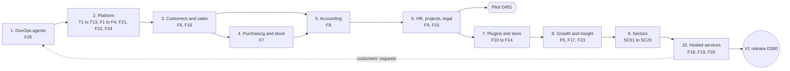

🏠 [Specs](../../README.md) › 🎯 [Vision](../README.md) › 🛣️ [Roadmap and options](README.md) › 🗺️ Roadmap

# 🗺️ Roadmap

**Status:** ✅ specified

The options for ordering V1, and the gaps of this plan, are compared in [Roadmap options](options/README.md); the
inventory of V1 is [What V1 holds](inventory.md).

## Build steps

Everything the specifications hold is in V1 ([D483](../../06-decisions/vision/d483-roadmap-devops-agents-first.md), D3,
[D380](../../06-decisions/vision/d380-every-capability-first-confirmed.md)): every functional capability F1 to F25,
every technical capability T1 to T13, the 20 sectors, the UX, the non-functional requirements and the France country
pack. V1 is built in ten steps; the DevOps agents come first so that they build the rest. The owner adopted this order,
option A of the [roadmap options](options/README.md), on 2026-11-27, cut into the twelve phases of
[Phases](phases/README.md) ([D569](../../06-decisions/vision/d569-roadmap-option-a-in-twelve-phases.md),
[Q20](../../07-questions/q20-which-roadmap-option-orders-v1.md)).

| Step | Capabilities | Depends on steps |
|---|---|---|
| 1. DevOps agents | F25 | none |
| 2. Platform | T1, T2, T3, T4, T5, T6, T7, T8, T9, T10, T11, T12, T13, F1, F2, F3, F4, F21, F22, F24 | 1 |
| 3. Customers and sales | F6, F16 | 2 |
| 4. Purchasing and stock | F7 | 3 |
| 5. Accounting | F8 | 3, 4 |
| 6. HR and projects, and the legal assistant | F9, F15 | 5 |
| 7. Plugins and the plugin store | F10, F11, F12, F13, F14 | 2 to 6 |
| 8. Growth and insight | F5, F17, F23 | 3 to 7 |
| 9. Sectors | SC01 to SC20 | 2 to 8 |
| 10. Hosted edition services | F18, F19, F20 | 1 to 9 |

## Steps in detail

### Step 1: DevOps agents

The factory first: agents that live in the CI turn each specification ticket into a tested pull request, which a
maintainer approves, so that every later step is built with them. Customers' requests reach them from step 10, through
the hosted support assistant (F20) and the USER features (GH-23).

**Capabilities:**

- [F25 DevOps agents (hosted edition)](../../02-functional/f25-devops-agents/README.md)

**Technical design:** [devops](../../../technical/operations/devops.md),
[ci cd and stages](../../../technical/delivery/ci-cd-and-stages.md),
[repository layout](../../../technical/architecture/repository-layout.md),
[infrastructure](../../../technical/infrastructure/infrastructure.md),
[ai operations](../../../technical/operations/ai-operations.md),
[supply chain and licences](../../../technical/security/supply-chain-and-licences.md).

**Non-functional requirements:** [security](../../05-non-functional/security.md),
[ai governance](../../05-non-functional/ai-governance.md).

**Exit criteria:** An agent turns a specification ticket of step 2 into a pull request that passes CI, its
evidence and a maintainer's review; its runners run in the isolated European cluster (D442).
### Step 2: Platform

The whole platform before any business area (D16): companies and isolation, identity, audit, plugins, API, MCP and A2A,
AI providers, RAG, install and updates, translations, the France law corpus, connectors; then administration, no-code
configuration (with the booking engine, portals and offline forms), the AI assistant, meetings, onboarding, cost
management and the integrations hub.

**Capabilities:**

- [T1 Companies and data isolation](../../03-technical/t01-companies-and-data-isolation/README.md)
- [T2 Identity and access engine](../../03-technical/t02-identity-and-access/README.md)
- [T3 Audit trail](../../03-technical/t03-audit-trail/README.md)
- [T4 Plugin runtime](../../03-technical/t04-plugin-runtime/README.md)
- [T5 API and webhooks](../../03-technical/t05-api-and-webhooks/README.md)
- [T6 MCP and A2A gateway](../../03-technical/t06-mcp-and-a2a-gateway/README.md)
- [T7 AI providers and models](../../03-technical/t07-ai-providers-and-models/README.md)
- [T8 RAG platform (Milvus)](../../03-technical/t08-rag-platform/README.md)
- [T9 Install, backups and updates](../../03-technical/t09-install-backups-and-updates/README.md)
- [T10 Translations and notifications](../../03-technical/t10-translations-and-notifications/README.md)
- [T11 Legal corpora](../../03-technical/t11-legal-corpora/README.md)
- [T12 Connectors and scrapers](../../03-technical/t12-connectors-and-scrapers/README.md)
- [T13 Maps and geodata](../../03-technical/t13-maps-and-geodata/README.md)
- [F1 Administration](../../02-functional/f01-administration/README.md)
- [F2 No-code configuration](../../02-functional/f02-no-code-configuration/README.md)
- [F3 Assistant](../../02-functional/f03-assistant/README.md)
- [F4 Meetings](../../02-functional/f04-meetings/README.md)
- [F21 Onboarding and module activation](../../02-functional/f21-onboarding-and-modules/README.md)
- [F22 Unified platform cost management](../../02-functional/f22-unified-cost-management/README.md)
- [F24 Integrations hub](../../02-functional/f24-integrations-hub/README.md)

**Technical design:** [architecture](../../../technical/architecture/architecture.md),
[backend](../../../technical/architecture/backend.md), [frontend](../../../technical/architecture/frontend.md),
[api](../../../technical/interfaces/api.md), [mcp](../../../technical/interfaces/mcp.md),
[a2a](../../../technical/interfaces/a2a.md), [data model](../../../technical/data/data-model.md),
[storage](../../../technical/data/storage.md), [configuration](../../../technical/architecture/configuration.md),
[security](../../../technical/security/security.md), [observability](../../../technical/operations/observability.md),
[performance and capacity](../../../technical/infrastructure/performance-and-capacity.md),
[deployment](../../../technical/infrastructure/deployment.md),
[operations](../../../technical/operations/operations.md),
[release and versioning](../../../technical/delivery/release-and-versioning.md),
[tests and traceability](../../../technical/delivery/tests-and-traceability.md),
[plugin sdk](../../../technical/interfaces/plugin-sdk.md).

**Non-functional requirements:** [performance](../../05-non-functional/performance.md),
[scalability](../../05-non-functional/scalability.md), [availability](../../05-non-functional/availability.md),
[backups](../../05-non-functional/backups.md), [updates](../../05-non-functional/updates.md),
[installation](../../05-non-functional/installation.md), [data isolation](../../05-non-functional/data-isolation.md),
[security](../../05-non-functional/security.md), [privacy gdpr](../../05-non-functional/privacy-gdpr.md),
[data retention](../../05-non-functional/data-retention.md), [observability](../../05-non-functional/observability.md),
[localisation](../../05-non-functional/localisation.md), [accessibility](../../05-non-functional/accessibility.md),
[ai governance](../../05-non-functional/ai-governance.md),
[meeting recording](../../05-non-functional/meeting-recording.md).

**Exit criteria:** One company runs on the laptop profile (8 GB) and on Kubernetes; every T requirement has
its tests; F1 to F4, F21, F22 and F24 pass their acceptance criteria.
### Step 3: Customers and sales

Quotes to cash with the customer portal, multi-payer invoicing, commissions and targets; then the customer support
agents, which use F6's requests and customer data.

**Capabilities:**

- [F6 Customers and sales](../../02-functional/f06-customers-and-sales/README.md)
- [F16 Customer support agents](../../02-functional/f16-customer-support-agents/README.md)

**Non-functional requirements:** [legal france](../../05-non-functional/legal-france.md).

**Exit criteria:** F6 and F16 pass their acceptance criteria on the example companies.
### Step 4: Purchasing and stock

Procure to stock with the supplier portal and the scanners.

**Capabilities:**

- [F7 Purchasing and stock](../../02-functional/f07-purchasing-and-stock/README.md)

**Exit criteria:** F7 passes its acceptance criteria.
### Step 5: Accounting

The books, VAT, the FEC, grants and third-party funds, and e-invoicing through Super PDP and B2Brouter (D454).

**Capabilities:**

- [F8 Accounting](../../02-functional/f08-accounting/README.md)

**Non-functional requirements:** [legal france](../../05-non-functional/legal-france.md),
[e invoicing platforms](../../05-non-functional/e-invoicing-platforms.md).

**Exit criteria:** F8 passes its acceptance criteria; an e-invoice goes through each platform's sandbox.
### Step 6: HR and projects, and the legal assistant

People, time, projects, rounds and capacity; then the legal assistant, which answers on a person's own situation from
F9's data.

**Capabilities:**

- [F9 HR and projects](../../02-functional/f09-hr-and-projects/README.md)
- [F15 Legal assistant](../../02-functional/f15-legal-assistant/README.md)

**Non-functional requirements:** [legal advice limits](../../05-non-functional/legal-advice-limits.md),
[legal france](../../05-non-functional/legal-france.md).

**Exit criteria:** F9 and F15 pass their acceptance criteria; the pilot of D451 can start.
### Step 7: Plugins and the plugin store

Point of sale, online shop, manufacturing with recipes, and payroll, built only on the public plugin API like a third
party (D15); then the store that distributes them and every other plugin.

**Capabilities:**

- [F10 Point of sale (plugin)](../../02-functional/f10-point-of-sale/README.md)
- [F11 Online shop (plugin)](../../02-functional/f11-online-shop/README.md)
- [F12 Manufacturing (plugin)](../../02-functional/f12-manufacturing/README.md)
- [F13 Payroll (plugin)](../../02-functional/f13-payroll/README.md)
- [F14 Plugin store](../../02-functional/f14-plugin-store/README.md)

**Exit criteria:** F10 to F14 pass their acceptance criteria; each plugin installs, updates and uninstalls
from the store.
### Step 8: Growth and insight

Social media and marketing with events and ticketing, competitive analysis, and what-if simulation, which read the data
of the steps before.

**Capabilities:**

- [F5 Social media and marketing](../../02-functional/f05-social-media/README.md)
- [F17 Competitive analysis](../../02-functional/f17-competitive-analysis/README.md)
- [F23 What-if simulation and impact](../../02-functional/f23-what-if-simulation/README.md)

**Exit criteria:** F5, F17 and F23 pass their acceptance criteria.
### Step 9: Sectors

The 20 sector packs: their record types, rules, documents, screens and regulation, installed through F2 and F14 on the
capabilities above.

**Capabilities:**

- [SC01 Construction](../../08-sectors/sc01-construction/README.md)
- [SC02 Retail](../../08-sectors/sc02-retail/README.md)
- [SC03 Services](../../08-sectors/sc03-services/README.md)
- [SC04 Home care](../../08-sectors/sc04-home-care/README.md)
- [SC05 Manufacturing](../../08-sectors/sc05-manufacturing/README.md)
- [SC06 Restaurant and hospitality](../../08-sectors/sc06-hospitality/README.md)
- [SC07 Transport and logistics](../../08-sectors/sc07-transport/README.md)
- [SC08 Non-profit association](../../08-sectors/sc08-non-profit/README.md)
- [SC09 Health practices](../../08-sectors/sc09-health-practices/README.md)
- [SC10 Real estate](../../08-sectors/sc10-real-estate/README.md)
- [SC11 Professional firms](../../08-sectors/sc11-professional-firms/README.md)
- [SC12 Education and training](../../08-sectors/sc12-education-and-training/README.md)
- [SC13 Agriculture and food](../../08-sectors/sc13-agriculture-and-food/README.md)
- [SC14 IT and software](../../08-sectors/sc14-it-and-software/README.md)
- [SC15 Wholesale and distribution](../../08-sectors/sc15-wholesale-and-distribution/README.md)
- [SC16 Events and culture](../../08-sectors/sc16-events-and-culture/README.md)
- [SC17 Beauty and wellness](../../08-sectors/sc17-beauty-and-wellness/README.md)
- [SC18 Sports and fitness](../../08-sectors/sc18-sports-and-fitness/README.md)
- [SC19 Trades and home services](../../08-sectors/sc19-trades-and-home-services/README.md)
- [SC20 Public bodies](../../08-sectors/sc20-public-bodies/README.md)

**Non-functional requirements:** [sector technical standards](../../05-non-functional/sector-technical-standards.md).

**Exit criteria:** Each sector's example company runs its use cases end to end.
### Step 10: Hosted edition services

The publisher's closed services (D388): hosted websites and domains, the feature factory, and the hosted support
assistant, which also brings customers' requests to the DevOps agents of step 1.

**Capabilities:**

- [F18 Hosted websites and domains (hosted edition)](../../02-functional/f18-hosted-websites-and-domains/README.md)
- [F19 Feature factory (hosted edition)](../../02-functional/f19-feature-factory/README.md)
- [F20 Hosted support assistant (hosted edition)](../../02-functional/f20-hosted-support-assistant/README.md)

**Non-functional requirements:** [availability](../../05-non-functional/availability.md).

**Exit criteria:** F18 to F20 pass their acceptance criteria on the hosted clusters; a customer's request
reaches the DevOps agents as a USER feature.
## Dependency graph

## Pilot and release

- The pilot ([D451](../../06-decisions/vision/d451-dated-pilot-before-the-release.md)) runs F1 to F4 and F6 to F9 with
  e-invoicing through an approved platform once step 6 (P7) is built; F5 follows in step 8 (P9). Its date of
  1 September 2027 is superseded by the phase calendar ([D569](../../06-decisions/vision/d569-roadmap-option-a-in-twelve-phases.md)).
- V1 is released once every step is built and the 20 sectors run
  ([D380](../../06-decisions/vision/d380-every-capability-first-confirmed.md)).
- [Q16](../../07-questions/q16-pilot-before-the-first-release.md) is answered by D451, and
  [Q20](../../07-questions/q20-which-roadmap-option-orders-v1.md) by D569.

## The first plan

The owner's first plan (READ.md, D3, D16), kept as written; its order is now steps 2 to 7, after the DevOps agents
(D483):

Every capability is in the first version (D3). They are built in four steps: the whole platform first, then the business
areas in order, then the plugins. Each capability will get its own chapter, with its user stories, flows, business
rules, data, errors and acceptance criteria.

The earlier IDs (P, B, X) are mapped in
[D26](../../06-decisions/foundations/d26-technical-and-functional-capabilities.md).

---

⬆️ [Up](README.md) · ➡️ [What V1 holds](inventory.md)
