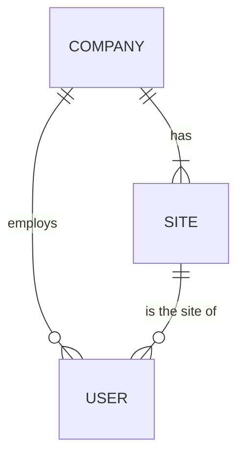
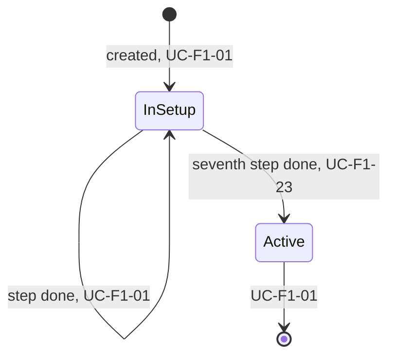

🏠 [Specs](../../../README.md) › 🧩 [Functional capabilities](../../README.md) › 🛡️ [F1 Administration](../README.md) ›
🗃️ [Data](README.md) › 🗃️ E-F1-01 Company

# 🗃️ E-F1-01 Company

**Status:** ✅ specified

## Purpose

A client company using simple-ERP, with its own database (D19).

## Fields

| Name | Type | Required | Validation | Default | Example | Personal data | Custom fields |
|---|---|---|---|---|---|---|---|
| name | text | yes | 1 to 200 characters | - | Acme Bâtiment SAS | no | - |
| legal form | list | yes | French legal forms, or other | - | SAS | no | - |
| SIREN | text | yes in France | 9 digits, Luhn key | - | 552100554 | no | - |
| VAT number | text | before the first invoice | FR + key + SIREN in France | - | FR40552100554 | no | - |
| address | address | yes | - | - | 12 rue des Lilas, 69003 Lyon | no | - |
| logo | image | no | PNG or SVG, up to 2 MB | - | logo.svg | no | - |
| currency | list | yes | ISO 4217 | EUR | EUR | no | - |
| fiscal year start | date | yes | - | 1 January | 1 January | no | - |
| VAT regime | list | yes | French regimes | - | normal monthly | no | - |
| sector pack | list | yes | one of eight, or none | - | construction | no | - |
| setup step | number | yes | 1 to 7, then done | 1 | 4 | no | - |

## Relations

The same item as [E-T01-01 Company](../../../03-technical/t01-companies-and-data-isolation/data/e-t01-01-company.md)
([D516](../../../06-decisions/foundations/d516-naming-rules-and-the-seven-classes-of-names.md), rule 4).

## Lifecycle

## Indexes and search

One company per database; found by name and SIREN on the provider's platform.

## Retention

⬜ To be specified with T1.

## Audit

Every change of identity, money settings and sector pack.

## Import and export

Created by UC-F1-01 or UC-F1-10; no import.

## Used by

- [UC-F1-01 Set up a new company](../use-cases/01-guided-setup/uc-f01-01-set-up-a-new-company.md)
- [UC-F1-10 Create a client company on the platform](../use-cases/08-provider-and-client-companies/uc-f01-10-create-a-client-company-on-the-platform.md)
- [UC-F1-23 Close a company and export all its data](../use-cases/14-close-a-company/uc-f01-23-close-a-company-and-export-all-its-data.md)

## Open questions

None.

---

⬆️ [Up](README.md) · ➡️ [E-F1-02 Company site](e-f01-02-company-site.md)
