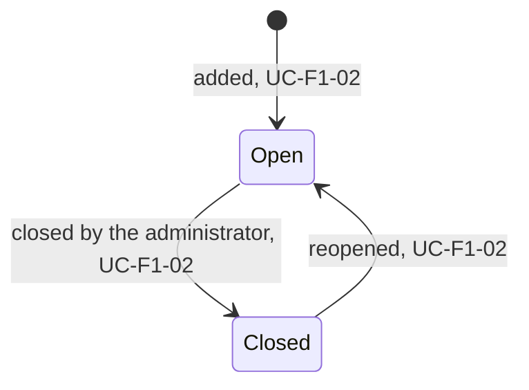

🏠 [Specs](../../../README.md) › 🧩 [Functional capabilities](../../README.md) › 🛡️ [F1 Administration](../README.md) ›
🗃️ [Data](README.md) › 🗃️ E-F1-02 Company site

# 🗃️ E-F1-02 Company site

**Status:** ✅ specified

## Purpose

A location of a company: the head office or another site (D32, D36).

## Fields

| Name | Type | Required | Validation | Default | Example | Personal data | Custom fields |
|---|---|---|---|---|---|---|---|
| name | text | yes | 1 to 100 characters | Head office | Lyon yard | no | yes |
| address | address | yes | - | the company's | 4 chemin du Port, 69007 Lyon | no | - |
| opening hours | weekly hours | no | - | - | Mon to Fri 7:30 to 17:00 | no | - |
| holds stock | yes or no | yes | - | no | yes | no | - |
| manager | user | no | an active user | - | Marie Dupont | yes (a name) | - |
| head office | yes or no | yes | exactly one per company | - | no | no | - |
| SIRET | 14 digits | no | starts with the company's SIREN (CR-FR-001) | - | 123 456 789 00012 | no | - |

## Relations

See [E-F1-01 Company](e-f01-01-company.md#relations).

## Lifecycle

## Indexes and search

By name, within the company.

## Retention

A closed site is kept, for the history of its stock and staff.

## Audit

Every change of address, hours, stock and manager.

## Import and export

Created in setup step 3 or by UC-F1-02; no import.

## Used by

- [UC-F1-01 Set up a new company](../use-cases/01-guided-setup/uc-f01-01-set-up-a-new-company.md)
- [UC-F1-02 Add or change a site](../use-cases/02-manage-sites/uc-f01-02-add-or-change-a-site.md)
- [UC-F1-15 Administer the users of one's own site](../use-cases/10-bring-users-in-at-scale/uc-f01-15-administer-the-users-of-ones-own-site.md)

## Open questions

None.

---

⬅️ [E-F1-01 Company](e-f01-01-company.md) · ⬆️ [Up](README.md) · ➡️ [E-F1-03 User](e-f01-03-user.md)
