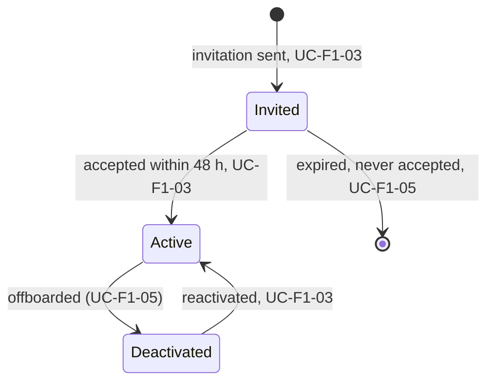

🏠 [Specs](../../../README.md) › 🧩 [Functional capabilities](../../README.md) › 🛡️ [F1 Administration](../README.md) ›
🗃️ [Data](README.md) › 🗃️ E-F1-03 User

# 🗃️ E-F1-03 User

**Status:** ✅ specified

## Purpose

A person who signs in to a company: an employee, or an outside user (accountant, portal, provider).

## Fields

| Name | Type | Required | Validation | Default | Example | Personal data | Custom fields |
|---|---|---|---|---|---|---|---|
| name | text | yes | - | from the HR record | Marie Dupont | yes | - |
| email | email | yes | unique in the company (BR-F1-07) | - | marie@acme.fr | yes | - |
| roles | list of roles | yes | at least one | - | Sales | no | - |
| site | site | yes for employees | an open site | - | Lyon yard | no | - |
| manager | user | no | an active user | - | P. Martin | yes | - |
| language | list | yes | French or English | the invitation's | Français | no | - |
| HR record | link to F9 | no | - | - | Marie Dupont (F9) | yes | - |
| status | list | yes | invited, active, deactivated | invited | active | no | - |
| density | list | yes | comfortable or compact | the role's (D42) | compact | no | - |

## Relations

See [E-F1-01 Company](e-f01-01-company.md#relations).

## Lifecycle

## Indexes and search

By name and email, with filters on site, role and status.

## Retention

⬜ To be specified with T2 and the GDPR page.

## Audit

Every change of roles, site, manager, status and HR link.

## Import and export

No import of users (D55).

## Used by

- [UC-F1-03 Invite a user](../use-cases/03-user-lifecycle/uc-f01-03-invite-a-user.md)
- [UC-F1-04 Change a user's role or site](../use-cases/03-user-lifecycle/uc-f01-04-change-a-users-role-or-site.md)
- [UC-F1-05 Deactivate and offboard a user](../use-cases/03-user-lifecycle/uc-f01-05-deactivate-and-offboard-a-user.md)
- [UC-F1-13 Provision users from the identity provider](../use-cases/10-bring-users-in-at-scale/uc-f01-13-provision-users-from-the-identity-provider.md)
- [UC-F1-14 Invite users in bulk](../use-cases/10-bring-users-in-at-scale/uc-f01-14-invite-users-in-bulk.md)
- [UC-F1-15 Administer the users of one's own site](../use-cases/10-bring-users-in-at-scale/uc-f01-15-administer-the-users-of-ones-own-site.md)
- [UC-F1-16 Delegate approvals during an absence](../use-cases/11-team-delegation-and-access-review/uc-f01-16-delegate-approvals-during-an-absence.md)
- [UC-F1-17 See my team's accounts and pending requests](../use-cases/11-team-delegation-and-access-review/uc-f01-17-see-my-teams-accounts-and-pending-requests.md)
- [UC-F1-18 Run an access review campaign](../use-cases/11-team-delegation-and-access-review/uc-f01-18-run-an-access-review-campaign.md)

## Open questions

None.

---

⬅️ [E-F1-02 Company site](e-f01-02-company-site.md) · ⬆️ [Up](README.md) ·
➡️ [E-F1-04 Invitation](e-f01-04-invitation.md)
