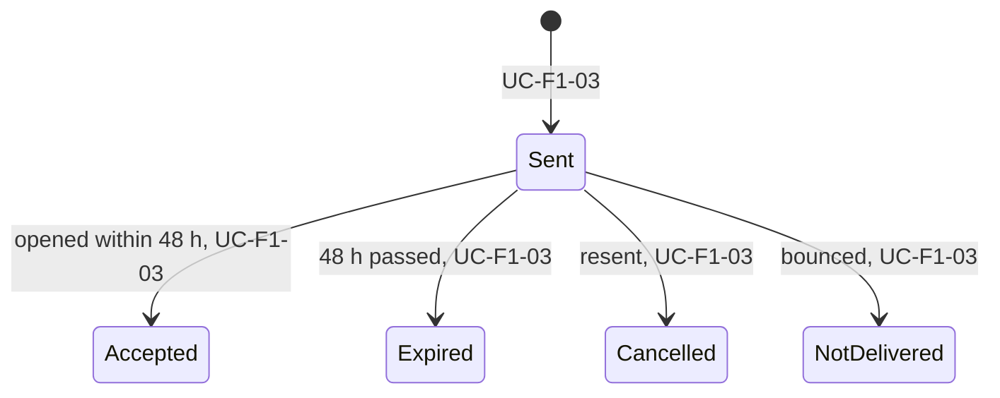

🏠 [Specs](../../../README.md) › 🧩 [Functional capabilities](../../README.md) › 🛡️ [F1 Administration](../README.md) ›
🗃️ [Data](README.md) › 🗃️ E-F1-04 Invitation

# 🗃️ E-F1-04 Invitation

**Status:** ✅ specified

## Purpose

An invitation sent to an email, valid 48 hours, once (BR-F1-06).

## Fields

| Name | Type | Required | Validation | Default | Example | Personal data | Custom fields |
|---|---|---|---|---|---|---|---|
| email | email | yes | no account in the company | - | paul@acme.fr | yes | - |
| settings | roles, site, manager, language, HR record | yes | as E-F1-03 | - | Employee, Head office | yes | - |
| sent at | date and time | yes | - | now | 2026-11-10 09:00 | no | - |
| expires at | date and time | yes | sent at + 48 h | - | 2026-11-12 09:00 | no | - |
| status | list | yes | sent, accepted, expired, cancelled, not delivered | sent | sent | no | - |

### Capability extension: F21 Onboarding and module activation

From [E-F21-06 Invitation](../../f21-onboarding-and-modules/data/e-f21-06-invitation.md), merged here
([D516](../../../06-decisions/foundations/d516-naming-rules-and-the-seven-classes-of-names.md), shared name
"Invitation"). A user invited during onboarding.

| Name | Type | Required | Validation | Default | Example | Personal data | Custom fields |
|---|---|---|---|---|---|---|---|
| email, roles, sent | records | yes | - | - | a@acme.example, sales, 2026-11-12 | yes | no |

### Merged in: E-SC12-19 Session invitation

From
[E-SC12-19 Session invitation](../../../08-sectors/sc12-education-and-training/data/e-sc12-19-session-invitation.md),
merged here (the owner's answer S2-9 of 2026-11-13). (Proposed) The session invitation the flow charts name with the
words "Invitations"
([FL-SC12-02](../../../08-sectors/sc12-education-and-training/flows/fl-sc12-02-enrol-and-fund.md)). The owner decided
to create it ([D516](../../../06-decisions/foundations/d516-naming-rules-and-the-seven-classes-of-names.md)); what
it holds waits for the owner's confirmation.

## Relations

An accepted invitation creates one User.

## Lifecycle

## Indexes and search

Shown with the users, status "invited".

## Retention

Kept 90 days after it ends, then deleted.

## Audit

See UC-F1-03's audit events.

## Import and export

None.

## Used by

- [UC-F1-03 Invite a user](../use-cases/03-user-lifecycle/uc-f01-03-invite-a-user.md)
- [UC-F1-14 Invite users in bulk](../use-cases/10-bring-users-in-at-scale/uc-f01-14-invite-users-in-bulk.md)
- [UC-F21-08 Invite users and give roles](../../f21-onboarding-and-modules/use-cases/03-team-and-data/uc-f21-08-invite-users-and-give-roles.md)
- [UC-F21-17 Welcome an employee at first sign-in](../../f21-onboarding-and-modules/use-cases/04-learn-and-improve/uc-f21-17-welcome-an-employee-at-first-sign-in.md)
- [UC-F21-23 Invite the external accountant](../../f21-onboarding-and-modules/use-cases/03-team-and-data/uc-f21-23-invite-the-external-accountant.md)
- [UC-SC12-05 Send invitations and needs assessments](../../../08-sectors/sc12-education-and-training/use-cases/02-enrol-and-fund/uc-sc12-05-send-invitations-and-needs-assessments.md)

## Open questions

None.

---

⬅️ [E-F1-03 User](e-f01-03-user.md) · ⬆️ [Up](README.md) ·
➡️ [E-F1-05 Former-employee access](e-f01-05-former-employee-access.md)
