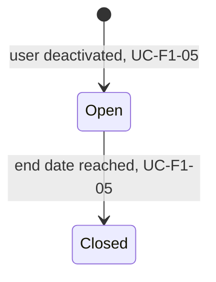

🏠 [Specs](../../../README.md) › 🧩 [Functional capabilities](../../README.md) › 🛡️ [F1 Administration](../README.md) ›
🗃️ [Data](README.md) › 🗃️ E-F1-05 Former-employee access

# 🗃️ E-F1-05 Former-employee access

**Status:** ✅ specified

## Purpose

A former employee's read-only access to their own payslips and HR papers (D74).

## Fields

| Name | Type | Required | Validation | Default | Example | Personal data | Custom fields |
|---|---|---|---|---|---|---|---|
| former user | user | yes | a deactivated user | - | Luc Bernard | yes | - |
| email | email | yes | - | the user's | luc.bernard@mail.fr | yes | - |
| opened at | date | yes | - | deactivation | 2026-11-30 | no | - |
| ends at | date | yes | [Q12](../../../07-questions/q12-payslip-availability-period.md) | - | - | no | - |

## Relations

One per former employee, on their deactivated user (E-F1-03).

## Lifecycle

## Indexes and search

By the former user.

## Retention

Until its end date: [Q12](../../../07-questions/q12-payslip-availability-period.md).

## Audit

Each document downloaded.

## Import and export

None.

## Used by

- [UC-F1-05](../use-cases/03-user-lifecycle/uc-f01-05-deactivate-and-offboard-a-user.md)

## Open questions

- [Q12 Payslip availability period](../../../07-questions/q12-payslip-availability-period.md)

---

⬅️ [E-F1-04 Invitation](e-f01-04-invitation.md) · ⬆️ [Up](README.md) · ➡️ [E-F1-06 Role](e-f01-06-role.md)
