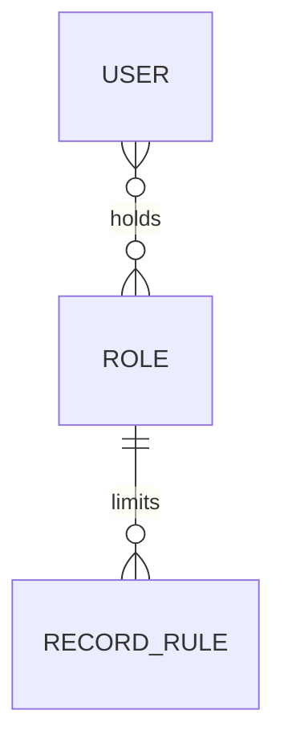
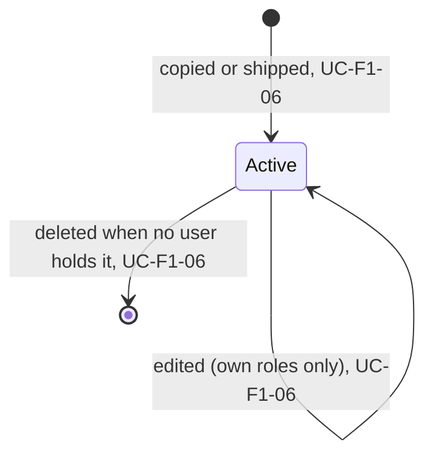

🏠 [Specs](../../../README.md) › 🧩 [Functional capabilities](../../README.md) › 🛡️ [F1 Administration](../README.md) ›
🗃️ [Data](README.md) › 🗃️ E-F1-06 Role

# 🗃️ E-F1-06 Role

**Status:** ✅ specified

## Purpose

A set of rights given to users: ready-made or the company's own (D12, D78). Among them, the map right shows records on
a map (D502), and the planner mark says that the role's holders plan other people's work (D503).

## Fields

| Name | Type | Required | Validation | Default | Example | Personal data | Custom fields |
|---|---|---|---|---|---|---|---|
| name | text | yes | unique in the company | - | Sales Lyon | no | - |
| ready-made | yes or no | yes | - | no | no | no | - |
| copied from | role | no | - | - | Sales | no | - |
| matrix | rows of See, Create, Change, Delete, Approve, Export | yes | - | the source role's | see the role editor | no | - |
| map right | yes or no | yes | a warning when given to a role that is neither a planner nor a manager role ([BR-F1-32](../business-rules/br-f01-32-map-right-for-planners-and-managers.md)) | the source role's | yes | no | - |
| planner | yes or no | yes | marks the roles whose holders plan other people's work | the source role's | yes | no | - |
| default density | comfortable or compact | yes | - | the source role's (D42) | compact | no | - |

The ready-made roles that are planner roles, and hold the map right (D517): Dispatcher (U29), Care coordinator
(U25), Site manager (U22), Engagement manager (U24), Production planner (U21), Store manager (U23), Training
coordinator (U38), Property manager (U34), Event producer (U43), Hotel receptionist (U28). The ready-made Manager role
(U02) and the owner (U13) hold the map right without being planner roles. A planner sees the positions of the people
their record rules cover ([BR-F9-32](../../f09-hr-and-projects/business-rules/br-f09-32-who-sees-a-position.md)).

## Relations

## Lifecycle

## Indexes and search

By name.

## Retention

A deleted role is kept in the audit trail only.

## Audit

Every change, cell by cell.

## Import and export

Export of the matrix, for audits.

## Used by

- [UC-F1-06](../use-cases/04-edit-a-role/uc-f01-06-edit-a-role-and-its-record-rules.md)
- [UC-F1-15 Administer the users of one's own site](../use-cases/10-bring-users-in-at-scale/uc-f01-15-administer-the-users-of-ones-own-site.md)
- [UC-F1-18 Run an access review campaign](../use-cases/11-team-delegation-and-access-review/uc-f01-18-run-an-access-review-campaign.md)
- [UC-F1-20 Create and revoke API tokens and service accounts](../use-cases/12-portal-accounts-and-integrations/uc-f01-20-create-and-revoke-api-tokens-and-service-accounts.md)
- [UC-F9-36 See work and places on a map](../../f09-hr-and-projects/use-cases/12-schedule-customer-requests/uc-f09-36-see-work-and-places-on-a-map.md)
- [UC-F9-33 Schedule a work request](../../f09-hr-and-projects/use-cases/12-schedule-customer-requests/uc-f09-33-schedule-a-work-request.md)

## Open questions

None.

---

⬅️ [E-F1-05 Former-employee access](e-f01-05-former-employee-access.md) · ⬆️ [Up](README.md) ·
➡️ [E-F1-07 Record rule](e-f01-07-record-rule.md)
