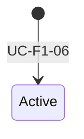

🏠 [Specs](../../../README.md) › 🧩 [Functional capabilities](../../README.md) › 🛡️ [F1 Administration](../README.md) ›
🗃️ [Data](README.md) › 🗃️ E-F1-07 Record rule

# 🗃️ E-F1-07 Record rule

**Status:** ✅ specified

## Purpose

A limit on the records a role's row applies to (BR-F1-12).

## Fields

| Name | Type | Required | Validation | Default | Example | Personal data | Custom fields |
|---|---|---|---|---|---|---|---|
| row | capability of a role | yes | - | - | Quotes | no | - |
| kind | list | yes | own records, own site, own team, amount limit | - | amount limit | no | - |
| amount | money | for amount limits | positive | - | 5,000 EUR | no | - |
| applies to | action | for amount limits | Approve, Create | Approve | Approve | no | - |

## Relations

See [E-F1-06 Role](e-f01-06-role.md#relations).

## Lifecycle

Created, changed and removed with its role.

## Indexes and search

With its role.

## Retention

With its role.

## Audit

With its role.

## Import and export

With its role.

## Used by

- [UC-F1-06](../use-cases/04-edit-a-role/uc-f01-06-edit-a-role-and-its-record-rules.md)

## Open questions

None.

---

⬅️ [E-F1-06 Role](e-f01-06-role.md) · ⬆️ [Up](README.md) · ➡️ [E-F1-08 Agent connection](e-f01-08-agent-connection.md)
