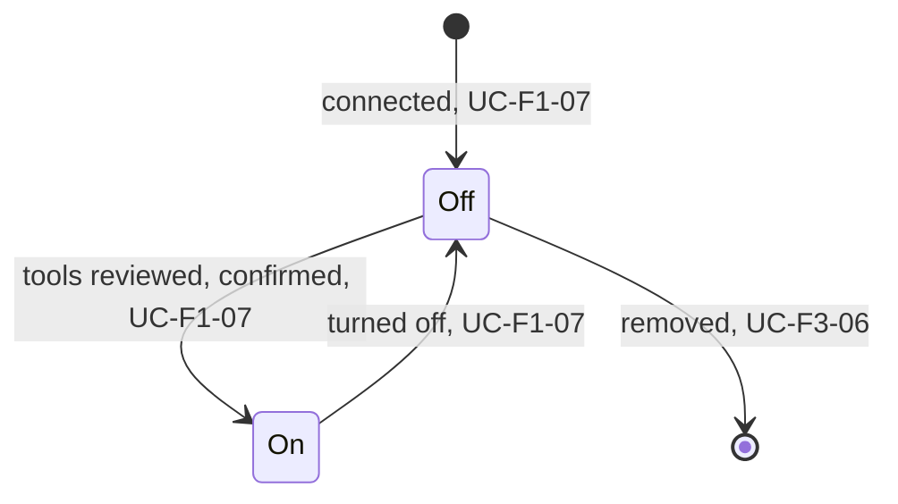

🏠 [Specs](../../../README.md) › 🧩 [Functional capabilities](../../README.md) › 🛡️ [F1 Administration](../README.md) ›
🗃️ [Data](README.md) › 🗃️ E-F1-08 Agent connection

# 🗃️ E-F1-08 Agent connection

**Status:** ✅ specified

## Purpose

An outside MCP server or A2A agent the company's AI assistants may use (D6, D79).

## Fields

| Name | Type | Required | Validation | Default | Example | Personal data | Custom fields |
|---|---|---|---|---|---|---|---|
| name | text | yes | unique | - | GitHub | no | - |
| kind | list | yes | MCP server, A2A agent, outside API (D139) | - | MCP server | no | - |
| address | URL | yes | HTTPS outside the local network | - | https://api.githubcopilot.com/mcp | no | - |
| credentials | secret | depends | stored encrypted, never shown again | - | (hidden) | no | - |
| tools | list | yes | each on or off | all off until reviewed | 28 of 40 on | no | - |
| changes | list | yes | always ask, trusted | always ask | always ask | no | - |
| status | list | yes | on, off | off | on | no | - |
| data categories | list | yes | none, business data, personal data (D169) | none | business data | no | - |
| monthly call cap | number | no | per connection, and per user (D172) | no cap | 1,000 | no | - |
| personal accounts | yes or no | yes | users may connect their own account (D171) | no | yes | no | - |

## Relations

A connection is a row of every role's matrix (D80).

## Lifecycle

## Indexes and search

By name and kind.

## Retention

A removed connection's calls stay in the audit trail.

## Audit

See UC-F1-07's audit events.

## Import and export

None.

## Used by

- [UC-F1-07](../use-cases/05-connect-an-external-tool/uc-f01-07-connect-an-external-mcp-server-or-a2a-agent.md)

## Open questions

None.

---

⬅️ [E-F1-07 Record rule](e-f01-07-record-rule.md) · ⬆️ [Up](README.md) ·
➡️ [E-F1-09 AI feature setting](e-f01-09-ai-feature-setting.md)
