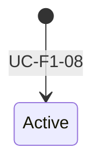

🏠 [Specs](../../../README.md) › 🧩 [Functional capabilities](../../README.md) › 🛡️ [F1 Administration](../README.md) ›
🗃️ [Data](README.md) › 🗃️ E-F1-09 AI feature setting

# 🗃️ E-F1-09 AI feature setting

**Status:** ✅ specified

## Purpose

Where one AI feature runs (D5, D82).

The Default setting applies to every AI feature without its own row (F7, F8, F11 to F14, F16, F17, F21 to F24 and the
sectors) until an administrator gives it one; the hosted-only services (F18, F19, F20, F25) use the publisher's
providers of D440, shown read-only.

## Fields

| Name | Type | Required | Validation | Default | Example | Personal data | Custom fields |
|---|---|---|---|---|---|---|---|
| feature | list | yes | Assistant (F3), Meetings: speech-to-text (F4), Meetings: summaries (F4), Legal assistant (F15), Social media drafts (F5), Workflow AI steps (F2, D133), Assistant voice (F3, D145), Photo reading (F3, D183), Default (every other AI feature) | - | Legal assistant (F15) | no | - |
| provider | list | yes | local, or an external provider | local | Claude | no | - |
| key | secret | for external | stored encrypted, never shown again | - | (hidden) | no | - |
| time limit | seconds | yes | 5 to 120 | 20 | 20 | no | - |

## Relations

One per feature and company.

The same item as
[E-T07-02 AI feature setting](../../../03-technical/t07-ai-providers-and-models/data/e-t07-02-ai-feature-setting.md)
([D516](../../../06-decisions/foundations/d516-naming-rules-and-the-seven-classes-of-names.md), rule 4).

## Lifecycle

Changed by UC-F1-08; never deleted.

## Indexes and search

By feature.

## Retention

As long as the company.

## Audit

See UC-F1-08's audit events.

## Import and export

None.

## Used by

- [UC-F1-08](../use-cases/06-choose-an-ai-provider/uc-f01-08-choose-the-ai-provider-of-a-feature.md)

## Open questions

None.

---

⬅️ [E-F1-08 Agent connection](e-f01-08-agent-connection.md) · ⬆️ [Up](README.md) ·
➡️ [E-F1-10 Single sign-on setting](e-f01-10-single-sign-on-setting.md)
