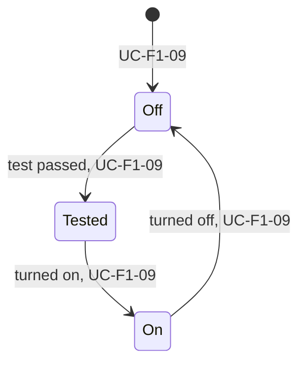

🏠 [Specs](../../../README.md) › 🧩 [Functional capabilities](../../README.md) › 🛡️ [F1 Administration](../README.md) ›
🗃️ [Data](README.md) › 🗃️ E-F1-10 Single sign-on setting

# 🗃️ E-F1-10 Single sign-on setting

**Status:** ✅ specified

## Purpose

How a company's users sign in through its identity provider (D85 to D87).

## Fields

| Name | Type | Required | Validation | Default | Example | Personal data | Custom fields |
|---|---|---|---|---|---|---|---|
| provider | list | yes | Google Workspace, Microsoft Entra ID, OpenID Connect, SAML 2.0 | - | Microsoft Entra ID | no | - |
| details | client ID and secret, discovery address, or SAML metadata | yes | secrets stored encrypted | - | (hidden) | no | - |
| allowed domains | list | yes | at least one | - | acme.fr | no | - |
| default role | role | yes | - | Employee | Employee | no | - |
| default site | site | yes | an open site | the head office | Head office | no | - |
| tested | date | no | - | - | 2026-11-10 | no | - |
| status | list | yes | off, on | off | on | no | - |

## Relations

One per company.

## Lifecycle

## Indexes and search

One per company.

## Retention

As long as the company.

## Audit

See UC-F1-09's audit events.

## Import and export

SAML metadata can be imported as a file.

## Used by

- [UC-F1-09](../use-cases/07-set-up-single-sign-on/uc-f01-09-set-up-single-sign-on.md)
- [UC-F1-13 Provision users from the identity provider](../use-cases/10-bring-users-in-at-scale/uc-f01-13-provision-users-from-the-identity-provider.md)

## Open questions

None.

---

⬅️ [E-F1-09 AI feature setting](e-f01-09-ai-feature-setting.md) · ⬆️ [Up](README.md) ·
➡️ [E-F1-11 Company template](e-f01-11-company-template.md)
