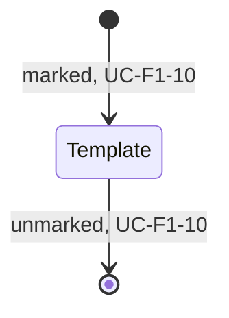

🏠 [Specs](../../../README.md) › 🧩 [Functional capabilities](../../README.md) › 🛡️ [F1 Administration](../README.md) ›
🗃️ [Data](README.md) › 🗃️ E-F1-11 Company template

# 🗃️ E-F1-11 Company template

**Status:** ✅ specified

## Purpose

One of the provider's companies used as a model for new clients (D88).

## Fields

| Name | Type | Required | Validation | Default | Example | Personal data | Custom fields |
|---|---|---|---|---|---|---|---|
| name | text | yes | unique on the platform | - | Construction | no | - |
| source company | company | yes | one of the provider's | - | NetServ Construction model | no | - |
| copies | list | yes | roles, forms, fields, workflows, sector pack | all | all | no | - |

## Relations

A template is a company of the provider marked as template.

## Lifecycle

## Indexes and search

By name.

## Retention

As long as the provider keeps it.

## Audit

Each client company created from it.

## Import and export

None.

## Used by

- [UC-F1-10](../use-cases/08-provider-and-client-companies/uc-f01-10-create-a-client-company-on-the-platform.md)

## Open questions

None.

---

⬅️ [E-F1-10 Single sign-on setting](e-f01-10-single-sign-on-setting.md) · ⬆️ [Up](README.md) ·
➡️ [E-F1-12 Provider session](e-f01-12-provider-session.md)
