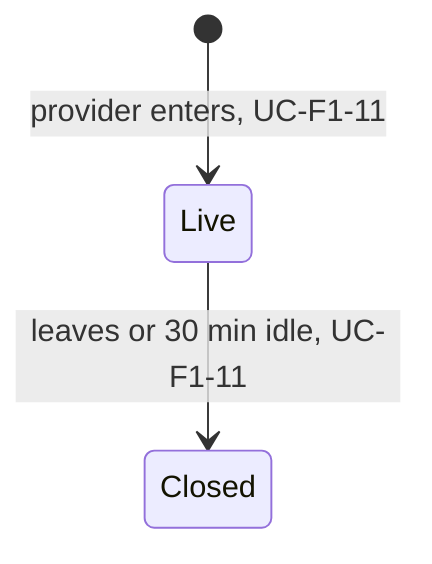

🏠 [Specs](../../../README.md) › 🧩 [Functional capabilities](../../README.md) › 🛡️ [F1 Administration](../README.md) ›
🗃️ [Data](README.md) › 🗃️ E-F1-12 Provider session

# 🗃️ E-F1-12 Provider session

**Status:** ✅ specified

## Purpose

A visit of the IT provider administrator inside a client company (BR-F1-20).

## Fields

| Name | Type | Required | Validation | Default | Example | Personal data | Custom fields |
|---|---|---|---|---|---|---|---|
| provider user | user of the provider | yes | - | - | Paul (NetServ) | yes | - |
| started | date and time | yes | - | now | 2026-11-10 10:02 | no | - |
| ended | date and time | no | - | - | 2026-11-10 10:31 | no | - |
| actions | list | yes | - | empty | changed role Sales Lyon | no | - |

## Relations

Many per client company.

The same item as
[E-T01-03 Provider session](../../../03-technical/t01-companies-and-data-isolation/data/e-t01-03-provider-session.md)
([D516](../../../06-decisions/foundations/d516-naming-rules-and-the-seven-classes-of-names.md), rule 4).

## Lifecycle

## Indexes and search

By date.

## Retention

⬜ To be specified with T3.

## Audit

It is itself an audit record.

## Import and export

Export for the client.

## Used by

- [UC-F1-11](../use-cases/08-provider-and-client-companies/uc-f01-11-enter-a-client-company-to-support-it.md)

## Open questions

None.

---

⬅️ [E-F1-11 Company template](e-f01-11-company-template.md) · ⬆️ [Up](README.md) ·
➡️ [E-F1-13 Approval delegation](e-f01-13-approval-delegation.md)
