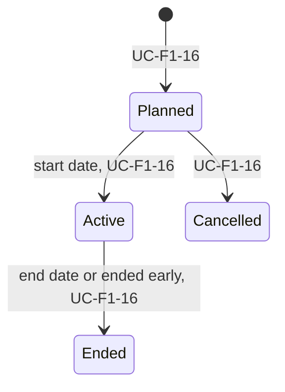

🏠 [Specs](../../../README.md) › 🧩 [Functional capabilities](../../README.md) › 🛡️ [F1 Administration](../README.md) ›
🗃️ [Data](README.md) › 🗃️ E-F1-13 Approval delegation

# 🗃️ E-F1-13 Approval delegation

**Status:** 🔄 waiting for the owner

## Purpose

A manager's approvals handed to a deputy for dated period.

## Fields

| Name | Type | Required | Validation | Default | Example | Personal data | Custom fields |
|---|---|---|---|---|---|---|---|
| delegator | user | yes | active manager | - | Pierre Martin | yes | - |
| deputy | user | yes | active, not the delegator | - | Paul Morel | yes | - |
| approvals | list | yes | leave, purchases, expenses, all | all | all | no | - |
| start | date | yes | - | - | 2026-12-21 | no | - |
| end | date | yes | after start | - | 2027-01-04 | no | - |
| status | list | yes | planned, active, ended, cancelled | planned | active | no | - |

## Relations

One delegator and one deputy, both Users; approvals routed during it record it.

## Lifecycle

## Indexes and search

By delegator, deputy and dates; shown on My team.

## Retention

Kept 2 years after it ends (Proposed).

## Audit

Created, changed, ended, cancelled.

## Import and export

None.

## Used by

- [UC-F1-16 Delegate approvals during an absence](../use-cases/11-team-delegation-and-access-review/uc-f01-16-delegate-approvals-during-an-absence.md)
- [UC-F1-17 See my team's accounts and pending requests](../use-cases/11-team-delegation-and-access-review/uc-f01-17-see-my-teams-accounts-and-pending-requests.md)

## Open questions

None.

---

⬅️ [E-F1-12 Provider session](e-f01-12-provider-session.md) · ⬆️ [Up](README.md) ·
➡️ [E-F1-14 Provisioning setting](e-f01-14-provisioning-setting.md)
