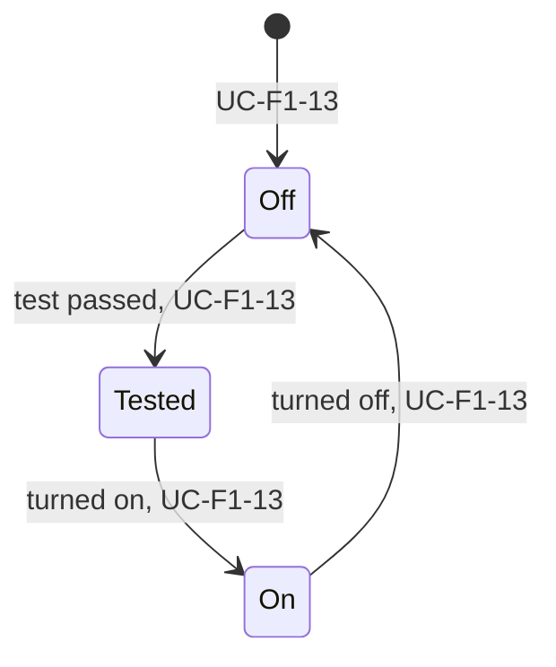

🏠 [Specs](../../../README.md) › 🧩 [Functional capabilities](../../README.md) › 🛡️ [F1 Administration](../README.md) ›
🗃️ [Data](README.md) › 🗃️ E-F1-14 Provisioning setting

# 🗃️ E-F1-14 Provisioning setting

**Status:** ✅ specified

## Purpose

The company's automatic provisioning (SCIM): token, group mappings and status.

## Fields

| Name | Type | Required | Validation | Default | Example | Personal data | Custom fields |
|---|---|---|---|---|---|---|---|
| status | list | yes | off, tested, on | off | on | no | - |
| token | secret | yes | shown once | - | ****7f3a | no | - |
| group mappings | list of group, roles, site | no | roles and sites exist | - | Sales -> Sales, Lyon yard | no | - |
| last sync | date and time | no | - | - | 2026-11-12 08:00 | no | - |

## Relations

One per company, beside its Single sign-on setting (E-F1-10).

## Lifecycle

## Indexes and search

None: one per company.

## Retention

While the company exists.

## Audit

Turned on or off, token created or revoked, mapping changed.

## Import and export

None.

## Used by

- [UC-F1-13 Provision users from the identity provider](../use-cases/10-bring-users-in-at-scale/uc-f01-13-provision-users-from-the-identity-provider.md)

## Open questions

None.

---

⬅️ [E-F1-13 Approval delegation](e-f01-13-approval-delegation.md) · ⬆️ [Up](README.md) ·
➡️ [E-F1-15 Bulk invitation batch](e-f01-15-bulk-invitation-batch.md)
