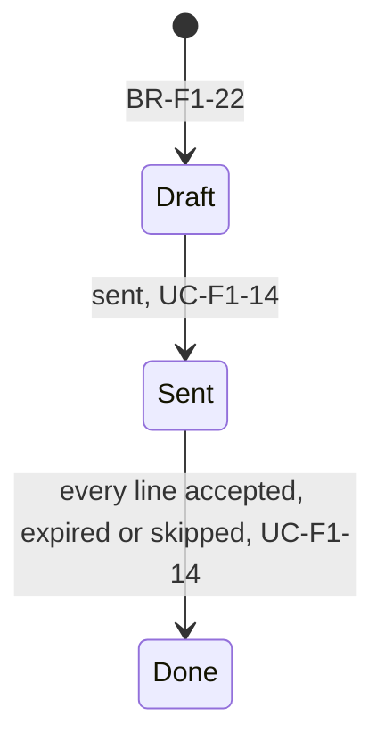

🏠 [Specs](../../../README.md) › 🧩 [Functional capabilities](../../README.md) › 🛡️ [F1 Administration](../README.md) ›
🗃️ [Data](README.md) › 🗃️ E-F1-15 Bulk invitation batch

# 🗃️ E-F1-15 Bulk invitation batch

**Status:** ✅ specified

## Purpose

A list of people invited together, with each line's check and result.

## Fields

| Name | Type | Required | Validation | Default | Example | Personal data | Custom fields |
|---|---|---|---|---|---|---|---|
| lines | list of email, name, role, site, manager, language | yes | checked (BR-F1-22) | - | 42 lines | yes | - |
| line status | list | yes | valid, in error, skipped, sent, accepted, expired | - | sent | no | - |
| created by | user | yes | - | - | Admin Acme | no | - |
| sent at | date and time | no | - | - | 2026-11-12 10:00 | no | - |

## Relations

Each sent line creates one Invitation (E-F1-04).

## Lifecycle

## Indexes and search

By date and creator; shown under Users.

## Retention

Kept 90 days after its last line ends, as invitations.

## Audit

Created, sent, resent.

## Import and export

Import from CSV or a spreadsheet; export of the line results.

## Used by

- [UC-F1-14 Invite users in bulk](../use-cases/10-bring-users-in-at-scale/uc-f01-14-invite-users-in-bulk.md)

## Open questions

None.

---

⬅️ [E-F1-14 Provisioning setting](e-f01-14-provisioning-setting.md) · ⬆️ [Up](README.md) ·
➡️ [E-F1-16 Access review campaign](e-f01-16-access-review-campaign.md)
