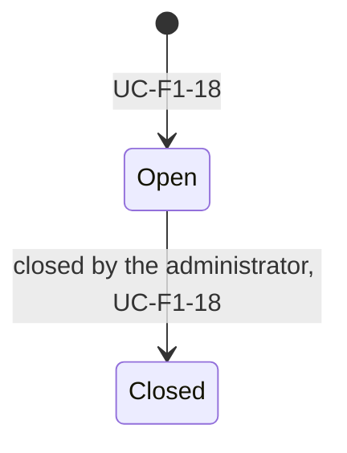

🏠 [Specs](../../../README.md) › 🧩 [Functional capabilities](../../README.md) › 🛡️ [F1 Administration](../README.md) ›
🗃️ [Data](README.md) › 🗃️ E-F1-16 Access review campaign

# 🗃️ E-F1-16 Access review campaign

**Status:** ✅ specified

## Purpose

A dated review of users' rights by their managers, with one line per right.

## Fields

| Name | Type | Required | Validation | Default | Example | Personal data | Custom fields |
|---|---|---|---|---|---|---|---|
| scope | all, site, role | yes | - | all | all users | no | - |
| deadline | date | yes | after launch | - | 2026-12-15 | no | - |
| lines | user, right, reviewer, decision, comment, date | yes | - | - | Lea, Accounting, Pierre, removed | yes | - |
| status | list | yes | open, closed | open | closed | no | - |

## Relations

Lines refer to Users and Roles; reviewers are their managers.

## Lifecycle

## Indexes and search

By quarter and status; the report per campaign.

## Retention

Kept 3 years as evidence.

## Audit

Launched, each decision, closed.

## Import and export

Report exported as PDF and CSV.

## Used by

- [UC-F1-18 Run an access review campaign](../use-cases/11-team-delegation-and-access-review/uc-f01-18-run-an-access-review-campaign.md)

## Open questions

None.

---

⬅️ [E-F1-15 Bulk invitation batch](e-f01-15-bulk-invitation-batch.md) · ⬆️ [Up](README.md) ·
➡️ [E-F1-17 Portal account](e-f01-17-portal-account.md)
