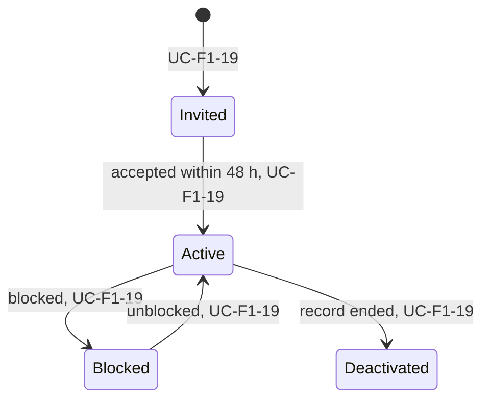

🏠 [Specs](../../../README.md) › 🧩 [Functional capabilities](../../README.md) › 🛡️ [F1 Administration](../README.md) ›
🗃️ [Data](README.md) › 🗃️ E-F1-17 Portal account

# 🗃️ E-F1-17 Portal account

**Status:** ✅ specified

## Purpose

An outside person's account on a portal, linked to the records they may see.

## Fields

| Name | Type | Required | Validation | Default | Example | Personal data | Custom fields |
|---|---|---|---|---|---|---|---|
| email | email | yes | one per portal account | - | claire@durand.fr | yes | - |
| linked records | list of records | yes | of portal-enabled record types | - | customer Durand SA | no | - |
| status | list | yes | invited, active, blocked, deactivated | invited | active | no | - |
| two-factor | yes or no | yes | as the portal's policy | no | yes | no | - |
| last sign-in | date and time | no | - | - | 2026-11-10 18:20 | yes | - |

## Relations

Linked to one or more records (customer, supplier, or a sector record type of F2); never a User with roles.

## Lifecycle

## Indexes and search

By email, record and status.

## Retention

Deactivated accounts deleted after 1 year.

## Audit

As UC-F1-19's audit events.

## Import and export

None.

## Used by

- [UC-F1-19 Manage portal accounts](../use-cases/12-portal-accounts-and-integrations/uc-f01-19-manage-portal-accounts.md)
- [UC-F2-20 Expose a record type on a portal](../../f02-no-code-configuration/use-cases/09-portals-and-offline-forms/uc-f02-20-expose-a-record-type-on-a-portal.md)

## Open questions

None.

---

⬅️ [E-F1-16 Access review campaign](e-f01-16-access-review-campaign.md) · ⬆️ [Up](README.md) ·
➡️ [E-F1-18 API token](e-f01-18-api-token.md)
