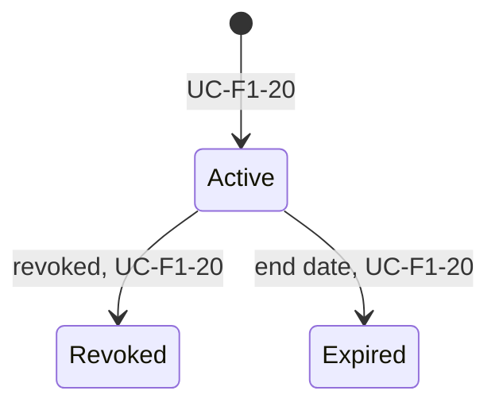

🏠 [Specs](../../../README.md) › 🧩 [Functional capabilities](../../README.md) › 🛡️ [F1 Administration](../README.md) ›
🗃️ [Data](README.md) › 🗃️ E-F1-18 API token

# 🗃️ E-F1-18 API token

**Status:** ✅ specified

## Purpose

A token of a service account or a user, with scopes and an end date.

## Fields

| Name | Type | Required | Validation | Default | Example | Personal data | Custom fields |
|---|---|---|---|---|---|---|---|
| service account | name, owner, role | yes | role exists | - | EDI Lemoine | no | - |
| scopes | list of record type and read or write | yes | within the role | - | orders write | no | - |
| end date | date | yes | within 1 year | - | 2027-06-30 | no | - |
| allowed IPs | list | no | valid ranges | - | 203.0.113.0/24 | no | - |
| last use | date and time | no | - | - | 2026-11-12 07:55 | no | - |

## Relations

One service account has several tokens.

## Lifecycle

## Indexes and search

By service account, owner and status.

## Retention

Revoked and expired tokens kept 1 year for the audit.

## Audit

Created, revoked, expired, every call.

## Import and export

None.

## Used by

- [UC-F1-20 Create and revoke API tokens and service accounts](../use-cases/12-portal-accounts-and-integrations/uc-f01-20-create-and-revoke-api-tokens-and-service-accounts.md)

## Open questions

None.

---

⬅️ [E-F1-17 Portal account](e-f01-17-portal-account.md) · ⬆️ [Up](README.md) ·
➡️ [E-F1-19 Security policy](e-f01-19-security-policy.md)
