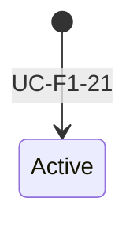

🏠 [Specs](../../../README.md) › 🧩 [Functional capabilities](../../README.md) › 🛡️ [F1 Administration](../README.md) ›
🗃️ [Data](README.md) › 🗃️ E-F1-19 Security policy

# 🗃️ E-F1-19 Security policy

**Status:** 🔄 waiting for the owner

## Purpose

The company's password, session, two-factor, IP and device rules, per role.

## Fields

| Name | Type | Required | Validation | Default | Example | Personal data | Custom fields |
|---|---|---|---|---|---|---|---|
| password | length, expiry | yes | length 12 or more (Proposed) | 12, no expiry | 14 | no | - |
| session | length, idle timeout | yes | - | 12 h, 60 min (Proposed) | 8 h, 30 min | no | - |
| two-factor per role | list | yes | administrators always | administrators | administrators, accounting | no | - |
| IP and devices per role | list | no | valid ranges | - | administrators: 192.0.2.0/24 | no | - |

## Relations

One per company; applies to Users through their Roles.

## Lifecycle

Changed in place; each change is a dated version in the audit trail.

## Indexes and search

None: one per company.

## Retention

While the company exists.

## Audit

Each change with before and after.

## Import and export

None.

## Used by

- [UC-F1-21 Set the security policies](../use-cases/13-security-and-audit/uc-f01-21-set-the-security-policies.md)

## Open questions

None.

---

⬅️ [E-F1-18 API token](e-f01-18-api-token.md) · ⬆️ [Up](README.md) ·
➡️ [E-F1-20 SIEM destination](e-f01-20-siem-destination.md)
