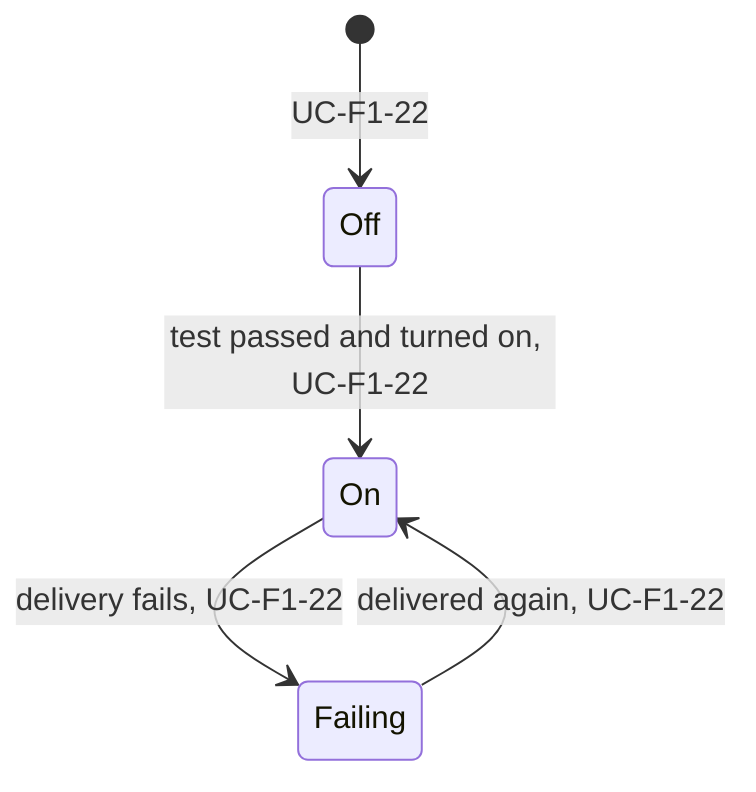

🏠 [Specs](../../../README.md) › 🧩 [Functional capabilities](../../README.md) › 🛡️ [F1 Administration](../README.md) ›
🗃️ [Data](README.md) › 🗃️ E-F1-20 SIEM destination

# 🗃️ E-F1-20 SIEM destination

**Status:** ✅ specified

## Purpose

Where the audit trail is streamed: the company's security tool.

## Fields

| Name | Type | Required | Validation | Default | Example | Personal data | Custom fields |
|---|---|---|---|---|---|---|---|
| protocol | list | yes | syslog over TLS, HTTPS | - | syslog over TLS | no | - |
| address | host and port or URL | yes | reachable at test | - | siem.acme.fr:6514 | no | - |
| status | list | yes | off, on, failing | off | on | no | - |
| last delivered | date and time | no | - | - | 2026-11-12 09:12 | no | - |

## Relations

One per company; reads the audit trail (T3).

## Lifecycle

## Indexes and search

None.

## Retention

While the company exists.

## Audit

Created, changed, turned on or off.

## Import and export

None.

## Used by

- [UC-F1-22 Search the audit trail and export it to a SIEM](../use-cases/13-security-and-audit/uc-f01-22-search-the-audit-trail-and-export-it-to-a-siem.md)

## Open questions

None.

---

⬅️ [E-F1-19 Security policy](e-f01-19-security-policy.md) · ⬆️ [Up](README.md) ·
➡️ [E-F1-21 Company closing](e-f01-21-company-closing.md)
