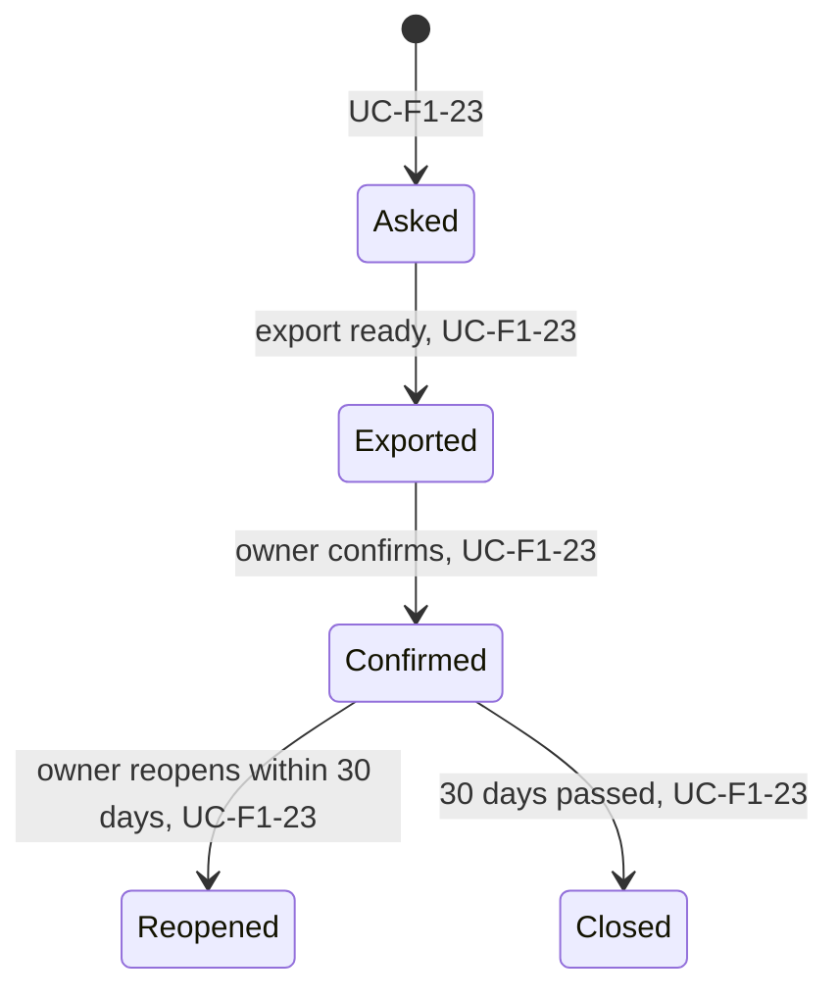

🏠 [Specs](../../../README.md) › 🧩 [Functional capabilities](../../README.md) › 🛡️ [F1 Administration](../README.md) ›
🗃️ [Data](README.md) › 🗃️ E-F1-21 Company closing

# 🗃️ E-F1-21 Company closing

**Status:** 🔄 waiting for the owner

## Purpose

The request to close a company or leave the hosted edition, its export and its dates.

## Fields

| Name | Type | Required | Validation | Default | Example | Personal data | Custom fields |
|---|---|---|---|---|---|---|---|
| kind | list | yes | close, leave the hosted edition | - | leave | no | - |
| asked by | user | yes | the owner | - | Claire Acme | yes | - |
| open items accepted | list | no | - | - | 2 unpaid invoices | no | - |
| export | file and counts | no | - | - | acme-export-2026-11-30.zip | no | - |
| read-only until | date | no | confirmation + 30 days (Proposed) | - | 2026-12-30 | no | - |
| status | list | yes | asked, exported, confirmed, reopened, closed | asked | confirmed | no | - |

## Relations

One per Company (E-F1-01).

## Lifecycle

## Indexes and search

None.

## Retention

Kept with the legal archive (BR-F1-30).

## Audit

As UC-F1-23's audit events.

## Import and export

The export itself.

## Used by

- [UC-F1-23 Close a company and export all its data](../use-cases/14-close-a-company/uc-f01-23-close-a-company-and-export-all-its-data.md)

## Open questions

None.

---

⬅️ [E-F1-20 SIEM destination](e-f01-20-siem-destination.md) · ⬆️ [Up](README.md) ·
➡️ [E-F1-22 Record of processing activities](e-f01-22-record-of-processing-activities.md)
