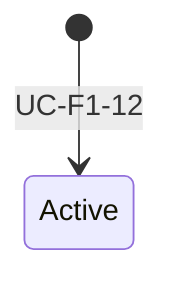

🏠 [Specs](../../../README.md) › 🧩 [Functional capabilities](../../README.md) › 🛡️ [F1 Administration](../README.md) ›
🗃️ [Data](README.md) › 🗃️ E-F1-22 Record of processing activities

# 🗃️ E-F1-22 Record of processing activities

**Status:** 🔄 waiting for the owner

## Purpose

(Proposed) The record of processing activities the flow charts name with the words "GDPR register"
([FL-F1-09](../flows/fl-f01-09-administration-reports.md)). The owner decided to create it
([D516](../../../06-decisions/foundations/d516-naming-rules-and-the-seven-classes-of-names.md)); what it holds waits for
the owner's confirmation.

## Fields

(Proposed) To define with the owner: the flow charts name the record, not its fields.

## Relations

(Proposed) To define with the owner, from the use cases below.

## Lifecycle

## Indexes and search

(Proposed) To define with the owner.

## Retention

(Proposed) As the other records of its capability, to confirm with the owner.

## Audit

(Proposed) Every change, as the other records of its capability.

## Import and export

(Proposed) To define with the owner.

## Used by

- [UC-F1-12 Draft the record of processing activities](../use-cases/09-administration-reports/uc-f01-12-draft-the-record-of-processing-activities.md)

## Open questions

(Proposed) Its fields, relations and states wait for the owner (waiting list, step 36e).

---

⬅️ [E-F1-21 Company closing](e-f01-21-company-closing.md) · ⬆️ [Up](README.md) ·
➡️ [E-F1-23 User session](e-f01-23-user-session.md)
