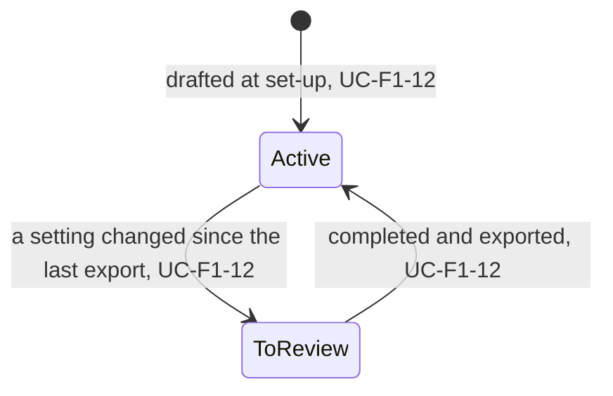

🏠 [Specs](../../../README.md) › 🧩 [Functional capabilities](../../README.md) › 🛡️ [F1 Administration](../README.md) ›
🗃️ [Data](README.md) › 🗃️ E-F1-22 Record of processing activities

# 🗃️ E-F1-22 Record of processing activities

**Status:** ✅ specified

## Purpose

The record of processing activities the flow charts name with the words "GDPR register"
([FL-F1-09](../flows/fl-f01-09-administration-reports.md)). The owner decided to create it
([D516](../../../06-decisions/foundations/d516-naming-rules-and-the-seven-classes-of-names.md)); its fields are derived
from the specifications and confirmed by the owner (D572).

## Fields

| Name | Type | Required | Validation | Default | Example | Personal data | Custom fields |
|---|---|---|---|---|---|---|---|
| activity | text | yes | - | the capability's name | Customers and sales | no | no |
| capability | capability | no | one drafted activity per capability in use | - | F6 Customers and sales | no | no |
| people concerned | text | yes | - | drafted from the settings | Customers' contacts | no | no |
| data kept | text | yes | - | drafted from the settings | Names, emails, phone numbers | no | no |
| retention | text | yes | - | from the retention policies | 3 years after the last order | no | no |
| recipients | list of connections, AI providers, processors | no | - | drafted from the settings | Claude | no | no |
| transfers | list of recipients outside the EU | no | CR-FR-049 | drafted from the settings | - | no | no |
| purposes | text | yes | approved by the administrator | suggested by the AI assistant | Quotes, orders and invoices | no | no |
| legal basis | text | yes | approved by the administrator | suggested by the AI assistant | Contract | no | no |
| controller's contact | name and email | yes | - | - | Claire Acme, dpo@acme.fr | yes | no |
| last export | file and date | no | each export is kept | - | gdpr-register-2026-11-10.pdf | no | no |
| state | active, to review | yes | the lifecycle below | active | to review | no | no |

Derived from [UC-F1-12](../use-cases/09-administration-reports/uc-f01-12-draft-the-record-of-processing-activities.md)
(one processing activity per capability in use, with the data kept, the people concerned, the retention and the
recipients; purposes, legal bases and the controller's contact completed by the administrator; marked to review when a
setting changes), [D93](../../../06-decisions/f01-administration/d93-gdpr-register-draft.md),
[CR-FR-048](../../../10-country-packs/france/data-protection/cr-fr-048-record-of-processing.md) (purposes, legal bases,
categories, retention, processors and transfers),
[S-F1-12](../screens/09-administration-reports/s-f01-12-users-overview-dashboard.md) and the list
[S-F1-L22](../screens/00-lists/s-f01-l22-record-of-processing-activities.md), whose rows are the activities.

## Relations

One line of the company's register ([E-F1-01 Company](e-f01-01-company.md)); its retention comes from the
[retention policies](e-f01-24-retention-policy.md), its recipients from the
[agent connections](e-f01-08-agent-connection.md) and the [AI feature settings](e-f01-09-ai-feature-setting.md), the IT
provider being listed as processor (D53).

## Lifecycle

The changes since the last export are highlighted while it is to review; the administrators are told (D92).

## Indexes and search

By activity, capability, state.

## Retention

As the other records of its capability.

## Audit

Every change, as the other records of its capability.

## Import and export

The whole register is exported as PDF or spreadsheet, with every activity and the administrator's additions
([UC-F1-12](../use-cases/09-administration-reports/uc-f01-12-draft-the-record-of-processing-activities.md)), together
with the retention policies ([E-F1-24](e-f01-24-retention-policy.md)); each export is kept. No import.

## Used by

- [UC-F1-12 Draft the record of processing activities](../use-cases/09-administration-reports/uc-f01-12-draft-the-record-of-processing-activities.md)

## Open questions

None.

---

⬅️ [E-F1-21 Company closing](e-f01-21-company-closing.md) · ⬆️ [Up](README.md) ·
➡️ [E-F1-23 User session](e-f01-23-user-session.md)
