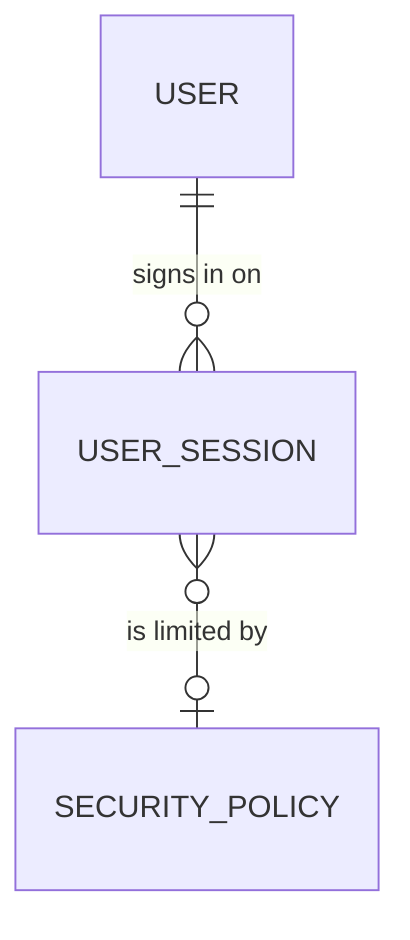
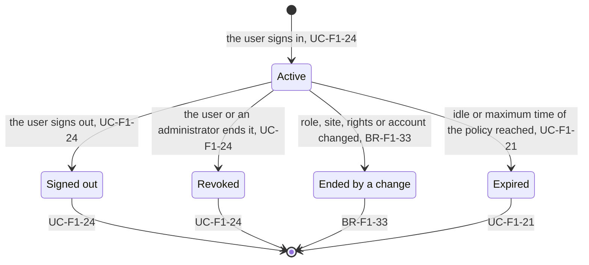

🏠 [Specs](../../../README.md) › 🧩 [Functional capabilities](../../README.md) › 🛡️ [F1 Administration](../README.md) ›
🗃️ [Data](README.md) › 🗃️ E-F1-23 User session

# 🗃️ E-F1-23 User session

**Status:** ✅ specified

## Purpose

One signed-in browser, app or phone of a user, with what the user and the administrator need to recognise it and end it
([D520](../../../06-decisions/f01-administration/d520-benchmark-gaps-f01-administration.md)).

## Fields

| Name | Type | Required | Validation | Default | Example | Personal data | Custom fields |
|---|---|---|---|---|---|---|---|
| user | user | yes | - | - | Claire P. | yes | no |
| device name | text | yes | up to 80 characters | from the browser or the app | Claire's phone | yes | no |
| kind | browser, app, phone | yes | - | - | app | no | no |
| application and version | text | no | - | - | SimpleERP mobile 3.2 | no | no |
| sign-in method | password, single sign-on, passkey | yes | - | - | single sign-on | no | no |
| place | country and town | no | from the address, never exact | - | Lyon, FR | yes | no |
| address | IP address | yes | kept 90 days then dropped | - | 203.0.113.24 | yes | no |
| started at | date and time | yes | - | now | 2026-11-14 08:12 | no | no |
| last active | date and time | yes | - | now | 2026-11-14 08:40 | no | no |
| trusted until | date | no | within the security policy's limit | - | 2026-12-14 | no | no |
| state | active, signed out, revoked, ended by a change, expired | yes | the lifecycle below | active | active | no | no |
| ended by, reason | user or administrator, text | when ended | - | - | Claire, lost phone | yes | no |

## Relations

- [E-F1-03 User](e-f01-03-user.md)
- [E-F1-19 Security policy](e-f01-19-security-policy.md)

## Lifecycle

## Indexes and search

By user, state, last active and trusted until; the active sessions of a user for the next request.

## Retention

An ended session is kept 13 months for the audit trail, its IP address 90 days
([CR-FR-052](../../../10-country-packs/france/data-protection/cr-fr-052-storage-limitation.md)).

## Audit

Every start, end, trust and revocation, with who did it and why.

## Import and export

No import. The sessions of a user are exported with the audit trail
([UC-F1-22](../use-cases/13-security-and-audit/uc-f01-22-search-the-audit-trail-and-export-it-to-a-siem.md)).

## Used by

- [UC-F1-24 Manage sessions and trusted devices](../use-cases/15-security-and-group-data/uc-f01-24-manage-sessions-and-trusted-devices.md)

## Open questions

None.

---

⬅️ [E-F1-22 Record of processing activities](e-f01-22-record-of-processing-activities.md) · ⬆️ [Up](README.md) ·
➡️ [E-F1-24 Retention policy](e-f01-24-retention-policy.md)
