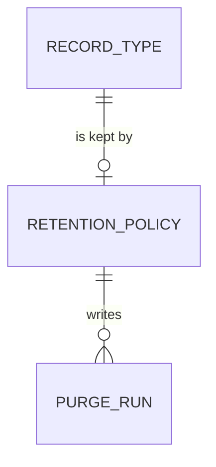
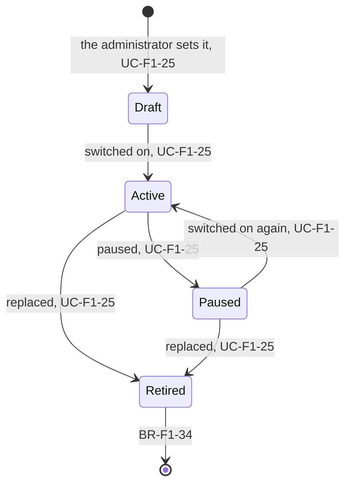

🏠 [Specs](../../../README.md) › 🧩 [Functional capabilities](../../README.md) › 🛡️ [F1 Administration](../README.md) ›
🗃️ [Data](README.md) › 🗃️ E-F1-24 Retention policy

# 🗃️ E-F1-24 Retention policy

**Status:** ✅ specified

## Purpose

How long one kind of record is kept, what happens at the end and what the law requires
([D520](../../../06-decisions/f01-administration/d520-benchmark-gaps-f01-administration.md)).

## Fields

| Name | Type | Required | Validation | Default | Example | Personal data | Custom fields |
|---|---|---|---|---|---|---|---|
| record type | record type | yes | one active policy per record type | - | Customer | no | no |
| start event | creation, last activity, end of contract, closing | yes | - | last activity | last contact | no | no |
| period | number and unit | yes | not under the legal minimum | the country pack's period | 3 years | no | no |
| action | delete, anonymise, keep | yes | keep only where the law requires it | anonymise | anonymise | no | no |
| legal minimum | period and source | no | read from the country pack | - | 10 years, accounting records | no | no |
| fields anonymised | list of fields | when anonymising | - | the personal-data fields | name, email | no | no |
| mode | preview, live | yes | - | preview | live | no | no |
| state | draft, active, paused, retired | yes | the lifecycle below | draft | active | no | no |
| last run, next run | date and time | no | - | - | 2026-11-14 02:00 | no | no |
| last run counts | purged, kept, failed | no | - | - | 412, 38, 0 | no | no |

## Relations

- [E-F2-05 Record type](../../f02-no-code-configuration/data/e-f02-05-record-type.md)
- [E-F1-22 Record of processing activities](e-f01-22-record-of-processing-activities.md)

## Lifecycle

## Indexes and search

By record type, state and next run.

## Retention

A policy is kept as long as the company, with its versions, since the record of processing activities refers to it.
Purge log lines are kept 5 years.

## Audit

Every change of a period or an action, with the old and the new value, who and when; every run.

## Import and export

The policies are exported with the record of processing activities
([UC-F1-12](../use-cases/09-administration-reports/uc-f01-12-draft-the-record-of-processing-activities.md)).

## Used by

- [UC-F1-25 Set retention and purge personal data](../use-cases/15-security-and-group-data/uc-f01-25-set-retention-and-purge-personal-data.md)

## Open questions

None.

---

⬅️ [E-F1-23 User session](e-f01-23-user-session.md) · ⬆️ [Up](README.md) ·
➡️ [E-F1-25 Sharing rule](e-f01-25-sharing-rule.md)
