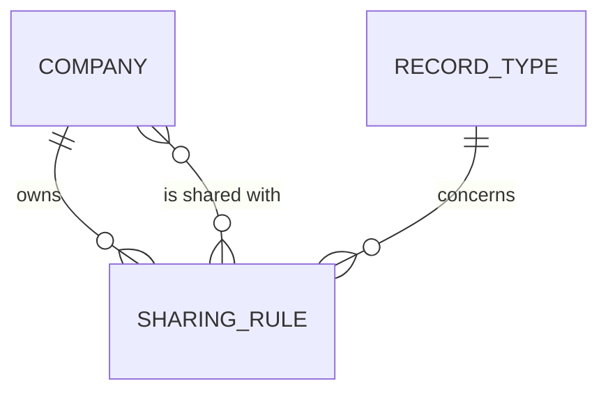
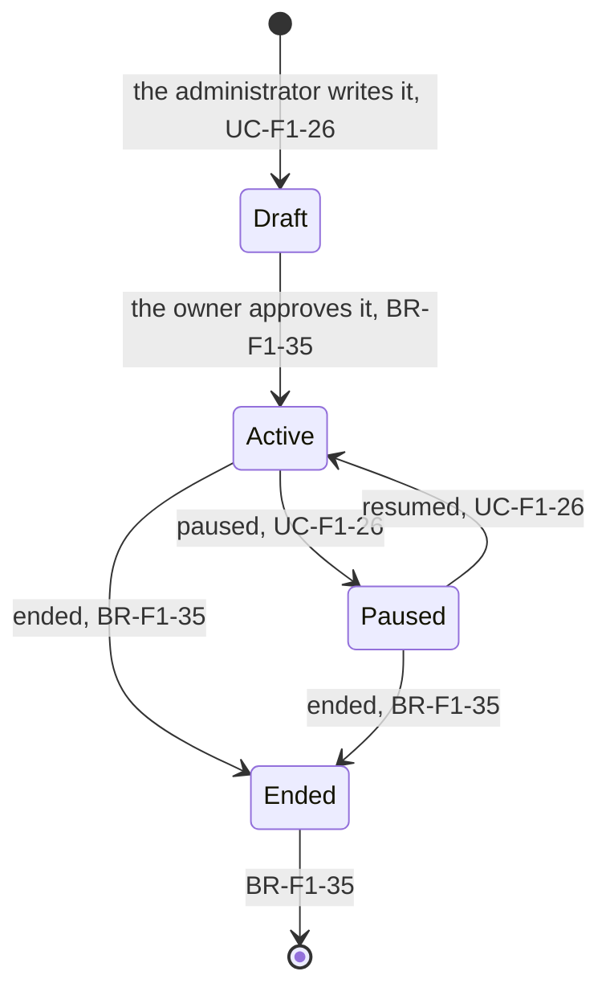

🏠 [Specs](../../../README.md) › 🧩 [Functional capabilities](../../README.md) › 🛡️ [F1 Administration](../README.md) ›
🗃️ [Data](README.md) › 🗃️ E-F1-25 Sharing rule

# 🗃️ E-F1-25 Sharing rule

**Status:** ✅ specified

## Purpose

What one company shares with the others of its group: which record type, which fields, with whom and how
([D520](../../../06-decisions/f01-administration/d520-benchmark-gaps-f01-administration.md)).

## Fields

| Name | Type | Required | Validation | Default | Example | Personal data | Custom fields |
|---|---|---|---|---|---|---|---|
| owner company | company | yes | - | the company of the administrator | Paris company | no | no |
| record type | record type | yes | one rule per record type and owner | - | Customer | no | no |
| fields shared | list of fields | yes | never a secret or a private field | - | name, address, tax number | no | no |
| shared with | list of companies or all | yes | the owner's group only | - | Lyon, Nantes | no | no |
| mode | read only, use and propose | yes | - | read only | use and propose | no | no |
| approved by, at | user, date and time | before active | the owner (BR-F1-35) | - | Marc D., 2026-11-14 | yes | no |
| state | draft, active, paused, ended | yes | the lifecycle below | draft | active | no | no |
| records shared | number | no | - | - | 1,240 | no | no |
| proposals waiting | number | no | - | 0 | 3 | no | no |

## Relations

- [E-F1-01 Company](e-f01-01-company.md)
- [E-F2-05 Record type](../../f02-no-code-configuration/data/e-f02-05-record-type.md)

## Lifecycle

## Indexes and search

By owner company, record type and state.

## Retention

A rule and its history are kept as long as the group; the proposals, 2 years.

## Audit

Every change of a rule, its approval, each pause and end, each proposal and its answer.

## Import and export

The rules are exported with the group's configuration pack, see
[UC-F2-11](../../f02-no-code-configuration/use-cases/06-share-a-configuration/uc-f02-11-export-or-import-a-configuration-as-a-pack.md).

## Used by

- [UC-F1-26 Share master data across the group](../use-cases/15-security-and-group-data/uc-f01-26-share-master-data-across-the-group.md)

## Open questions

None.

---

⬅️ [E-F1-24 Retention policy](e-f01-24-retention-policy.md) · ⬆️ [Up](README.md) ·
➡️ [E-F1-26 Act-as session](e-f01-26-act-as-session.md)
