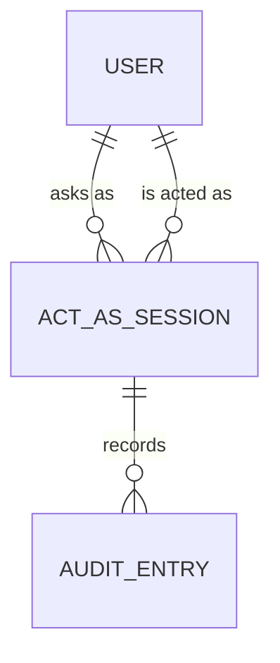
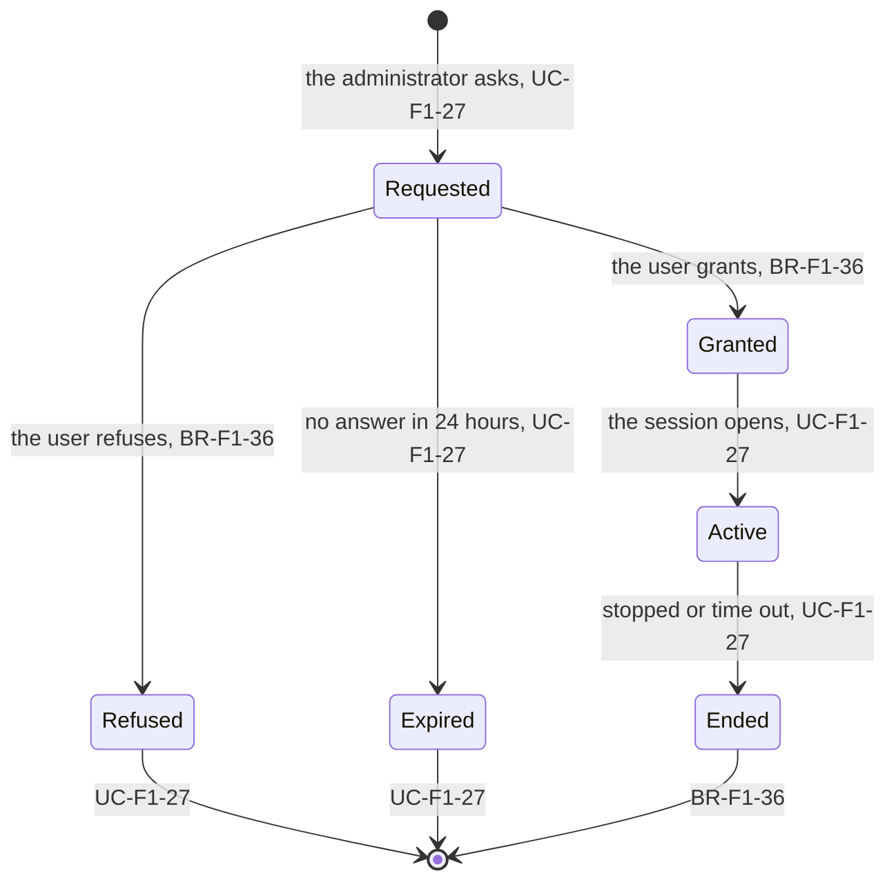

🏠 [Specs](../../../README.md) › 🧩 [Functional capabilities](../../README.md) › 🛡️ [F1 Administration](../README.md) ›
🗃️ [Data](README.md) › 🗃️ E-F1-26 Act-as session

# 🗃️ E-F1-26 Act-as session

**Status:** ✅ specified

## Purpose

A request to act as a user and the short session it opens, with the consent of that user
([D520](../../../06-decisions/f01-administration/d520-benchmark-gaps-f01-administration.md)).

## Fields

| Name | Type | Required | Validation | Default | Example | Personal data | Custom fields |
|---|---|---|---|---|---|---|---|
| administrator | user | yes | has the right to ask | - | Marc D. | yes | no |
| target user | user | yes | not an owner or an administrator | - | Sonia M. | yes | no |
| reason | text | yes | up to 300 characters | - | cannot post an expense, ticket 2031 | no | no |
| duration asked | minutes | yes | 1 to 60 | 30 | 30 | no | no |
| requested at | date and time | yes | - | now | 2026-11-14 10:00 | no | no |
| answered at | date and time | when answered | - | - | 2026-11-14 10:01 | no | no |
| ends at | date and time | when granted | at most 60 minutes after the grant | - | 2026-11-14 10:31 | no | no |
| state | requested, granted, refused, active, ended, expired | yes | the lifecycle below | requested | active | no | no |
| ended by | administrator, user, time | when ended | - | - | time | no | no |
| actions done | number | no | - | 0 | 3 | no | no |

## Relations

- [E-F1-03 User](e-f01-03-user.md)
- [E-T03-01 Audit entry](../../../03-technical/t03-audit-trail/data/e-t03-01-audit-entry.md)

## Lifecycle

## Indexes and search

By target user, administrator, state and date.

## Retention

Kept with the audit trail, 13 months at least
([BR-F1-29](../business-rules/br-f01-29-audit-exports-carry-the-checksum-chain.md)).

## Audit

Request, answer, start, stop, each action under both names.

## Import and export

No import; exported with the audit trail
([UC-F1-22](../use-cases/13-security-and-audit/uc-f01-22-search-the-audit-trail-and-export-it-to-a-siem.md)).

## Used by

- [UC-F1-27 Act as a user with consent](../use-cases/15-security-and-group-data/uc-f01-27-act-as-a-user-with-consent.md)

## Open questions

None.

---

⬅️ [E-F1-25 Sharing rule](e-f01-25-sharing-rule.md) · ⬆️ [Up](README.md)
