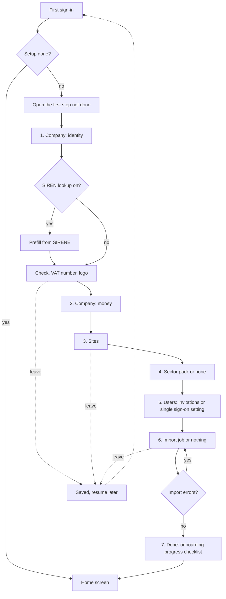

🏠 [Specs](../../../README.md) › 🧩 [Functional capabilities](../../README.md) › 🛡️ [F1 Administration](../README.md) ›
🔀 [Flows](README.md) › 🔀 FL-F1-01 Guided setup

# 🔀 FL-F1-01 Guided setup

**Status:** ✅ specified

## Summary

From a brand-new company to a usable one, through the seven steps of the setup wizard.

## Personas

- [U07 Administrator](../../../01-users/personas/u07-administrator.md)
- [U13 Owner](../../../01-users/personas/u13-owner.md)

## Flowchart

## Sequence diagram

See [UC-F1-01](../use-cases/01-guided-setup/uc-f01-01-set-up-a-new-company.md#sequence-diagram).

## Steps

| Step | Persona | Screen | Use case | What happens |
|---|---|---|---|---|
| 1 | U07, U13 | [S-F1-01](../screens/01-guided-setup/s-f01-01-setup-wizard.md) | [UC-F1-01](../use-cases/01-guided-setup/uc-f01-01-set-up-a-new-company.md) | Company identity, with the SIRENE lookup |
| 2 | U07, U13 | [S-F1-01](../screens/01-guided-setup/s-f01-01-setup-wizard.md) | [UC-F1-01](../use-cases/01-guided-setup/uc-f01-01-set-up-a-new-company.md) | Currency, fiscal year, VAT regime |
| 3 | U07, U13 | [S-F1-01](../screens/01-guided-setup/s-f01-01-setup-wizard.md) | [UC-F1-01](../use-cases/01-guided-setup/uc-f01-01-set-up-a-new-company.md) | Sites |
| 4 | U07, U13 | [S-F1-01](../screens/01-guided-setup/s-f01-01-setup-wizard.md) | [UC-F1-01](../use-cases/01-guided-setup/uc-f01-01-set-up-a-new-company.md) | Sector pack |
| 5 | U07, U13 | [S-F1-01](../screens/01-guided-setup/s-f01-01-setup-wizard.md) | [UC-F1-01](../use-cases/01-guided-setup/uc-f01-01-set-up-a-new-company.md) | Users |
| 6 | U07, U13 | [S-F1-01](../screens/01-guided-setup/s-f01-01-setup-wizard.md) | [UC-F1-01](../use-cases/01-guided-setup/uc-f01-01-set-up-a-new-company.md) | Data import |
| 7 | U07, U13 | [S-F1-01](../screens/01-guided-setup/s-f01-01-setup-wizard.md) | [UC-F1-01](../use-cases/01-guided-setup/uc-f01-01-set-up-a-new-company.md) | Done: checklist, then the home screen |

### Entities and screens

| Entity | States in this flow | Shown at step and screen | Aggregated view |
|---|---|---|---|
| [E-F1-01 Company](../data/e-f01-01-company.md) | In setup, Active | 1, 2, 3, 4, 5, 6, 7 [S-F1-01](../screens/01-guided-setup/s-f01-01-setup-wizard.md) | Companies |
| [E-F1-02 Company site](../data/e-f01-02-company-site.md) | Open, Closed | 1, 2, 3, 4, 5, 6, 7 [S-F1-01](../screens/01-guided-setup/s-f01-01-setup-wizard.md) | Company sites |
| [E-F2-11 Configuration pack](../../f02-no-code-configuration/data/e-f02-11-configuration-pack.md) | Published | Shown elsewhere: [S-F2-11 Packs](../../f02-no-code-configuration/screens/06-share-a-configuration/s-f02-11-packs.md) | Configuration packs |
| [E-F1-03 User](../data/e-f01-03-user.md) | Invited, Active, Deactivated | Shown elsewhere: [S-F1-03 Users](../screens/03-user-lifecycle/s-f01-03-users.md) | Users |
| [E-F1-04 Invitation](../data/e-f01-04-invitation.md) | Sent, Accepted, Expired, Cancelled, Not delivered | Shown elsewhere: [S-SC12-05 Invitations](../../../08-sectors/sc12-education-and-training/screens/02-enrol-and-fund/s-sc12-05-invitations.md) | Invitations |
| [E-F1-10 Single sign-on setting](../data/e-f01-10-single-sign-on-setting.md) | On | Shown elsewhere: [S-F1-09 Single sign-on](../screens/07-set-up-single-sign-on/s-f01-09-single-sign-on.md) | Single sign-on settings |
| [E-F21-07 Import job](../../f21-onboarding-and-modules/data/e-f21-07-import-job.md) | Active | Shown elsewhere: [S-F21-09 Import](../../f21-onboarding-and-modules/screens/03-team-and-data/s-f21-09-import.md) | Import jobs |
| [E-F21-01 Onboarding progress](../../f21-onboarding-and-modules/data/e-f21-01-onboarding-progress.md) | Done | Shown elsewhere: [S-F21-25 Phone onboarding](../../f21-onboarding-and-modules/screens/04-learn-and-improve/s-f21-25-phone-onboarding.md) | Onboarding progresses |

## Errors

A SIREN not found, a VAT number that does not match, an import file with errors: each keeps the administrator on the
step until fixed (see UC-F1-01's error flows).

## Images

Every step and error, for each persona taking part, in light and dark mode (D120). Steps are numbered as in the Steps
table; E rows are the error cases.

| Step | Persona | Device | Light | Dark |
|---|---|---|---|---|
| 1 | U07 | desktop | [light](../images/01-guided-setup/u07-administrator/1-company-identity-desktop-light.png) | [dark](../images/01-guided-setup/u07-administrator/1-company-identity-desktop-dark.png) |
| 2 | U07 | desktop | [light](../images/01-guided-setup/u07-administrator/2-money-desktop-light.png) | [dark](../images/01-guided-setup/u07-administrator/2-money-desktop-dark.png) |
| 3 | U07 | desktop | [light](../images/01-guided-setup/u07-administrator/3-sites-desktop-light.png) | [dark](../images/01-guided-setup/u07-administrator/3-sites-desktop-dark.png) |
| 4 | U07 | desktop | [light](../images/01-guided-setup/u07-administrator/4-sector-pack-desktop-light.png) | [dark](../images/01-guided-setup/u07-administrator/4-sector-pack-desktop-dark.png) |
| 5 | U07 | desktop | [light](../images/01-guided-setup/u07-administrator/5-users-desktop-light.png) | [dark](../images/01-guided-setup/u07-administrator/5-users-desktop-dark.png) |
| 6 | U07 | desktop | [light](../images/01-guided-setup/u07-administrator/6-data-import-desktop-light.png) | [dark](../images/01-guided-setup/u07-administrator/6-data-import-desktop-dark.png) |
| 7 | U07 | desktop | [light](../images/01-guided-setup/u07-administrator/7-done-desktop-light.png) | [dark](../images/01-guided-setup/u07-administrator/7-done-desktop-dark.png) |
| 1 | U13 | desktop | [light](../images/01-guided-setup/u13-owner/1-company-identity-desktop-light.png) | [dark](../images/01-guided-setup/u13-owner/1-company-identity-desktop-dark.png) |
| 1 | U13 | phone | [light](../images/01-guided-setup/u13-owner/1-company-identity-phone-light.png) | [dark](../images/01-guided-setup/u13-owner/1-company-identity-phone-dark.png) |
| 2 | U13 | desktop | [light](../images/01-guided-setup/u13-owner/2-money-desktop-light.png) | [dark](../images/01-guided-setup/u13-owner/2-money-desktop-dark.png) |
| 2 | U13 | phone | [light](../images/01-guided-setup/u13-owner/2-money-phone-light.png) | [dark](../images/01-guided-setup/u13-owner/2-money-phone-dark.png) |
| 3 | U13 | desktop | [light](../images/01-guided-setup/u13-owner/3-sites-desktop-light.png) | [dark](../images/01-guided-setup/u13-owner/3-sites-desktop-dark.png) |
| 3 | U13 | phone | [light](../images/01-guided-setup/u13-owner/3-sites-phone-light.png) | [dark](../images/01-guided-setup/u13-owner/3-sites-phone-dark.png) |
| 4 | U13 | desktop | [light](../images/01-guided-setup/u13-owner/4-sector-pack-desktop-light.png) | [dark](../images/01-guided-setup/u13-owner/4-sector-pack-desktop-dark.png) |
| 4 | U13 | phone | [light](../images/01-guided-setup/u13-owner/4-sector-pack-phone-light.png) | [dark](../images/01-guided-setup/u13-owner/4-sector-pack-phone-dark.png) |
| 5 | U13 | desktop | [light](../images/01-guided-setup/u13-owner/5-users-desktop-light.png) | [dark](../images/01-guided-setup/u13-owner/5-users-desktop-dark.png) |
| 5 | U13 | phone | [light](../images/01-guided-setup/u13-owner/5-users-phone-light.png) | [dark](../images/01-guided-setup/u13-owner/5-users-phone-dark.png) |
| 6 | U13 | desktop | [light](../images/01-guided-setup/u13-owner/6-data-import-desktop-light.png) | [dark](../images/01-guided-setup/u13-owner/6-data-import-desktop-dark.png) |
| 6 | U13 | phone | [light](../images/01-guided-setup/u13-owner/6-data-import-phone-light.png) | [dark](../images/01-guided-setup/u13-owner/6-data-import-phone-dark.png) |
| 7 | U13 | desktop | [light](../images/01-guided-setup/u13-owner/7-done-desktop-light.png) | [dark](../images/01-guided-setup/u13-owner/7-done-desktop-dark.png) |
| 7 | U13 | phone | [light](../images/01-guided-setup/u13-owner/7-done-phone-light.png) | [dark](../images/01-guided-setup/u13-owner/7-done-phone-dark.png) |
| E1 | U07 | desktop | [light](../images/01-guided-setup/u07-administrator/e1-siren-not-found-desktop-light.png) | [dark](../images/01-guided-setup/u07-administrator/e1-siren-not-found-desktop-dark.png) |
| E2 | U07 | desktop | [light](../images/01-guided-setup/u07-administrator/e2-vat-mismatch-desktop-light.png) | [dark](../images/01-guided-setup/u07-administrator/e2-vat-mismatch-desktop-dark.png) |
| E3 | U07 | desktop | [light](../images/01-guided-setup/u07-administrator/e3-import-errors-desktop-light.png) | [dark](../images/01-guided-setup/u07-administrator/e3-import-errors-desktop-dark.png) |

## Open questions

None.

---

⬆️ [Up](README.md) · ➡️ [FL-F1-02 Manage sites](fl-f01-02-manage-sites.md)
