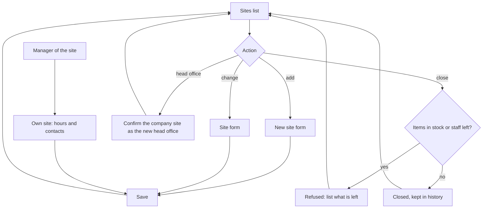

🏠 [Specs](../../../README.md) › 🧩 [Functional capabilities](../../README.md) › 🛡️ [F1 Administration](../README.md) ›
🔀 [Flows](README.md) › 🔀 FL-F1-02 Manage sites

# 🔀 FL-F1-02 Manage sites

**Status:** ✅ specified

## Summary

Adding, changing, moving the head office and closing sites.

## Personas

- [U07 Administrator](../../../01-users/personas/u07-administrator.md)
- [U02 Manager](../../../01-users/personas/u02-manager.md)

## Flowchart

## Sequence diagram

See [UC-F1-02](../use-cases/02-manage-sites/uc-f01-02-add-or-change-a-site.md#sequence-diagram).

## Steps

| Step | Persona | Screen | Use case | What happens |
|---|---|---|---|---|
| 1 | U07 | [S-F1-02](../screens/02-manage-sites/s-f01-02-sites.md) | [UC-F1-02](../use-cases/02-manage-sites/uc-f01-02-add-or-change-a-site.md) | Add a site |
| 2 | U07 | [S-F1-02](../screens/02-manage-sites/s-f01-02-sites.md) | [UC-F1-02](../use-cases/02-manage-sites/uc-f01-02-add-or-change-a-site.md) | Change a site |
| 3 | U02 | [S-F1-02](../screens/02-manage-sites/s-f01-02-sites.md) | [UC-F1-02](../use-cases/02-manage-sites/uc-f01-02-add-or-change-a-site.md) | Change their site's hours and contacts |
| 4 | U07 | [S-F1-02](../screens/02-manage-sites/s-f01-02-sites.md) | [UC-F1-02](../use-cases/02-manage-sites/uc-f01-02-add-or-change-a-site.md) | Make another site the head office |
| 5 | U07 | [S-F1-02](../screens/02-manage-sites/s-f01-02-sites.md) | [UC-F1-02](../use-cases/02-manage-sites/uc-f01-02-add-or-change-a-site.md) | Close an empty site |

### Entities and screens

| Entity | States in this flow | Shown at step and screen | Aggregated view |
|---|---|---|---|
| [E-F1-02 Company site](../data/e-f01-02-company-site.md) | Open, Closed | 1, 2, 3, 4, 5 [S-F1-02](../screens/02-manage-sites/s-f01-02-sites.md) | Company sites |
| [E-F7-06 Item](../../f07-purchasing-and-stock/data/e-f07-06-item.md) | Active | Shown elsewhere: [S-F7-21 Stock levels](../../f07-purchasing-and-stock/screens/03-replenish/s-f07-21-stock-levels.md) | Items |
| [E-F1-03 User](../data/e-f01-03-user.md) | Invited, Active, Deactivated | Shown elsewhere: [S-F1-03 Users](../screens/03-user-lifecycle/s-f01-03-users.md) | Users |

## Errors

Closing a site with stock or staff, or the head office, is refused (BR-F1-04).

## Images

Every step and error, for each persona taking part, in light and dark mode (D120). Steps are numbered as in the Steps
table; E rows are the error cases.

| Step | Persona | Device | Light | Dark |
|---|---|---|---|---|
| 1 | U07 | desktop | [light](../images/02-manage-sites/u07-administrator/1-add-a-site-desktop-light.png) | [dark](../images/02-manage-sites/u07-administrator/1-add-a-site-desktop-dark.png) |
| 2 | U07 | desktop | [light](../images/02-manage-sites/u07-administrator/2-change-a-site-desktop-light.png) | [dark](../images/02-manage-sites/u07-administrator/2-change-a-site-desktop-dark.png) |
| 3 | U02 | desktop | [light](../images/02-manage-sites/u02-manager/3-manager-changes-hours-desktop-light.png) | [dark](../images/02-manage-sites/u02-manager/3-manager-changes-hours-desktop-dark.png) |
| 3 | U02 | phone | [light](../images/02-manage-sites/u02-manager/3-manager-changes-hours-phone-light.png) | [dark](../images/02-manage-sites/u02-manager/3-manager-changes-hours-phone-dark.png) |
| 4 | U07 | desktop | [light](../images/02-manage-sites/u07-administrator/4-move-head-office-desktop-light.png) | [dark](../images/02-manage-sites/u07-administrator/4-move-head-office-desktop-dark.png) |
| 5 | U07 | desktop | [light](../images/02-manage-sites/u07-administrator/5-close-an-empty-site-desktop-light.png) | [dark](../images/02-manage-sites/u07-administrator/5-close-an-empty-site-desktop-dark.png) |
| E1 | U07 | desktop | [light](../images/02-manage-sites/u07-administrator/e1-site-still-holds-stock-desktop-light.png) | [dark](../images/02-manage-sites/u07-administrator/e1-site-still-holds-stock-desktop-dark.png) |
| E2 | U07 | desktop | [light](../images/02-manage-sites/u07-administrator/e2-head-office-cannot-close-desktop-light.png) | [dark](../images/02-manage-sites/u07-administrator/e2-head-office-cannot-close-desktop-dark.png) |

## Open questions

None.

---

⬅️ [FL-F1-01 Guided setup](fl-f01-01-guided-setup.md) · ⬆️ [Up](README.md) ·
➡️ [FL-F1-03 User lifecycle](fl-f01-03-user-lifecycle.md)
