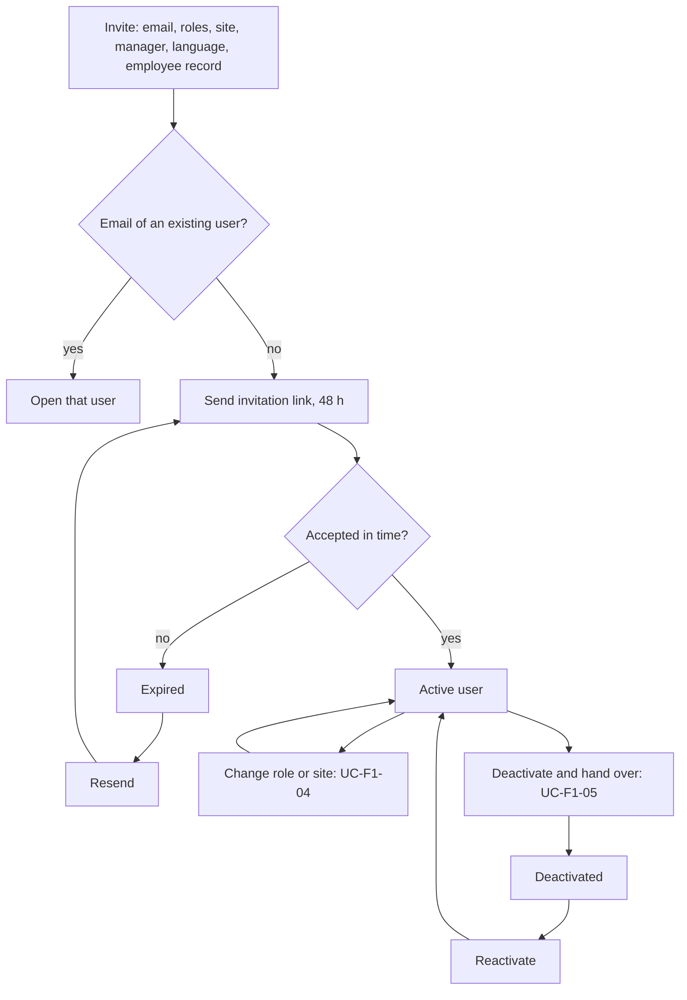

🏠 [Specs](../../../README.md) › 🧩 [Functional capabilities](../../README.md) › 🛡️ [F1 Administration](../README.md) ›
🔀 [Flows](README.md) › 🔀 FL-F1-03 User lifecycle

# 🔀 FL-F1-03 User lifecycle

**Status:** ✅ specified

## Summary

A user from invitation to deactivation: invited, active, changed, deactivated, reactivated.

## Personas

- [U07 Administrator](../../../01-users/personas/u07-administrator.md)
- [U01 Employee](../../../01-users/personas/u01-employee.md)

## Flowchart

## Sequence diagram

See [UC-F1-03](../use-cases/03-user-lifecycle/uc-f01-03-invite-a-user.md#sequence-diagram).

## Steps

| Step | Persona | Screen | Use case | What happens |
|---|---|---|---|---|
| 1 | U07 | [S-F1-03](../screens/03-user-lifecycle/s-f01-03-users.md) | [UC-F1-03](../use-cases/03-user-lifecycle/uc-f01-03-invite-a-user.md) | Invite |
| 2 | U01 | [S-F1-03](../screens/03-user-lifecycle/s-f01-03-users.md) | [UC-F1-03](../use-cases/03-user-lifecycle/uc-f01-03-invite-a-user.md) | Accept within 48 hours |
| 3 | U07 | [S-F1-03](../screens/03-user-lifecycle/s-f01-03-users.md) | [UC-F1-03](../use-cases/03-user-lifecycle/uc-f01-03-invite-a-user.md) | Resend an expired invitation |
| 4 | U07 | [S-F1-04](../screens/03-user-lifecycle/s-f01-04-user-page.md) | [UC-F1-04](../use-cases/03-user-lifecycle/uc-f01-04-change-a-users-role-or-site.md) | Change roles or site, at once or dated |
| 5 | U07 | [S-F1-05](../screens/03-user-lifecycle/s-f01-05-offboarding.md) | [UC-F1-05](../use-cases/03-user-lifecycle/uc-f01-05-deactivate-and-offboard-a-user.md) | Hand over, deactivate at once or on the last day |

### Entities and screens

| Entity | States in this flow | Shown at step and screen | Aggregated view |
|---|---|---|---|
| [E-F1-06 Role](../data/e-f01-06-role.md) | Active | 5 [S-F1-05](../screens/03-user-lifecycle/s-f01-05-offboarding.md) | Roles |
| [E-F1-02 Company site](../data/e-f01-02-company-site.md) | Open, Closed | 5 [S-F1-05](../screens/03-user-lifecycle/s-f01-05-offboarding.md) | Company sites |
| [E-F9-01 Employee record](../../f09-hr-and-projects/data/e-f09-01-employee-record.md) | Active | Shown elsewhere: [S-F9-01 Employee](../../f09-hr-and-projects/screens/01-people/s-f09-01-employee.md) | Employee records |
| [E-F1-03 User](../data/e-f01-03-user.md) | Invited, Active, Deactivated | 1, 2, 3 [S-F1-03](../screens/03-user-lifecycle/s-f01-03-users.md); 4 [S-F1-04](../screens/03-user-lifecycle/s-f01-04-user-page.md); 5 [S-F1-05](../screens/03-user-lifecycle/s-f01-05-offboarding.md) | Users |
| [E-F1-04 Invitation](../data/e-f01-04-invitation.md) | Sent, Accepted, Expired | 1, 2, 3 [S-F1-03](../screens/03-user-lifecycle/s-f01-03-users.md) | Invitations |

## Errors

An email that has an account, an expired or used link (BR-F1-06, BR-F1-07).

## Images

Every step and error, for each persona taking part, in light and dark mode (D120). Steps are numbered as in the Steps
table; E rows are the error cases.

| Step | Persona | Device | Light | Dark |
|---|---|---|---|---|
| 1 | U07 | desktop | [light](../images/03-user-lifecycle/u07-administrator/1-invite-desktop-light.png) | [dark](../images/03-user-lifecycle/u07-administrator/1-invite-desktop-dark.png) |
| 2 | U01 | desktop | [light](../images/03-user-lifecycle/u01-employee/2-accept-invitation-desktop-light.png) | [dark](../images/03-user-lifecycle/u01-employee/2-accept-invitation-desktop-dark.png) |
| 2 | U01 | phone | [light](../images/03-user-lifecycle/u01-employee/2-accept-invitation-phone-light.png) | [dark](../images/03-user-lifecycle/u01-employee/2-accept-invitation-phone-dark.png) |
| 3 | U07 | desktop | [light](../images/03-user-lifecycle/u07-administrator/3-resend-expired-desktop-light.png) | [dark](../images/03-user-lifecycle/u07-administrator/3-resend-expired-desktop-dark.png) |
| 4 | U07 | desktop | [light](../images/03-user-lifecycle/u07-administrator/4-change-role-or-site-desktop-light.png) | [dark](../images/03-user-lifecycle/u07-administrator/4-change-role-or-site-desktop-dark.png) |
| 5 | U07 | desktop | [light](../images/03-user-lifecycle/u07-administrator/5-offboard-desktop-light.png) | [dark](../images/03-user-lifecycle/u07-administrator/5-offboard-desktop-dark.png) |
| E1 | U07 | desktop | [light](../images/03-user-lifecycle/u07-administrator/e1-email-has-an-account-desktop-light.png) | [dark](../images/03-user-lifecycle/u07-administrator/e1-email-has-an-account-desktop-dark.png) |
| E2 | U01 | desktop | [light](../images/03-user-lifecycle/u01-employee/e2-invitation-expired-desktop-light.png) | [dark](../images/03-user-lifecycle/u01-employee/e2-invitation-expired-desktop-dark.png) |
| E2 | U01 | phone | [light](../images/03-user-lifecycle/u01-employee/e2-invitation-expired-phone-light.png) | [dark](../images/03-user-lifecycle/u01-employee/e2-invitation-expired-phone-dark.png) |
| E3 | U07 | desktop | [light](../images/03-user-lifecycle/u07-administrator/e3-last-administrator-desktop-light.png) | [dark](../images/03-user-lifecycle/u07-administrator/e3-last-administrator-desktop-dark.png) |

## Open questions

None.

---

⬅️ [FL-F1-02 Manage sites](fl-f01-02-manage-sites.md) · ⬆️ [Up](README.md) ·
➡️ [FL-F1-04 Edit a role](fl-f01-04-edit-a-role.md)
