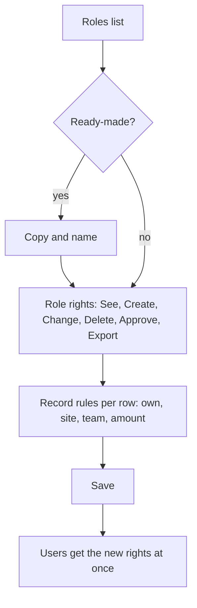

🏠 [Specs](../../../README.md) › 🧩 [Functional capabilities](../../README.md) › 🛡️ [F1 Administration](../README.md) ›
🔀 [Flows](README.md) › 🔀 FL-F1-04 Edit a role

# 🔀 FL-F1-04 Edit a role

**Status:** ✅ specified

## Summary

From a ready-made role to a company role, and its use.

## Personas

- [U07 Administrator](../../../01-users/personas/u07-administrator.md)

## Flowchart

## Sequence diagram

See [UC-F1-06](../use-cases/04-edit-a-role/uc-f01-06-edit-a-role-and-its-record-rules.md#sequence-diagram).

## Steps

| Step | Persona | Screen | Use case | What happens |
|---|---|---|---|---|
| 1 | U07 | [S-F1-06](../screens/04-edit-a-role/s-f01-06-role-editor.md) | [UC-F1-06](../use-cases/04-edit-a-role/uc-f01-06-edit-a-role-and-its-record-rules.md) | Copy a ready-made role |
| 2 | U07 | [S-F1-06](../screens/04-edit-a-role/s-f01-06-role-editor.md) | [UC-F1-06](../use-cases/04-edit-a-role/uc-f01-06-edit-a-role-and-its-record-rules.md) | Tick the matrix |
| 3 | U07 | [S-F1-06](../screens/04-edit-a-role/s-f01-06-role-editor.md) | [UC-F1-06](../use-cases/04-edit-a-role/uc-f01-06-edit-a-role-and-its-record-rules.md) | Add record rules and save |

### Entities and screens

| Entity | States in this flow | Shown at step and screen | Aggregated view |
|---|---|---|---|
| [E-F1-06 Role](../data/e-f01-06-role.md) | Active | 1, 2, 3 [S-F1-06](../screens/04-edit-a-role/s-f01-06-role-editor.md) | Roles |
| [E-F1-07 Record rule](../data/e-f01-07-record-rule.md) | Active | 1, 2, 3 [S-F1-06](../screens/04-edit-a-role/s-f01-06-role-editor.md) | Record rules |
| [E-F1-03 User](../data/e-f01-03-user.md) | Invited, Active, Deactivated | Shown elsewhere: [S-F1-03 Users](../screens/03-user-lifecycle/s-f01-03-users.md) | Users |

## Errors

Editing a ready-made role, deleting a role in use, removing the last administration rights.

## Images

Every step and error, for each persona taking part, in light and dark mode (D120). Steps are numbered as in the Steps
table; E rows are the error cases.

| Step | Persona | Device | Light | Dark |
|---|---|---|---|---|
| 1 | U07 | desktop | [light](../images/04-edit-a-role/u07-administrator/1-copy-a-ready-made-role-desktop-light.png) | [dark](../images/04-edit-a-role/u07-administrator/1-copy-a-ready-made-role-desktop-dark.png) |
| 2 | U07 | desktop | [light](../images/04-edit-a-role/u07-administrator/2-tick-the-matrix-desktop-light.png) | [dark](../images/04-edit-a-role/u07-administrator/2-tick-the-matrix-desktop-dark.png) |
| 3 | U07 | desktop | [light](../images/04-edit-a-role/u07-administrator/3-rules-and-save-desktop-light.png) | [dark](../images/04-edit-a-role/u07-administrator/3-rules-and-save-desktop-dark.png) |
| E1 | U07 | desktop | [light](../images/04-edit-a-role/u07-administrator/e1-ready-made-role-locked-desktop-light.png) | [dark](../images/04-edit-a-role/u07-administrator/e1-ready-made-role-locked-desktop-dark.png) |
| E2 | U07 | desktop | [light](../images/04-edit-a-role/u07-administrator/e2-role-in-use-desktop-light.png) | [dark](../images/04-edit-a-role/u07-administrator/e2-role-in-use-desktop-dark.png) |

## Open questions

None.

---

⬅️ [FL-F1-03 User lifecycle](fl-f01-03-user-lifecycle.md) · ⬆️ [Up](README.md) ·
➡️ [FL-F1-05 Connect an external tool](fl-f01-05-connect-an-external-tool.md)
