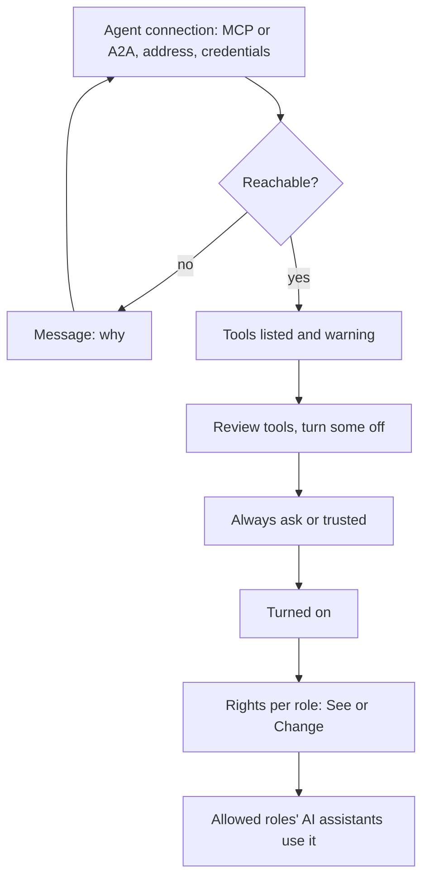

🏠 [Specs](../../../README.md) › 🧩 [Functional capabilities](../../README.md) › 🛡️ [F1 Administration](../README.md) ›
🔀 [Flows](README.md) › 🔀 FL-F1-05 Connect an external tool

# 🔀 FL-F1-05 Connect an external tool

**Status:** ✅ specified

## Summary

From an outside server's address to a tool the allowed roles' AI assistants can use.

## Personas

- [U07 Administrator](../../../01-users/personas/u07-administrator.md)

## Flowchart

## Sequence diagram

See
[UC-F1-07](../use-cases/05-connect-an-external-tool/uc-f01-07-connect-an-external-mcp-server-or-a2a-agent.md#sequence-diagram).

## Steps

| Step | Persona | Screen | Use case | What happens |
|---|---|---|---|---|
| 1 | U07 | [S-F1-07](../screens/05-connect-an-external-tool/s-f01-07-connections.md) | [UC-F1-07](../use-cases/05-connect-an-external-tool/uc-f01-07-connect-an-external-mcp-server-or-a2a-agent.md) | Connect and review tools |
| 2 | U07 | [S-F1-07](../screens/05-connect-an-external-tool/s-f01-07-connections.md) | [UC-F1-07](../use-cases/05-connect-an-external-tool/uc-f01-07-connect-an-external-mcp-server-or-a2a-agent.md) | Choose always ask or trusted |
| 3 | U07 | [S-F1-06](../screens/04-edit-a-role/s-f01-06-role-editor.md) | [UC-F1-07](../use-cases/05-connect-an-external-tool/uc-f01-07-connect-an-external-mcp-server-or-a2a-agent.md) | Give roles See or Change |

### Entities and screens

| Entity | States in this flow | Shown at step and screen | Aggregated view |
|---|---|---|---|
| [E-F1-08 Agent connection](../data/e-f01-08-agent-connection.md) | Off, On | 1, 2 [S-F1-07](../screens/05-connect-an-external-tool/s-f01-07-connections.md); 3 [S-F1-06](../screens/04-edit-a-role/s-f01-06-role-editor.md) | Agent connections |
| [E-T12-02 Credential](../../../03-technical/t12-connectors-and-scrapers/data/e-t12-02-credential.md) | Active | Shown elsewhere: [S-T12-02 Credential](../../../03-technical/t12-connectors-and-scrapers/screens/s-t12-02-credential.md), from the admin list [S-T12-L02](../../../03-technical/t12-connectors-and-scrapers/screens/00-lists/s-t12-l02-credentials.md) | Credentials |
| [E-T06-01 Tool](../../../03-technical/t06-mcp-and-a2a-gateway/data/e-t06-01-tool.md) | Active | Shown elsewhere: [S-T06-01 Tool](../../../03-technical/t06-mcp-and-a2a-gateway/screens/s-t06-01-tool.md), from the admin list [S-T06-L01](../../../03-technical/t06-mcp-and-a2a-gateway/screens/00-lists/s-t06-l01-tools.md) | Tools |
| [E-F1-06 Role](../data/e-f01-06-role.md) | Active | 3 [S-F1-06](../screens/04-edit-a-role/s-f01-06-role-editor.md) | Roles |

## Errors

Unreachable server, refused credentials, an outside address without HTTPS.

## Images

Every step and error, for each persona taking part, in light and dark mode (D120). Steps are numbered as in the Steps
table; E rows are the error cases.

| Step | Persona | Device | Light | Dark |
|---|---|---|---|---|
| 1 | U07 | desktop | [light](../images/05-connect-an-external-tool/u07-administrator/1-connect-and-review-desktop-light.png) | [dark](../images/05-connect-an-external-tool/u07-administrator/1-connect-and-review-desktop-dark.png) |
| 2 | U07 | desktop | [light](../images/05-connect-an-external-tool/u07-administrator/2-always-ask-or-trusted-desktop-light.png) | [dark](../images/05-connect-an-external-tool/u07-administrator/2-always-ask-or-trusted-desktop-dark.png) |
| 3 | U07 | desktop | [light](../images/05-connect-an-external-tool/u07-administrator/3-give-roles-access-desktop-light.png) | [dark](../images/05-connect-an-external-tool/u07-administrator/3-give-roles-access-desktop-dark.png) |
| E1 | U07 | desktop | [light](../images/05-connect-an-external-tool/u07-administrator/e1-server-unreachable-desktop-light.png) | [dark](../images/05-connect-an-external-tool/u07-administrator/e1-server-unreachable-desktop-dark.png) |
| E2 | U07 | desktop | [light](../images/05-connect-an-external-tool/u07-administrator/e2-address-not-secure-desktop-light.png) | [dark](../images/05-connect-an-external-tool/u07-administrator/e2-address-not-secure-desktop-dark.png) |

## Open questions

None.

---

⬅️ [FL-F1-04 Edit a role](fl-f01-04-edit-a-role.md) · ⬆️ [Up](README.md) ·
➡️ [FL-F1-06 Choose an AI provider](fl-f01-06-choose-an-ai-provider.md)
