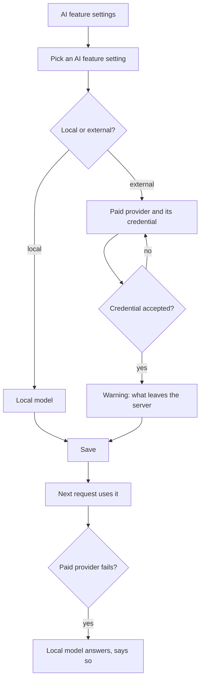

🏠 [Specs](../../../README.md) › 🧩 [Functional capabilities](../../README.md) › 🛡️ [F1 Administration](../README.md) ›
🔀 [Flows](README.md) › 🔀 FL-F1-06 Choose an AI provider

# 🔀 FL-F1-06 Choose an AI provider

**Status:** ✅ specified

## Summary

Switching an AI feature between the local model and an external provider.

## Personas

- [U07 Administrator](../../../01-users/personas/u07-administrator.md)

## Flowchart

## Sequence diagram

See [UC-F1-08](../use-cases/06-choose-an-ai-provider/uc-f01-08-choose-the-ai-provider-of-a-feature.md#sequence-diagram).

## Steps

| Step | Persona | Screen | Use case | What happens |
|---|---|---|---|---|
| 1 | U07 | [S-F1-08](../screens/06-choose-an-ai-provider/s-f01-08-ai-settings.md) | [UC-F1-08](../use-cases/06-choose-an-ai-provider/uc-f01-08-choose-the-ai-provider-of-a-feature.md) | Pick a feature and a provider |
| 2 | U07 | [S-F1-08](../screens/06-choose-an-ai-provider/s-f01-08-ai-settings.md) | [UC-F1-08](../use-cases/06-choose-an-ai-provider/uc-f01-08-choose-the-ai-provider-of-a-feature.md) | Enter and test the key, read the warning, save |

### Entities and screens

| Entity | States in this flow | Shown at step and screen | Aggregated view |
|---|---|---|---|
| [E-F1-09 AI feature setting](../data/e-f01-09-ai-feature-setting.md) | Active | 1, 2 [S-F1-08](../screens/06-choose-an-ai-provider/s-f01-08-ai-settings.md) | AI feature settings |
| [E-T07-01 Model](../../../03-technical/t07-ai-providers-and-models/data/e-t07-01-model.md) | Active | Shown elsewhere: [S-T07-01 Model](../../../03-technical/t07-ai-providers-and-models/screens/s-t07-01-model.md), from the admin list [S-T07-L01](../../../03-technical/t07-ai-providers-and-models/screens/00-lists/s-t07-l01-models.md) | Models |
| [E-F22-04 Paid provider](../../f22-unified-cost-management/data/e-f22-04-paid-provider.md) | Paid | Shown elsewhere: [S-F22-04 Providers](../../f22-unified-cost-management/screens/01-see-and-set-up/s-f22-04-providers.md) | Paid providers |
| [E-T12-02 Credential](../../../03-technical/t12-connectors-and-scrapers/data/e-t12-02-credential.md) | Active | Shown elsewhere: [S-T12-02 Credential](../../../03-technical/t12-connectors-and-scrapers/screens/s-t12-02-credential.md), from the admin list [S-T12-L02](../../../03-technical/t12-connectors-and-scrapers/screens/00-lists/s-t12-l02-credentials.md) | Credentials |

## Errors

A refused key; a failing provider at use (BR-F1-16).

## Images

Every step and error, for each persona taking part, in light and dark mode (D120). Steps are numbered as in the Steps
table; E rows are the error cases.

| Step | Persona | Device | Light | Dark |
|---|---|---|---|---|
| 1 | U07 | desktop | [light](../images/06-choose-an-ai-provider/u07-administrator/1-pick-a-feature-and-provider-desktop-light.png) | [dark](../images/06-choose-an-ai-provider/u07-administrator/1-pick-a-feature-and-provider-desktop-dark.png) |
| 2 | U07 | desktop | [light](../images/06-choose-an-ai-provider/u07-administrator/2-key-warning-save-desktop-light.png) | [dark](../images/06-choose-an-ai-provider/u07-administrator/2-key-warning-save-desktop-dark.png) |
| E1 | U07 | desktop | [light](../images/06-choose-an-ai-provider/u07-administrator/e1-key-refused-desktop-light.png) | [dark](../images/06-choose-an-ai-provider/u07-administrator/e1-key-refused-desktop-dark.png) |
| E2 | U07 | desktop | [light](../images/06-choose-an-ai-provider/u07-administrator/e2-provider-down-fallback-desktop-light.png) | [dark](../images/06-choose-an-ai-provider/u07-administrator/e2-provider-down-fallback-desktop-dark.png) |

## Open questions

None.

---

⬅️ [FL-F1-05 Connect an external tool](fl-f01-05-connect-an-external-tool.md) · ⬆️ [Up](README.md) ·
➡️ [FL-F1-07 Set up single sign-on](fl-f01-07-set-up-single-sign-on.md)
