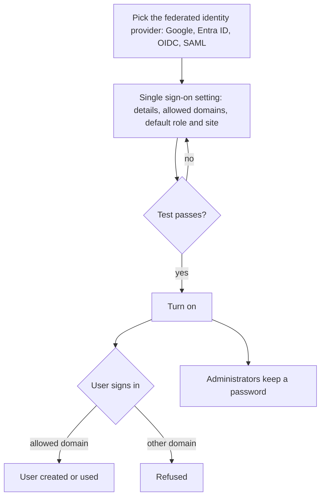

🏠 [Specs](../../../README.md) › 🧩 [Functional capabilities](../../README.md) › 🛡️ [F1 Administration](../README.md) ›
🔀 [Flows](README.md) › 🔀 FL-F1-07 Set up single sign-on

# 🔀 FL-F1-07 Set up single sign-on

**Status:** ✅ specified

## Summary

From choosing the provider to users signing in with their company account.

## Personas

- [U07 Administrator](../../../01-users/personas/u07-administrator.md)

## Flowchart

## Sequence diagram

See [UC-F1-09](../use-cases/07-set-up-single-sign-on/uc-f01-09-set-up-single-sign-on.md#sequence-diagram).

## Steps

| Step | Persona | Screen | Use case | What happens |
|---|---|---|---|---|
| 1 | U07 | [S-F1-09](../screens/07-set-up-single-sign-on/s-f01-09-single-sign-on.md) | [UC-F1-09](../use-cases/07-set-up-single-sign-on/uc-f01-09-set-up-single-sign-on.md) | Provider and details |
| 2 | U07 | [S-F1-09](../screens/07-set-up-single-sign-on/s-f01-09-single-sign-on.md) | [UC-F1-09](../use-cases/07-set-up-single-sign-on/uc-f01-09-set-up-single-sign-on.md) | Domains, default role and site |
| 3 | U07 | [S-F1-09](../screens/07-set-up-single-sign-on/s-f01-09-single-sign-on.md) | [UC-F1-09](../use-cases/07-set-up-single-sign-on/uc-f01-09-set-up-single-sign-on.md) | Test, then turn on |

### Entities and screens

| Entity | States in this flow | Shown at step and screen | Aggregated view |
|---|---|---|---|
| [E-T02-04 Federated identity provider](../../../03-technical/t02-identity-and-access/data/e-t02-04-federated-identity-provider.md) | Active | Shown elsewhere: [S-T02-04 Federated identity provider](../../../03-technical/t02-identity-and-access/screens/s-t02-04-federated-identity-provider.md), from the admin list [S-T02-L04](../../../03-technical/t02-identity-and-access/screens/00-lists/s-t02-l04-federated-identity-providers.md) | Federated identity providers |
| [E-F1-10 Single sign-on setting](../data/e-f01-10-single-sign-on-setting.md) | Off, Tested, On | 1, 2, 3 [S-F1-09](../screens/07-set-up-single-sign-on/s-f01-09-single-sign-on.md) | Single sign-on settings |
| [E-F1-06 Role](../data/e-f01-06-role.md) | Active | Shown elsewhere: [S-F1-06 Role editor](../screens/04-edit-a-role/s-f01-06-role-editor.md) | Roles |
| [E-F1-02 Company site](../data/e-f01-02-company-site.md) | Open, Closed | Shown elsewhere: [S-F1-02 Sites](../screens/02-manage-sites/s-f01-02-sites.md) | Company sites |
| [E-F1-03 User](../data/e-f01-03-user.md) | Invited, Active, Deactivated | Shown elsewhere: [S-F1-03 Users](../screens/03-user-lifecycle/s-f01-03-users.md) | Users |

## Errors

A failing test; a provider down at sign-in.

## Images

Every step and error, for each persona taking part, in light and dark mode (D120). Steps are numbered as in the Steps
table; E rows are the error cases.

| Step | Persona | Device | Light | Dark |
|---|---|---|---|---|
| 1 | U07 | desktop | [light](../images/07-set-up-single-sign-on/u07-administrator/1-provider-and-details-desktop-light.png) | [dark](../images/07-set-up-single-sign-on/u07-administrator/1-provider-and-details-desktop-dark.png) |
| 2 | U07 | desktop | [light](../images/07-set-up-single-sign-on/u07-administrator/2-domains-role-site-desktop-light.png) | [dark](../images/07-set-up-single-sign-on/u07-administrator/2-domains-role-site-desktop-dark.png) |
| 3 | U07 | desktop | [light](../images/07-set-up-single-sign-on/u07-administrator/3-test-then-turn-on-desktop-light.png) | [dark](../images/07-set-up-single-sign-on/u07-administrator/3-test-then-turn-on-desktop-dark.png) |
| E1 | U07 | desktop | [light](../images/07-set-up-single-sign-on/u07-administrator/e1-test-failed-desktop-light.png) | [dark](../images/07-set-up-single-sign-on/u07-administrator/e1-test-failed-desktop-dark.png) |
| E2 | U01 | desktop | [light](../images/07-set-up-single-sign-on/u01-employee/e2-password-refused-desktop-light.png) | [dark](../images/07-set-up-single-sign-on/u01-employee/e2-password-refused-desktop-dark.png) |
| E2 | U01 | phone | [light](../images/07-set-up-single-sign-on/u01-employee/e2-password-refused-phone-light.png) | [dark](../images/07-set-up-single-sign-on/u01-employee/e2-password-refused-phone-dark.png) |

## Open questions

None.

---

⬅️ [FL-F1-06 Choose an AI provider](fl-f01-06-choose-an-ai-provider.md) · ⬆️ [Up](README.md) ·
➡️ [FL-F1-08 The provider and its client companies](fl-f01-08-provider-and-client-companies.md)
