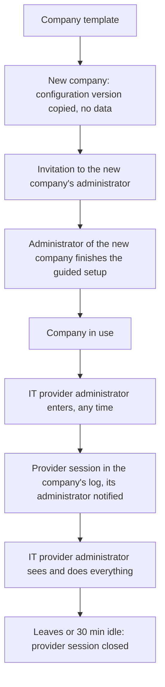

🏠 [Specs](../../../README.md) › 🧩 [Functional capabilities](../../README.md) › 🛡️ [F1 Administration](../README.md) ›
🔀 [Flows](README.md) › 🔀 FL-F1-08 The provider and its client companies

# 🔀 FL-F1-08 The provider and its client companies

**Status:** ✅ specified

## Summary

The IT provider creates client companies from templates and enters them, visibly, to support them.

## Personas

- [U11 IT provider administrator](../../../01-users/personas/u11-provider-admin.md)
- [U07 Administrator](../../../01-users/personas/u07-administrator.md)

## Flowchart

## Sequence diagram

See
[UC-F1-11](../use-cases/08-provider-and-client-companies/uc-f01-11-enter-a-client-company-to-support-it.md#sequence-diagram).

## Steps

| Step | Persona | Screen | Use case | What happens |
|---|---|---|---|---|
| 1 | U11 | [S-F1-10](../screens/08-provider-and-client-companies/s-f01-10-client-companies.md) | [UC-F1-10](../use-cases/08-provider-and-client-companies/uc-f01-10-create-a-client-company-on-the-platform.md) | Create a client company from a template |
| 2 | U07 | [S-F1-10](../screens/08-provider-and-client-companies/s-f01-10-client-companies.md) | [UC-F1-10](../use-cases/08-provider-and-client-companies/uc-f01-10-create-a-client-company-on-the-platform.md) | The client's administrator accepts and finishes the setup |
| 3 | U11 | [S-F1-10](../screens/08-provider-and-client-companies/s-f01-10-client-companies.md) | [UC-F1-11](../use-cases/08-provider-and-client-companies/uc-f01-11-enter-a-client-company-to-support-it.md) | Enter a client company |
| 4 | U07 | [S-F1-11](../screens/08-provider-and-client-companies/s-f01-11-provider-access-log.md) | [UC-F1-11](../use-cases/08-provider-and-client-companies/uc-f01-11-enter-a-client-company-to-support-it.md) | The client sees the session in its provider access log |

### Entities and screens

| Entity | States in this flow | Shown at step and screen | Aggregated view |
|---|---|---|---|
| [E-F1-11 Company template](../data/e-f01-11-company-template.md) | Template | 1, 2, 3 [S-F1-10](../screens/08-provider-and-client-companies/s-f01-10-client-companies.md) | Company templates |
| [E-F1-01 Company](../data/e-f01-01-company.md) | In setup, Active | 1, 2, 3 [S-F1-10](../screens/08-provider-and-client-companies/s-f01-10-client-companies.md) | Companies |
| [E-F2-10 Configuration version](../../f02-no-code-configuration/data/e-f02-10-configuration-version.md) | Published, Superseded | Shown elsewhere: [S-F2-10 Publish and versions](../../f02-no-code-configuration/screens/05-publish-and-roll-back/s-f02-10-publish-and-versions.md) | Configuration versions |
| [E-F1-04 Invitation](../data/e-f01-04-invitation.md) | Sent, Accepted, Expired, Cancelled, Not delivered | Shown elsewhere: [S-SC12-05 Invitations](../../../08-sectors/sc12-education-and-training/screens/02-enrol-and-fund/s-sc12-05-invitations.md) | Invitations |
| [E-F1-12 Provider session](../data/e-f01-12-provider-session.md) | Live, Closed | 1, 2, 3 [S-F1-10](../screens/08-provider-and-client-companies/s-f01-10-client-companies.md); 4 [S-F1-11](../screens/08-provider-and-client-companies/s-f01-11-provider-access-log.md) | Provider sessions |

## Errors

A database that cannot be created (UC-F1-10).

## Images

Every step and error, for each persona taking part, in light and dark mode (D120). Steps are numbered as in the Steps
table; E rows are the error cases.

| Step | Persona | Device | Light | Dark |
|---|---|---|---|---|
| 1 | U11 | desktop | [light](../images/08-provider-and-client-companies/u11-provider-admin/1-new-from-template-desktop-light.png) | [dark](../images/08-provider-and-client-companies/u11-provider-admin/1-new-from-template-desktop-dark.png) |
| 2 | U07 | desktop | [light](../images/08-provider-and-client-companies/u07-administrator/2-client-finishes-setup-desktop-light.png) | [dark](../images/08-provider-and-client-companies/u07-administrator/2-client-finishes-setup-desktop-dark.png) |
| 3 | U11 | desktop | [light](../images/08-provider-and-client-companies/u11-provider-admin/3-enter-a-client-desktop-light.png) | [dark](../images/08-provider-and-client-companies/u11-provider-admin/3-enter-a-client-desktop-dark.png) |
| 4 | U07 | desktop | [light](../images/08-provider-and-client-companies/u07-administrator/4-client-sees-the-session-desktop-light.png) | [dark](../images/08-provider-and-client-companies/u07-administrator/4-client-sees-the-session-desktop-dark.png) |
| E1 | U11 | desktop | [light](../images/08-provider-and-client-companies/u11-provider-admin/e1-database-not-created-desktop-light.png) | [dark](../images/08-provider-and-client-companies/u11-provider-admin/e1-database-not-created-desktop-dark.png) |

## Open questions

None.

---

⬅️ [FL-F1-07 Set up single sign-on](fl-f01-07-set-up-single-sign-on.md) · ⬆️ [Up](README.md) ·
➡️ [FL-F1-09 Administration reports](fl-f01-09-administration-reports.md)
